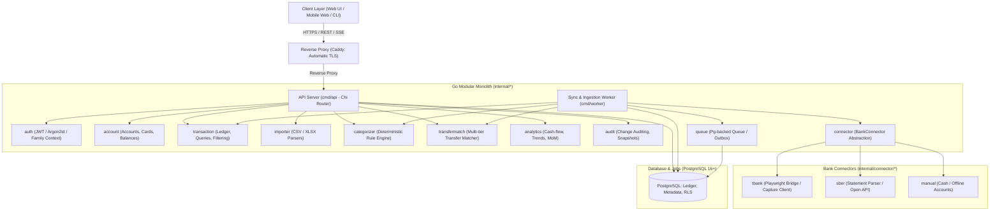
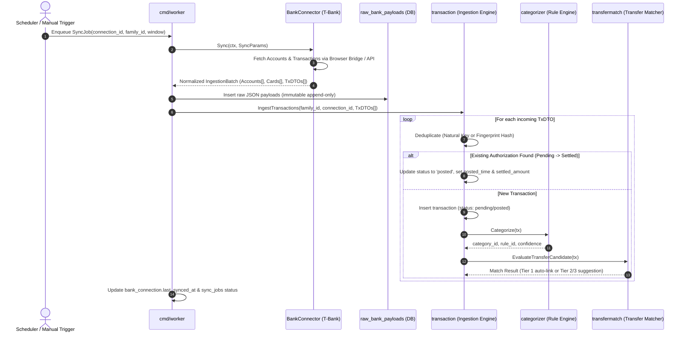
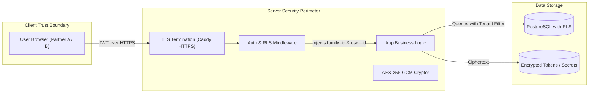

# Family Finance: System Architecture Specification

## 1. Architectural Philosophy & Principles

1. **Modular Monolith in Go:** High developer velocity, single compilation target, zero distributed system overhead (no Kubernetes, Kafka, or microservices required for a self-hosted family deployment), with strictly enforced domain boundaries.
2. **PostgreSQL as the Single Source of Truth:** All domain logic, ledger state, outbox events, and background job queues reside in PostgreSQL (leveraging `pgx/v5` and `SKIP LOCKED`).
3. **Defense-in-Depth Multi-Tenancy:** Every entity belongs to a `family_id`. PostgreSQL Row-Level Security (RLS) is applied on the database layer, complementing application-level middleware checks.
4. **Immutable Ingestion Layer:** Raw external data (bank payloads, CSV rows) is stored in raw, append-only tables. Categorization, attribution, and transfer matching are decoupled projections that do not mutate raw bank evidence.
5. **Exact Financial Mathematics:** Strict prohibition of floating-point numbers (`float32`/`float64`) for money. All monetary amounts are handled as `int64` minor units (kopeks, cents) alongside ISO 4217 currency codes.
6. **Stateless API & Background Worker Separation:** Deployed as two runtimes from the same codebase (`cmd/api` and `cmd/worker`) sharing internal domain packages.

---

## 2. Component Diagram & Module Boundaries



### Module Responsibilities:

| Module | Boundary & Responsibility | Inward Dependencies | Outward Dependencies |
| :--- | :--- | :--- | :--- |
| `internal/auth` | User authentication, session management, Argon2id password hashing, JWT generation, family member permissions. | `database` | None |
| `internal/account` | Account and card lifecycle management, balance calculation, credit limit tracking, manual cash accounts. | `auth`, `database` | `audit` |
| `internal/connector` | Defines `BankConnector` interface and adapters for T-Bank, Sberbank, etc. Translates external bank DTOs to normalized internal models. | `domain` | External APIs / Local browser runner |
| `internal/importer` | Parses CSV, XLSX, and 1C files from T-Bank, Sber, Alfa-Bank, and generic formats. Dispatches raw batches to the transaction pipeline. | `connector`, `domain` | None |
| `internal/transaction` | Core ledger operations, raw payload preservation, deduplication, transaction lifecycle updates (auth -> posted -> refund). | `account`, `domain` | `categorizer`, `transfermatch`, `queue`, `audit` |
| `internal/categorizer` | Rule-based hierarchical categorization engine (User rule > Merchant rule > MCC > Keyword regex > AI fallback). | `domain` | None |
| `internal/transfermatch`| Multi-tier transfer matching engine (Tier 1 exact, Tier 2 probable, Tier 3 manual) and credit card debt repayment detection. | `transaction`, `domain` | `audit` |
| `internal/analytics` | High-performance read-only queries for cash flows, real expenses, debt tracking, MoM comparisons, and partner attribution. | `domain`, `database` | None |
| `internal/queue` | PostgreSQL-backed persistent job queue (transactional outbox) with retry backoff and concurrency control. | `database` | None |
| `internal/audit` | Append-only audit trail recording user actions, category reclassifications, manual transfer links, and rule modifications. | `database` | None |

---

## 3. Core Data Flow & Pipelines

### 3.1 Automated Bank Sync Pipeline (T-Bank & External Connectors)


### 3.2 Statement Import Pipeline (CSV / XLSX)
1. User uploads a file through the UI (`POST /api/v1/imports/upload`).
2. API validates file size, calculates SHA-256 checksum to prevent re-uploading the identical file, and stores raw bytes in `statement_imports`.
3. Specialized parser (`TBankCSVParser`, `SberXLSXParser`, etc.) streams rows, validates headers, and extracts currency amounts in minor units.
4. Preview modal is returned to user showing detected accounts, date range, row count, and sample transactions.
5. User confirms import; transaction ingestion engine executes the exact same deduplication, categorization, and transfer matching pipeline as the automated sync.

---

## 4. Ingestion Cadence, Re-check Windows & Idempotency

### 4.1 Sync Cadence Strategy
- **Routine Periodic Sync:** Every 4 hours during active hours (07:00–23:00 local time).
- **Manual User Sync:** On-demand via UI click, debounced to at most once per 5 minutes per connection.
- **Nightly Deep Reconciliation:** Nightly at 03:00, running a full statement reconciliation for the past 30 days.

### 4.2 Re-Check Windows
Banks often take several days to settle card transactions. The ingestion worker employs a **triple-window strategy**:
1. **Current Window (0 to 3 Days Ago):**
   - High churn.
   - Detects fresh transactions and authorizations (`pending`).
2. **Settlement Re-Check Window (3 to 7 Days Ago):**
   - Detects state transitions from `pending` (hold) to `posted` (cleared).
   - Updates `posted_time`, `debiting_amount_minor`, and handles final exchange rate settlements for foreign currency purchases.
3. **Refund & Reversal Window (7 to 30 Days Ago):**
   - Catches delayed chargebacks, merchant refunds, and cancellation events.
   - Re-evaluates linked transactions and adjusts net categorical expenses.

### 4.3 Worker Concurrency & Idempotency
- **PostgreSQL-Backed Job Queue:** Implemented via a `worker_jobs` table using `SELECT ... FOR UPDATE SKIP LOCKED` or River.
- **Idempotency Keys:** Every sync task has a deterministic key: `sync:<connection_id>:<window_start_date>:<window_end_date>`.
- **Database Locks:** Uses Postgres advisory locks (`pg_try_advisory_xact_lock(hashtext('conn:' || connection_id))`) to ensure only one worker processes a given bank connection at a time.

---

## 5. BankConnector Go Interface Specification

```go
package connector

import (
	"context"
	"time"
)

// CurrencyAmount represents an exact monetary quantity in minor units.
type CurrencyAmount struct {
	MinorUnits int64  // e.g. 150050 for 1,500.50 RUB
	Currency   string // ISO 4217, e.g. "RUB", "USD", "EUR"
}

// AccountDTO represents an external account discovered from the bank.
type AccountDTO struct {
	ExternalID     string
	Name           string
	Type           string // "checking", "credit_card", "savings", "deposit"
	Currency       string
	Balance        CurrencyAmount
	DebtAmount     *CurrencyAmount
	CreditLimit    *CurrencyAmount
	MinimalPayment *CurrencyAmount
	StatementDate  *time.Time
	Cards          []CardDTO
}

// CardDTO represents an access instrument linked to an account.
type CardDTO struct {
	ExternalID    string
	MaskedPAN     string // e.g. "*1234"
	DisplayName   string
	PaymentSystem string // "MIR", "VISA", "MASTERCARD"
	IsVirtual     bool
	Status        string // "ACTIVE", "BLOCKED", "CLOSED"
}

// TransactionDTO represents a normalized transaction from an external source.
type TransactionDTO struct {
	ExternalID          string          // Bank operation ID
	ExternalAuthID      *string         // Authorization/hold ID if applicable
	AccountExternalID   string
	CardExternalID      *string
	Amount              CurrencyAmount  // Transaction nominal amount
	AccountAmount       CurrencyAmount  // Exact amount debited/credited to account
	TransactionTime     time.Time
	SettledTime         *time.Time      // Nil if still pending/hold
	Status              string          // "pending", "posted", "cancelled", "refunded"
	MerchantName        string
	RawDescription      string
	MCC                 *int
	BankCategory        string
	IsCreditCardPayment bool
	RawJSON             []byte
}

// SyncParams configures an ingestion run.
type SyncParams struct {
	StartDate time.Time
	EndDate   time.Time
	Accounts  []string // Optional: restrict to specific accounts
}

// BankConnector defines the contract for bank ingestion providers.
type BankConnector interface {
	// ProviderCode returns a unique provider identifier, e.g. "tbank", "sber".
	ProviderCode() string

	// HealthCheck tests connectivity, session validity, or token freshness.
	HealthCheck(ctx context.Context, config map[string]any) error

	// FetchAccounts retrieves accounts, balances, and linked cards.
	FetchAccounts(ctx context.Context, config map[string]any) ([]AccountDTO, error)

	// FetchTransactions retrieves operations for the specified time range.
	FetchTransactions(ctx context.Context, config map[string]any, params SyncParams) ([]TransactionDTO, error)
}
```

---

## 6. Security Architecture & Threat Mitigation



1. **Authentication & Multi-User Authorization:**
   - Password hashing with **Argon2id** (memory cost 64MB, 3 iterations, 4 parallelism threads).
   - Short-lived asymmetric or HMAC-SHA256 JWT access tokens (15-minute expiry) with rotating refresh tokens stored as secure HTTP-only cookies.
   - Dual-partner authorization: Every request executes within the context of an authenticated `user_id` and verified `family_id`.
2. **PostgreSQL Row-Level Security (RLS):**
   - All financial tables enforce `WHERE family_id = current_setting('app.current_family_id')::uuid`. Even if an application bug omits a `WHERE family_id` clause, the database kernel strictly forbids cross-tenant access.
3. **Encryption at Rest:**
   - Bank session tokens, API keys, and sidecar pairing secrets are encrypted using **AES-256-GCM** with unique 96-bit initialization vectors (nonces). Master key provided via environment variable `ENCRYPTION_MASTER_KEY`.
4. **Zero-Knowledge Financial Hygiene:**
   - **No Plaintext Card Credentials:** No full Primary Account Numbers (PANs), CVV/CVC, or banking passwords are ever accepted, requested, logged, or stored. PANs are permanently truncated to `*XXXX`.
   - **Log Sanitization:** A custom Zerolog/Zap logger hook automatically redacts keys named `authorization`, `cookie`, `token`, `password`, and any regex pattern resembling a 16-digit card number.
5. **Comprehensive Audit Logging:**
   - All category overrides, transaction splits, transfer match approvals/rejections, and manual balance corrections generate an immutable row in `audit_logs` tracking who made the change, the previous state, and the new state.

---

## 7. Deployment Model & Technology Stack

```
                                  [ Internet / Local Network ]
                                                │
                                                ▼
                                   ┌─────────────────────────┐
                                   │       Caddy v2.8+       │
                                   │ (Automatic Let's Encrypt│
                                   │  or Local Self-Signed)  │
                                   └────────────┬────────────┘
                                                │ :8080
                                                ▼
                       ┌─────────────────────────────────────────────────┐
                       │           Docker Compose Network                │
                       │                                                 │
                       │   ┌─────────────────────────────────────────┐   │
                       │   │             family-finance              │   │
                       │   │                                         │   │
                       │   │   cmd/api      ◄───►   cmd/worker       │   │
                       │   │  (REST API)            (Job Queue)      │   │
                       │   └────────────────────┬────────────────────┘   │
                       │                        │ :5432                  │
                       │                        ▼                        │
                       │   ┌─────────────────────────────────────────┐   │
                       │   │            PostgreSQL 16+               │   │
                       │   │       (Ledger + Outbox Queue)           │   │
                       │   └────────────────────┬────────────────────┘   │
                       │                        │ Mounted Volume         │
                       │                        ▼                        │
                       │              [/var/lib/postgresql/data]         │
                       └─────────────────────────────────────────────────┘
```

- **Backend Runtime:** Go 1.23+
- **HTTP Routing:** `github.com/go-chi/chi/v5`
- **Database Driver:** `github.com/jackc/pgx/v5` (connection pooling and native binary protocol)
- **Migrations:** `github.com/golang-migrate/migrate/v4`
- **Frontend SPA:** React 18 / Vite, TypeScript, Tailwind CSS, `shadcn/ui`, TanStack Query, Apache ECharts.
- **Packaging:** Multi-stage Dockerfile producing a minimal, distroless scratch/alpine binary (< 30 MB).
- **Orchestration:** Single `docker-compose.yml` file with healthchecks, restart policies, and automated daily database volume backup scripts.
