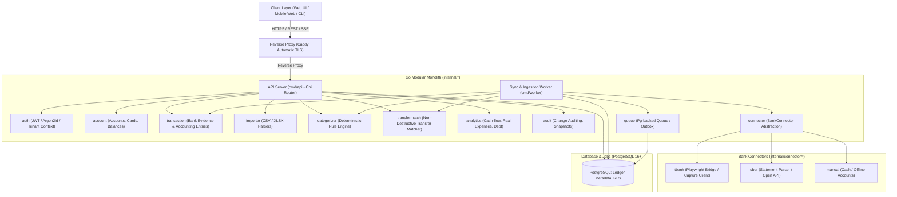
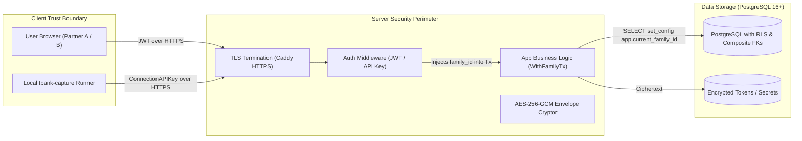

# Family Finance: System Architecture Specification

## 1. Architectural Philosophy & Principles

1. **Modular Monolith in Go:** Single compilation target, high developer velocity, zero distributed system overhead (no Kubernetes, Kafka, or microservices required for a self-hosted family deployment), with strictly enforced domain boundaries.
2. **Two-Layer Ledger (Evidence vs. Interpretation):**
   - **Bank Evidence Layer (`bank_transactions`):** Immutable, authoritative historical record of bank events. Stores bank identifiers (`id`, `operationId`, `authorizationId`), raw descriptions, MCC codes, booking status (`pending`, `posted`, `cancelled`), and cleared timestamps. Bank sync updates never overwrite user categorization, attribution, or notes.
   - **Accounting Interpretation Layer (`accounting_entries`):** The family's categorization, payer attribution, beneficiary allocation, and split entries. Supports 1:N splits of bank transactions. Manual cash operations exist purely in this layer (`bank_transaction_id IS NULL`).
3. **Multi-Tenant Isolation via Composite Foreign Keys & RLS:**
   - Minimum supported database: **PostgreSQL 16+**.
   - Every tenant-owned table enforces `UNIQUE (family_id, id)`.
   - Every relationship across tenant entities uses composite foreign keys referencing `(family_id, target_id)`.
   - Column-level deletion syntax `ON DELETE SET NULL (nullable_column)` ensures that deleting an optional target NULLs only the referencing attribute, preserving `family_id NOT NULL`.
   - User membership ownership: every tenant reference to a user is foreign-keyed to `family_members(family_id, user_id)`.
   - Transaction-scoped tenant context: Parameterized `SELECT set_config('app.current_family_id', $1, true)` executes inside every database transaction via `WithFamilyTx`. Missing context strictly evaluates to deny-all.
   - **Zero Worker Security Bypass:** Custom GUCs like `app.is_worker` are never used as security boundaries. Background workers execute under transaction-scoped `WithFamilyTx(job.family_id)`.
4. **Exact Minor-Unit Mathematics:** Strict prohibition of floating-point numbers (`float32`/`float64`) for money. All monetary amounts are handled as `int64` minor units (kopeks, cents) alongside ISO 4217 currency codes.
5. **Stateless API & Background Worker Separation:** Deployed as two runtimes from the same codebase (`cmd/api` and `cmd/worker`) sharing internal domain packages.

---

## 2. Component Diagram & Module Boundaries



### Module Responsibilities:

| Module | Boundary & Responsibility | Inward Dependencies | Outward Dependencies |
| :--- | :--- | :--- | :--- |
| `internal/auth` | User authentication, Argon2id hashing, JWT generation, family member permissions, bootstrap registration. | `database` | None |
| `internal/account` | Account and card lifecycle management, balance tracking (with timestamped observation sources), manual cash accounts. | `auth`, `database` | `audit` |
| `internal/connector` | Defines `BankConnector` interface and adapters for T-Bank, Sberbank, etc. Translates external bank DTOs to normalized internal models. | `domain` | External APIs / Local browser runner |
| `internal/importer` | Parses CSV and XLSX files from T-Bank, Sber, Alfa-Bank, and generic formats. Dispatches raw batches to the transaction pipeline. | `connector`, `domain` | None |
| `internal/transaction` | Ingestion into `bank_transactions`, raw payload preservation, deduplication, transaction lifecycle updates, deferred split trigger management, and `accounting_entries`. | `account`, `domain` | `categorizer`, `transfermatch`, `queue`, `audit` |
| `internal/categorizer` | Rule-based hierarchical categorization engine (User rule > Merchant rule > MCC > Keyword regex > Fallback). Operates on `accounting_entries`. | `domain` | None |
| `internal/transfermatch`| Conservative transfer matching engine (Tier 1 exact, Tier 2 probable, Tier 3 manual) and credit card debt repayment detection. Links `accounting_entries.transfer_match_id` non-destructively. | `transaction`, `domain` | `audit` |
| `internal/analytics` | High-performance read-only queries for cash flows, real consumption expenses, debt tracking, MoM comparisons, and partner attribution. | `domain`, `database` | None |
| `internal/queue` | PostgreSQL-backed persistent job queue (transactional outbox) with retry backoff and concurrency control (`SKIP LOCKED`). | `database` | None |
| `internal/audit` | Append-only audit trail recording user actions, category reclassifications, manual transfer links, and rule modifications. | `database` | None |

---

## 3. Stable TransactionView Identity Model

To prevent identity ambiguity between the physical bank evidence layer and the accounting interpretation layer:

```
[ Physical Bank Event ]                [ Accounting Interpretation ]
  bank_transactions                         accounting_entries
  id: "bt_1001"                              id: "entry_5001" (Groceries)
                                             id: "entry_5002" (Pharmacy)
                 │                                  │
                 └────────────────┬─────────────────┘
                                  ▼
                        [ TransactionView ]
                  view_id: "bt:bt_1001"
                  bank_transaction_id: "bt_1001"
                  entries: [ "entry_5001", "entry_5002" ]
```

1. **Deterministic View ID:**
   * For Bank-Backed Transactions: `view_id = "bt:" || bank_transaction_id`
   * For Manual Cash Operations: `view_id = "manual:" || accounting_entry_id`
2. **Behavior on GET and PATCH:**
   * `GET /transactions/{id}`: Accepting either a `view_id`, a `bank_transaction_id`, or any constituent `entry_id` resolves to the **complete `TransactionView`**, returning all split entries in that logical group.
   * `PATCH /transactions/entries/{entry_id}`: Targets a specific accounting entry to edit its category, comment, or beneficiary without mutating bank evidence.
   * `POST /transactions/entries/{entry_id}/split`: Splits an unsplit entry into $N \ge 2$ entries while preserving the stable `view_id`.

---

## 4. Account and Balance Semantics

To eliminate financial ambiguity, every balance value follows strict formulas, sign conventions, and authoritative sourcing rules:

### 4.1 Balance Definitions, Nullability & Sources

| Balance Dimension | Database Nullability | Authoritative Source | Semantics & Sourcing Rules |
| :--- | :--- | :--- | :--- |
| **Current Balance (`current_balance_minor`)** | `BIGINT NULL` | `balance_source = 'bank_api'` or `'statement_file'` | Physical cleared cash in bank. If unobserved, defaults to `NULL` (unknown), **never** fabricated as 0. |
| **Pending Holds (`pending_holds_minor`)** | Calculated on read | Sum of active holds | $\sum \text{abs}(\text{amount\_minor})$ for `bank_transactions` where `booking_status = 'pending'` and `amount_minor < 0`. |
| **Available Balance (`available_balance_minor`)** | `BIGINT NULL` | `bank_api` or calculated | Spendable liquidity. Debit: $\text{Current} - \text{Holds}$. Credit: $\text{Credit Limit} - (\text{Debt} + \text{Holds})$. |
| **Credit Card Debt (`debt_balance_minor`)** | `BIGINT NULL` | `bank_api` or calculated | Cleared debt balance on credit card. `NULL` on non-credit accounts. |
| **Credit Limit (`credit_limit_minor`)** | `BIGINT NULL` | `bank_api` | Approved credit line (`creditLimit.value`). `NULL` on non-credit accounts. |
| **Statement Balance (`statement_balance_minor`)** | `BIGINT NULL` | `statements` endpoint / `billedDebt` | Debt fixed at monthly billing cycle close. Must be repaid by grace period date. |
| **Minimal Payment (`minimal_payment_minor`)** | `BIGINT NULL` | `bank_api` (`currentMinimalPayment`) | Mandatory minimum payment due. `NULL` on non-credit accounts. |
| **Grace Period Due Date (`grace_period_end_date`)** | `DATE NULL` | `bank_api` (`nextStatementDate`) | Payment deadline for 0% interest benefit. |
| **Balance Observation Timestamp (`balance_updated_at`)** | `TIMESTAMPTZ NULL` | System / Bank timestamp | Records the exact point-in-time when this balance snapshot was observed. |

---

## 5. Non-Destructive Transfer Representation

When the transfer matcher pairs two bank transactions (e.g., checking outflow and credit card inflow):

1. **Non-Destructive Linkage:**
   * The linked `accounting_entries.transfer_match_id` foreign key is set to `transfer_matches.id`.
   * **Crucial Rule:** The entry's original `category_id`, `user_comment`, and `classification` are **100% preserved and never overwritten**.
2. **Analytical Interpretation:**
   * Queries and analytical views (`v_family_real_expenses`) check `transfer_match_id`: if pointing to a match with `status IN ('auto_confirmed', 'confirmed')`, the entry is projected as an internal transfer or debt repayment and excluded from consumption expenses.
3. **Rejection & Unlinking:**
   * If the user rejects or unlinks the transfer, `transfer_match_id` is set to `NULL` (via composite `ON DELETE SET NULL (transfer_match_id)` or explicit update).
   * The entry instantly reverts to displaying its original category and classification without losing any historical edits!

---

## 6. Security Architecture & Threat Mitigation



### 6.1 Parameterized Tenant Context Execution (`WithFamilyTx`)

```go
// WithFamilyTx executes fn within an explicit transaction scoped to familyID.
func WithFamilyTx(ctx context.Context, pool *pgxpool.Pool, familyID uuid.UUID, fn func(pgx.Tx) error) error {
    tx, err := pool.Begin(ctx)
    if err != nil {
        return fmt.Errorf("begin tx: %w", err)
    }
    defer tx.Rollback(ctx)

    // Parameterized set_config scopes the variable strictly to this transaction (is_local = true)
    var result string
    err = tx.QueryRow(ctx, "SELECT set_config('app.current_family_id', $1, true)", familyID.String()).Scan(&result)
    if err != nil {
        return fmt.Errorf("set tenant context: %w", err)
    }

    if err := fn(tx); err != nil {
        return err
    }
    return tx.Commit(ctx)
}
```

### 6.2 Background Worker Execution Model
* Worker jobs are queued in `worker_jobs`.
* When a worker claims a job for Family X, it begins a transaction and executes `WithFamilyTx(job.family_id)`.
* There is **no global RLS bypass GUC**. The worker is strictly constrained to the family tenant boundaries of the job it is actively processing.

---

## 7. BankConnector Go Interface Specification

```go
package connector

import (
	"context"
	"time"
)

type CurrencyAmount struct {
	MinorUnits int64  // e.g. 150050 for 1,500.50 RUB
	Currency   string // ISO 4217, e.g. "RUB", "USD", "EUR"
}

type AccountDTO struct {
	ExternalID       string
	Name             string
	Type             string // "checking", "credit_card", "savings", "deposit"
	Currency         string
	Balance          *CurrencyAmount // Nullable if not provided
	AvailableBalance *CurrencyAmount
	DebtAmount       *CurrencyAmount
	CreditLimit      *CurrencyAmount
	StatementBalance *CurrencyAmount
	MinimalPayment   *CurrencyAmount
	GracePeriodDate  *time.Time
	Cards            []CardDTO
}

type CardDTO struct {
	ExternalID    string
	MaskedPAN     string // e.g. "*1234"
	DisplayName   string
	PaymentSystem string // "MIR", "VISA", "MASTERCARD"
	IsVirtual     bool
	Status        string // "ACTIVE", "BLOCKED", "CLOSED"
}

type BankTransactionDTO struct {
	ExternalID          string          // Bank operation ID (operationId / id)
	ExternalAuthID      *string         // Card network authorization hold ID
	AccountExternalID   string
	CardExternalID      *string
	Amount              CurrencyAmount  // Nominal transaction amount
	AccountAmount       CurrencyAmount  // Cleared amount in account currency
	TransactionTime     time.Time
	SettledTime         *time.Time      // Nil if still pending/hold
	BookingStatus       string          // "pending", "posted", "cancelled"
	OperationType       string          // "purchase", "refund", "transfer_out", "transfer_in", "atm_cash", "fee", "card_check"
	RelatedExternalID   *string         // Reference to refunded operation if available
	MerchantName        string
	RawDescription      string
	MCC                 *int
	BankCategory        string
	RawJSON             []byte
}

type SyncParams struct {
	StartDate time.Time
	EndDate   time.Time
	Accounts  []string
}

type BankConnector interface {
	ProviderCode() string
	HealthCheck(ctx context.Context, config map[string]any) error
	FetchAccounts(ctx context.Context, config map[string]any) ([]AccountDTO, error)
	FetchTransactions(ctx context.Context, config map[string]any, params SyncParams) ([]BankTransactionDTO, error)
}
```
