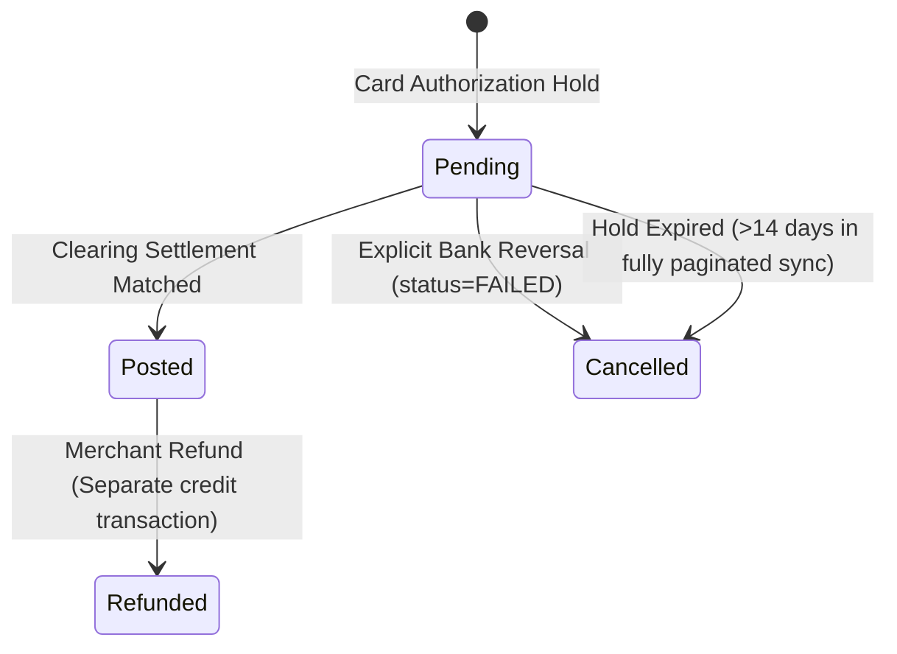
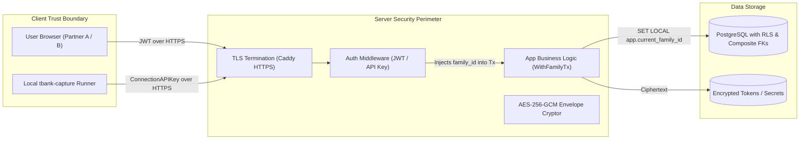

# Family Finance: System Architecture Specification

## 1. Architectural Philosophy & Principles

1. **Modular Monolith in Go:** Single compilation target, high developer velocity, zero distributed system overhead (no Kubernetes, Kafka, or microservices required for a self-hosted family deployment), with strictly enforced domain boundaries.
2. **Two-Layer Ledger (Evidence vs. Interpretation):**
   - **Bank Evidence Layer (`bank_transactions`):** Immutable, authoritative historical record of bank operations, holding external identifiers (`id`, `operationId`, `authorizationId`), raw descriptions, clearing times, MCC codes, and booking statuses (`pending`, `posted`, `cancelled`). Bank sync updates never overwrite user categorization, attribution, or notes.
   - **Accounting Interpretation Layer (`accounting_entries`):** The family's categorization, payer attribution, beneficiary allocation, and split entries. Supports 1:N splits of bank transactions. Manual cash operations exist purely in this layer (`bank_transaction_id IS NULL`).
3. **Multi-Tenant Isolation via Composite Foreign Keys & RLS:**
   - Every tenant-owned table enforces `UNIQUE (family_id, id)`.
   - Every relationship across tenant entities uses composite foreign keys referencing `(family_id, target_id)`.
   - PostgreSQL Row-Level Security (RLS) is applied on every tenant table with explicit `USING` and `WITH CHECK` policies.
   - Transaction-scoped tenant context: `SET LOCAL app.current_family_id = '...'` executes inside every database transaction via `WithFamilyTx`. Missing context defaults to deny-all.
4. **Exact Minor-Unit Mathematics:** Strict prohibition of floating-point numbers (`float32`/`float64`) for money. All monetary amounts are handled as `int64` minor units (kopeks, cents) alongside ISO 4217 currency codes.
5. **Stateless API & Background Worker Separation:** Deployed as two runtimes from the same codebase (`cmd/api` and `cmd/worker`) sharing internal domain packages.

---

## 2. Component Diagram & Module Boundaries


### Module Responsibilities:

| Module | Boundary & Responsibility | Inward Dependencies | Outward Dependencies |
| :--- | :--- | :--- | :--- |
| `internal/auth` | User authentication, Argon2id hashing, JWT generation, family member permissions, bootstrap registration. | `database` | None |
| `internal/account` | Account and card lifecycle management, balance calculations, credit limit & debt tracking, manual cash accounts. | `auth`, `database` | `audit` |
| `internal/connector` | Defines `BankConnector` interface and adapters for T-Bank, Sberbank, etc. Translates external bank DTOs to normalized internal models. | `domain` | External APIs / Local browser runner |
| `internal/importer` | Parses CSV and XLSX files from T-Bank, Sber, Alfa-Bank, and generic formats. Dispatches raw batches to the transaction pipeline. | `connector`, `domain` | None |
| `internal/transaction` | Ingestion into `bank_transactions`, raw payload preservation, deduplication, transaction lifecycle updates, and management of `accounting_entries` (including splits). | `account`, `domain` | `categorizer`, `transfermatch`, `queue`, `audit` |
| `internal/categorizer` | Rule-based hierarchical categorization engine (User rule > Merchant rule > MCC > Keyword regex > Fallback). Operates on `accounting_entries`. | `domain` | None |
| `internal/transfermatch`| Multi-tier conservative transfer matching engine (Tier 1 exact, Tier 2 probable, Tier 3 manual) and credit card debt repayment detection. Updates `accounting_entries.classification`. | `transaction`, `domain` | `audit` |
| `internal/analytics` | High-performance read-only queries for cash flows, real consumption expenses, debt tracking, MoM comparisons, and partner attribution. | `domain`, `database` | None |
| `internal/queue` | PostgreSQL-backed persistent job queue (transactional outbox) with retry backoff and concurrency control (`SKIP LOCKED`). | `database` | None |
| `internal/audit` | Append-only audit trail recording user actions, category reclassifications, manual transfer links, and rule modifications. | `database` | None |

---

## 3. Core Data Flow & Pipelines

### 3.1 Automated Bank Sync Pipeline
```mermaid
sequenceDiagram
    autonumber
    actor Cron as Scheduler / Manual Trigger
    participant W as cmd/worker
    participant BC as BankConnector (T-Bank)
    participant Raw as raw_bank_payloads (DB)
    participant BT as bank_transactions (DB)
    participant AE as accounting_entries (DB)
    participant Cat as categorizer (Rule Engine)
    participant Match as transfermatch (Transfer Matcher)

    Cron->>W: Enqueue SyncJob(connection_id, family_id, window)
    W->>BC: FetchAccounts & FetchTransactions(ctx, params)
    BC-->>W: Normalized IngestionBatch (Accounts[], Cards[], TxDTOs[])

    W->>Raw: Insert raw JSON payloads (immutable append-only)
    
    loop For each incoming TxDTO
        W->>BT: Ingest & Deduplicate (Natural Key or Fingerprint)
        alt Existing Authorization Found (Pending -> Settled)
            BT->>BT: Update booking_status='posted', posted_time, account_amount_minor
            BT->>AE: Update accounting_entry amount if unsplit; flag drift if split
        else New Bank Transaction
            BT->>BT: Insert into bank_transactions (status: pending/posted)
            BT->>AE: Create initial default accounting_entry (is_split=false)
            W->>Cat: Categorize(entry, bank_tx)
            Cat-->>AE: Assign category_id, rule_id
            W->>Match: EvaluateTransferCandidate(bank_tx)
            alt Tier 1 Exact Match (Semantic Evidence Verified)
                Match-->>AE: Set classification = 'transfer' (or 'debt_repayment')
            else Tier 2 Match
                Match-->>Match: Record in transfer_matches (status='suggested')
            end
        end
    end
    W->>W: Update bank_connection.last_synced_at & sync_jobs status
```

---

## 4. Account and Balance Semantics

To eliminate financial ambiguity, every balance value follows strict formulas, sign conventions, and authoritative sourcing rules:

### 4.1 Balance Definitions & Formulas

1. **Current Balance (`current_balance_minor`):**
   * *Type:* Signed integer minor units (`BIGINT`). Positive = asset/cash in bank; Negative = overdrawn balance.
   * *Source:* Provided by bank statement/API (`moneyAmount.value`) or calculated from initial balance + sum of `posted` transactions.
2. **Pending Holds (`pending_holds_minor`):**
   * *Type:* Positive integer minor units (`BIGINT`).
   * *Formula:* $\sum \text{abs}(\text{amount\_minor})$ for all `bank_transactions` where `booking_status = 'pending'` and `amount_minor < 0` (authorizations that temporarily reserve funds).
   * *Note:* Incoming pending deposits (if any) are tracked separately and **never** inflated into available balance until cleared.
3. **Available Balance (`available_balance_minor`):**
   * *Type:* Signed integer minor units (`BIGINT`).
   * *Debit Accounts:* $\text{Current Balance} - \text{Pending Holds}$.
   * *Credit Cards:* $\text{Credit Limit} - (\text{Debt Balance} + \text{Pending Holds})$.
   * *Rule:* Never relies on an undefined overdraft field. If the bank provides an explicit available balance, it is stored; otherwise, it is calculated via the above formula.
4. **Credit Card Debt (`debt_balance_minor`):**
   * *Type:* Positive integer minor units (`BIGINT`). Represents principal debt owed.
   * *Source:* Provided by bank (`debtAmount.value` / `debtBalance.value`) or verified locally as $\sum \text{abs}(\text{posted purchases}) - \sum \text{posted repayments}$.
5. **Credit Limit (`credit_limit_minor`):**
   * *Type:* Positive integer minor units (`BIGINT`). Approved revolving limit (`creditLimit.value`).
6. **Statement Balance (`statement_balance_minor`):**
   * *Type:* Positive integer minor units (`BIGINT`). Billed debt snapshot from last closed billing cycle (`statements` endpoint / `billedDebt`).
7. **Minimal Payment (`minimal_payment_minor`):**
   * *Type:* Positive integer minor units (`BIGINT`). Required minimum payment (`currentMinimalPayment`).
8. **Grace Period Due Date (`grace_period_end_date`):**
   * *Type:* ISO 8601 Date (`YYYY-MM-DD`). Deadline to repay statement balance to avoid interest charges.

*Rule on Incomplete Data:* If a balance metric cannot be reliably sourced from the bank or calculated from cleared ledger history, it is represented as `NULL` / unknown rather than fabricating a zero value.

---

## 5. Transaction Lifecycle & Safe Ingestion Rules



1. **Non-Interchangeable Identifiers:**
   * `id`: Timeline UI item identifier.
   * `operationId`: Bank clearing/accounting identifier.
   * `authorizationId`: Card network authorization hold code.
   * *Resolution:* Natural key `(family_id, account_id, external_id)` takes priority. If an incoming settled transaction has a new `external_id`, it resolves a pending hold **only if** `external_auth_id == incoming.authorizationId` on the same `account_id` within a 14-day hold window.
2. **Strict Cancellation vs. Expiry Conditions:**
   * Absence from a single sync response is **never** treated as cancellation.
   * An authorization transitions to `cancelled` **only if**:
     a) Bank explicitly reports it as `FAILED`, `CANCELLED`, or voided, OR
     b) A full, successfully paginated sync covering the entire 14-day active window completes without error and the authorization is absent.
3. **Refund Modeling:**
   * Post-clearing refunds are **never mutations** of original purchase records.
   * A refund is ingested as a distinct `bank_transaction` (`operation_type = 'refund'`) with positive `amount_minor` and `related_bank_transaction_id` referencing the original purchase.
   * Its `accounting_entry` inherits the original purchase category with a positive amount, accurately netting out the category expense in analytics without distorting family income.

---

## 6. Security Architecture & Threat Mitigation



### 6.1 Sidecar Pairing Handshake
1. **Creation:** User creates connection via UI (`POST /connections`). Server generates a 32-byte cryptographically secure single-use pairing secret (`sec_pair_...`, TTL: 10 min) and stores its Argon2id hash.
2. **Pairing Exchange:** Local runner calls `POST /connections/pair` over TLS presenting the pairing secret. Server validates, wipes the pairing hash to prevent replay, and issues a long-lived `ConnectionAPIKey`.
3. **Zero Credential Transmission:** The sidecar **never transmits** browser cookies, session tokens, passwords, OTPs, or full card numbers (PANs). Only sanitized, normalized financial JSON is transmitted.
4. **Envelope Encryption:** Secrets at rest are encrypted with **AES-256-GCM** using format `v1:<nonce>:<tag>:<ciphertext>`.
5. **Background Worker Security:** Background jobs run under a dedicated worker context (`app.is_worker = 'true'`). Before executing tenant tasks, the worker executes `WithFamilyTx(job.family_id)` to enforce RLS inside the job transaction.

---

## 7. BankConnector Go Interface Specification

```go
package connector

import (
	"context"
	"time"
)

type CurrencyAmount struct {
	MinorUnits int64  // e.g. 150050 for 1,500.50 RUB
	Currency   string // ISO 4217, e.g. "RUB", "USD", "EUR"
}

type AccountDTO struct {
	ExternalID       string
	Name             string
	Type             string // "checking", "credit_card", "savings", "deposit"
	Currency         string
	Balance          CurrencyAmount
	AvailableBalance *CurrencyAmount
	DebtAmount       *CurrencyAmount
	CreditLimit      *CurrencyAmount
	StatementBalance *CurrencyAmount
	MinimalPayment   *CurrencyAmount
	GracePeriodDate  *time.Time
	Cards            []CardDTO
}

type CardDTO struct {
	ExternalID    string
	MaskedPAN     string // e.g. "*1234"
	DisplayName   string
	PaymentSystem string // "MIR", "VISA", "MASTERCARD"
	IsVirtual     bool
	Status        string // "ACTIVE", "BLOCKED", "CLOSED"
}

type BankTransactionDTO struct {
	ExternalID          string          // Bank operation ID (operationId / id)
	ExternalAuthID      *string         // Card network authorization hold ID
	AccountExternalID   string
	CardExternalID      *string
	Amount              CurrencyAmount  // Nominal transaction amount
	AccountAmount       CurrencyAmount  // Cleared amount in account currency
	TransactionTime     time.Time
	SettledTime         *time.Time      // Nil if still pending/hold
	BookingStatus       string          // "pending", "posted", "cancelled"
	OperationType       string          // "purchase", "refund", "transfer_out", "transfer_in", "atm_cash", "fee", "card_check"
	RelatedExternalID   *string         // Reference to refunded operation if available
	MerchantName        string
	RawDescription      string
	MCC                 *int
	BankCategory        string
	RawJSON             []byte
}

type SyncParams struct {
	StartDate time.Time
	EndDate   time.Time
	Accounts  []string
}

type BankConnector interface {
	ProviderCode() string
	HealthCheck(ctx context.Context, config map[string]any) error
	FetchAccounts(ctx context.Context, config map[string]any) ([]AccountDTO, error)
	FetchTransactions(ctx context.Context, config map[string]any, params SyncParams) ([]BankTransactionDTO, error)
}
```
