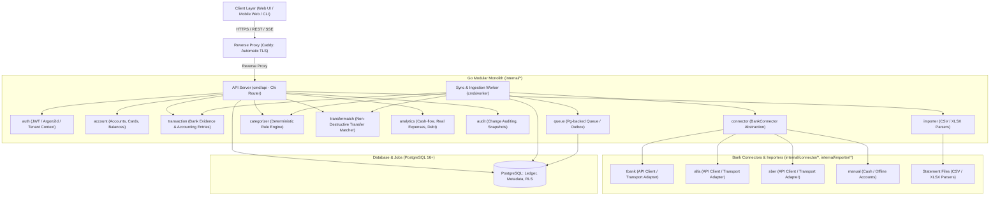
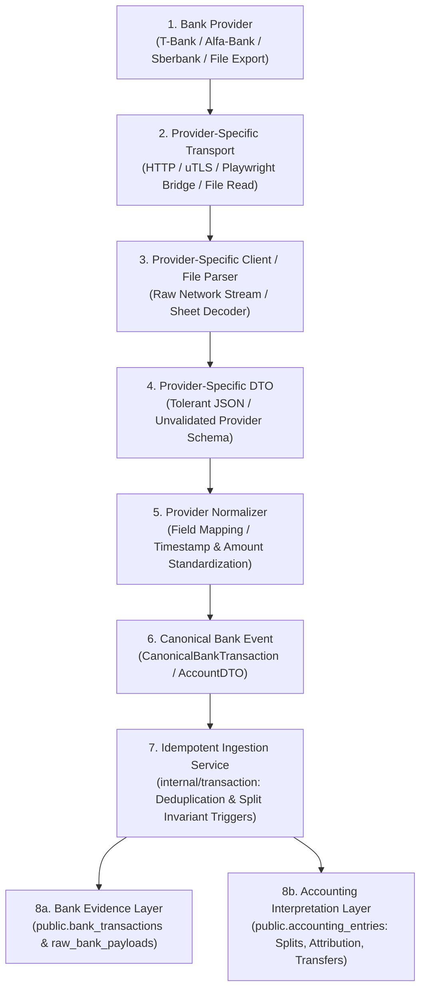
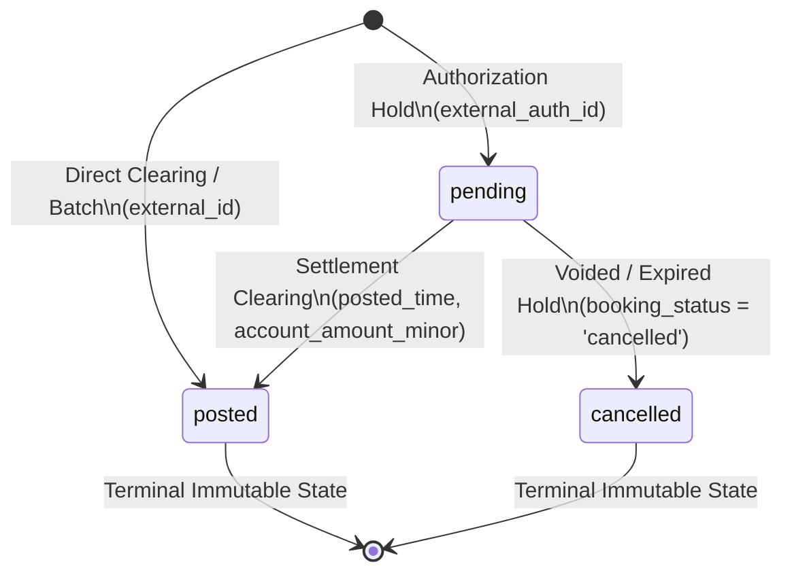
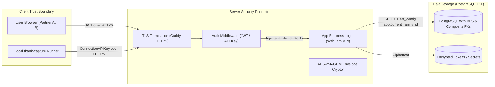

# Family Finance: System Architecture Specification

## 1. Architectural Philosophy & Principles

1. **Modular Monolith in Go:** Single compilation target, high developer velocity, zero distributed system overhead (no Kubernetes, Kafka, or microservices required for a self-hosted family deployment), with strictly enforced domain boundaries.
2. **Two-Layer Ledger (Evidence vs. Interpretation):**
   - **Bank Evidence Layer (`bank_transactions`):** Immutable, authoritative historical record of bank events. Stores bank identifiers (`id`, `operationId`, `authorizationId`), raw descriptions, MCC codes, booking status (`pending`, `posted`, `cancelled`), and cleared timestamps. Bank sync updates never overwrite user categorization, attribution, or notes.
   - **Accounting Interpretation Layer (`accounting_entries`):** The family's categorization, payer attribution, beneficiary allocation, and split entries. Supports 1:N splits of bank transactions. Manual cash operations exist purely in this layer (`bank_transaction_id IS NULL`).
3. **Multi-Tenant Isolation, Least-Privilege Role Model & Evidence Immutability:**
   - Minimum supported database: **PostgreSQL 16+**.
   - Every tenant-owned table enforces `UNIQUE (family_id, id)`.
   - Every relationship across tenant entities uses composite foreign keys referencing `(family_id, target_id)`.
   - Column-level deletion syntax `ON DELETE SET NULL (nullable_column)` ensures that deleting an optional target NULLs only the referencing attribute, preserving `family_id NOT NULL`.
   - User membership ownership: every tenant reference to a user is foreign-keyed to `family_members(family_id, user_id)`.
   - **Tenant Immutability:** `family_id` is strictly immutable on all 14 tenant tables; mutating `family_id` is blocked by `trg_enforce_tenant_immutability`.
   - **Row Evidence Immutability:** Historical bank facts in `bank_transactions` and `raw_bank_payloads` cannot be updated or deleted by runtime roles. Only monotonic `pending` -> `posted`/`cancelled` lifecycle updates are permitted for `family_worker`.
   - **Append-Only Compliance:** `audit_logs` and `transfer_rejections` are strictly append-only; runtime roles cannot update or delete entries.
   - **Least-Privilege Role Model:** Blanket runtime grants (`GRANT ALL`) are strictly prohibited. Six dedicated PostgreSQL roles (`family_admin`, `family_app`, `family_worker`, `family_queue_definer`, `family_auth_definer`, `family_auth_verifier`) partition privileges. Global user credentials (`password_hash`) are isolated behind `family_auth_verifier`.
   - **Defense-in-Depth RLS:** `FORCE ROW LEVEL SECURITY` is applied to all tenant tables so table owners cannot accidentally bypass RLS policies.
   - Transaction-scoped tenant context: Parameterized `SELECT set_config('app.current_family_id', $1, true)` executes inside every database transaction via `WithFamilyTx`. Missing context strictly evaluates to deny-all.
   - **Zero Worker Security Bypass:** Custom GUCs like `app.is_worker` are strictly forbidden as security boundaries. Background workers execute under transaction-scoped `WithFamilyTx(job.family_id)` using a dedicated `queue_sec.claim_next_worker_job()` function.
   - **RLS Recursion & Enumeration Defense:** Parameterless `auth_sec.get_current_user_family_ids()` runs as `family_auth_definer` to discover user memberships without recursion and without exposing cross-user enumeration vectors.
4. **Exact Minor-Unit Mathematics:** Strict prohibition of floating-point numbers (`float32`/`float64`) for money. All monetary amounts are handled as `int64` minor units (kopeks, cents) alongside ISO 4217 currency codes.
5. **Stateless API & Background Worker Separation:** Deployed as two runtimes from the same codebase (`cmd/api` and `cmd/worker`) sharing internal domain packages.
6. **Decoupled Provider-Independent Ingestion Architecture:**
   - **Core Finance Decoupling:** The core domain model, financial ledger, two-layer accounting rules, and consistency invariants are 100% decoupled from external banking providers. Production bank connectors or live network discovery are **never** prerequisites for core domain implementation or testing.
   - **Initial Banking Providers:** The system supports three initial banking providers: **T-Bank**, **Alfa-Bank**, and **Sberbank**.
   - **Decoupled Connector Pipeline:** Ingestion strictly follows an 8-layer logical separation:
     $$\text{Bank Provider} \rightarrow \text{Transport} \rightarrow \text{Client / Parser} \rightarrow \text{Provider DTO} \rightarrow \text{Normalizer} \rightarrow \text{Canonical Event} \rightarrow \text{Ingestion Service} \rightarrow \text{Evidence / Ledger}$$
   - **Zero Domain Contamination:** The core domain has ZERO dependencies on Playwright, uTLS libraries, HTTP transport clients, bank-specific JSON DTOs, or CSV/XLSX parsing libraries.
   - **uTLS Transport Boundary:** Transport-layer TLS fingerprint customization (uTLS) may be evaluated where technically appropriate for specific providers, but is strictly treated as a transport concern, **not** an API compatibility guarantee. TLS fingerprint compatibility, endpoint availability, authentication session lifetimes, and API contract stability are strictly separate concerns.
   - **Empirical Snapshots as Versioned Evidence:** Recorded API request/response snapshots are treated as versioned empirical evidence used for regression test fixtures and schema validation—**never** as permanent, authoritative vendor contracts.

---

## 2. Component Diagram & Module Boundaries



### Decoupled 8-Layer Ingestion Pipeline

To ensure the core financial domain is completely decoupled from bank networks, file formats, and authentication protocols:



#### Core Ingestion Boundary Rules:
1. **Zero Domain Contamination:** Modules `internal/domain`, `internal/transaction`, `internal/account`, `internal/transfermatch`, and `internal/analytics` MUST NEVER import bank-specific packages, Playwright, uTLS, HTTP transport clients, or spreadsheet parsing libraries.
2. **Provider Isolation:** Provider-specific clients, transports, and raw DTOs live exclusively inside isolated subpackages (`internal/connector/<provider>`, `internal/importer/<provider>`).
3. **Canonical Event Interface:** Connectors and file importers communicate with the ingestion service solely through canonical data structures (`CanonicalBankTransaction`, `AccountDTO`, `CardDTO`, `BalanceDTO`).
4. **Transport Independence:** Whether a payload arrives via official REST API, uTLS-emulated browser client, local capture bridge, or CSV export, the ingestion pipeline processes it through the identical deduplication, evidence storage, and split initialization logic.

### Module Responsibilities:

| Module | Boundary & Responsibility | Inward Dependencies | Outward Dependencies |
| :--- | :--- | :--- | :--- |
| `internal/domain` | Canonical domain models (`money.Money`, `TransactionView`), monetary arithmetic, and business validation. | None (Core) | None |
| `internal/auth` | User authentication, Argon2id hashing, JWT generation, family member permissions, bootstrap registration. | `database` | None |
| `internal/account` | Account and card lifecycle management, balance tracking (with timestamped observation sources), manual cash accounts. | `domain`, `auth`, `database` | `audit` |
| `internal/connector` | Defines provider-independent `BankConnector` interface, canonical events, and isolated provider adapters (`tbank`, `alfa`, `sber`). | `domain` | External APIs / Transports |
| `internal/importer` | Parses CSV and XLSX files from T-Bank, Sber, Alfa-Bank, and generic formats into canonical events. Dispatches batches to the ingestion pipeline. | `connector`, `domain` | None |
| `internal/transaction` | Ingestion into `bank_transactions`, raw payload preservation, deduplication, transaction lifecycle updates, deferred split trigger management, and `accounting_entries`. | `account`, `domain`, `database` | `categorizer`, `transfermatch`, `queue`, `audit` |
| `internal/categorizer` | Rule-based hierarchical categorization engine (User rule > Merchant rule > MCC > Keyword regex > Fallback). Operates on `accounting_entries`. | `domain`, `database` | None |
| `internal/transfermatch`| Conservative transfer matching engine (Tier 1 exact, Tier 2 probable, Tier 3 manual) and credit card debt repayment detection. Links `accounting_entries.transfer_match_id` non-destructively. | `transaction`, `domain`, `database` | `audit` |
| `internal/analytics` | High-performance read-only queries for cash flows, real consumption expenses, debt tracking, MoM comparisons, and partner attribution. | `domain`, `database` | None |
| `internal/queue` | PostgreSQL-backed persistent job queue (transactional outbox) with retry backoff and concurrency control (`SKIP LOCKED`). | `database` | None |
| `internal/audit` | Append-only audit trail recording user actions, category reclassifications, manual transfer links, and rule modifications. | `database` | None |

---

## 3. Stable TransactionView Identity Model

To prevent identity ambiguity between the physical bank evidence layer and the accounting interpretation layer:

```
[ Physical Bank Event ]                [ Accounting Interpretation ]
  bank_transactions                         accounting_entries
  id: "bt_1001"                              id: "entry_5001" (Groceries)
                                             id: "entry_5002" (Pharmacy)
                 │                                  │
                 └────────────────┬─────────────────┘
                                  ▼
                        [ TransactionView ]
                  view_id: "bt:bt_1001"
                  bank_transaction_id: "bt_1001"
                  entries: [ "entry_5001", "entry_5002" ]
```

1. **Deterministic View ID:**
   * For Bank-Backed Transactions: `view_id = "bt:" || bank_transaction_id`
   * For Manual Cash Operations: `view_id = "manual:" || accounting_entry_id`
2. **Behavior on GET and PATCH:**
   * `GET /transactions/{id}`: Accepting either a `view_id`, a `bank_transaction_id`, or any constituent `entry_id` resolves to the **complete `TransactionView`**, returning all split entries in that logical group.
   * `PATCH /transactions/entries/{entry_id}`: Targets a specific accounting entry to edit its category, comment, or beneficiary without mutating bank evidence.
   * `POST /transactions/entries/{entry_id}/split`: Splits an unsplit entry into $N \ge 2$ entries while preserving the stable `view_id`.

### 3.2 Transaction Lifecycle State Machine & Monotonic Settlement

Bank operations progress through an explicit monotonic state machine managed by `internal/transaction` and enforced by PostgreSQL trigger `trg_enforce_bank_evidence_immutability()`:



1. **Authorization Holds (`pending`):**
   * Represents provisional bank authorizations (card holds, pending transfers).
   * Amount reflects estimated or provisional hold value.
   * Generates a corresponding `accounting_entries` record with `is_split = FALSE` so pending expenses appear in views.
2. **Settlement Enrichment (`pending` $\rightarrow$ `posted`):**
   * Triggered when the bank clears the transaction.
   * Enforces settlement invariants:
     * `posted_time` is mandatory (`IS NOT NULL`) and immutable once posted.
     * `account_amount_minor` must be non-zero (except `card_check` zero-auth verification).
     * Debit/credit sign cannot flip upon settlement (an expense cannot become an income event).
     * `external_id` cannot be wiped or blank.
     * Category 1 historical bank facts (19 columns including `transaction_time`, `currency`, `mcc`, `raw_description`, `operation_type`) are strictly immutable.
3. **Terminal State Immutability:**
   * Both `posted` and `cancelled` are **strictly terminal**. Transitions `posted` $\rightarrow$ *anything* or `cancelled` $\rightarrow$ *anything* are aborted by database triggers.
   * Modifying settlement fields on terminal transactions (`posted` $\rightarrow$ `posted` or `cancelled` $\rightarrow$ `cancelled`) is completely forbidden.
4. **Hold Voiding (`pending` $\rightarrow$ `cancelled`):**
   * When an authorization expires or is released by the merchant without settlement, `booking_status` transitions to `cancelled`.
   * Only `booking_status` and `updated_at` may change; settlement amounts and external IDs remain untouched.
   * Accounting impact: cancelled transactions are excluded from net expense and cash-flow reporting.

### 3.3 Complex Financial Event Modeling: Additive Immutability

Because financial history in retail banking is strictly additive, the system **never mutates an existing settled transaction** to account for reversals, corrections, or returns. Every subsequent banking action is recorded as a distinct, immutable bank transaction:

| Real-World Financial Event | Bank Evidence Modeling (`bank_transactions`) | Accounting Interpretation (`accounting_entries`) |
| :--- | :--- | :--- |
| **Merchant Refund (Full or Partial)** | New immutable row with positive `account_amount_minor`, `operation_type = 'refund'`, and `related_bank_transaction_id` pointing to the original debit transaction. | Linked to the original debit's category (e.g. "Electronics"), netting out the original expenditure in analytics. |
| **Chargeback / Bank Reversal** | New immutable row with positive `account_amount_minor`, `operation_type = 'reversal'`, and `related_bank_transaction_id` pointing to the original transaction. | Offsets the disputed entry, preserving historical auditability. |
| **Bank Correction / Adjustment** | New immutable row with `operation_type = 'correction'`, positive or negative amount, linking via `related_bank_transaction_id` if known. | Classified under administrative adjustment or original category. |
| **Duplicate Bank Events** | Ingestion Layer 7 checks deduplication keys: `(account_id, external_id)` or `fingerprint_hash` + sequence. Identical events are safely ignored (idempotent no-op). | No duplicate entries created. |
| **Late-Arriving Authorization** | If a pending hold arrives for an operation already settled (`posted`), the late hold is discarded as redundant. | Existing posted entries remain unaffected. |
| **Direct Settlement without Hold** | Transaction arrives directly with `booking_status = 'posted'`. Inserted as settled. | Initial accounting entry initialized atomically. |

---

## 4. Account and Balance Semantics

To eliminate financial ambiguity, every balance value follows strict formulas, sign conventions, and authoritative sourcing rules:

### 4.1 Balance Definitions, Nullability & Sources

| Balance Dimension | Database Nullability | Authoritative Source | Semantics & Sourcing Rules |
| :--- | :--- | :--- | :--- |
| **Current Balance (`current_balance_minor`)** | `BIGINT NULL` | `balance_source = 'bank_api'` or `'statement_file'` | Physical cleared cash in bank. If unobserved, defaults to `NULL` (unknown), **never** fabricated as 0. |
| **Pending Holds (`pending_holds_minor`)** | Calculated on read | Sum of active holds | $\sum \text{abs}(\text{amount\_minor})$ for `bank_transactions` where `booking_status = 'pending'` and `amount_minor < 0`. |
| **Available Balance (`available_balance_minor`)** | `BIGINT NULL` | `bank_api` or calculated | Spendable liquidity. Debit: $\text{Current} - \text{Holds}$. Credit: $\text{Credit Limit} - (\text{Debt} + \text{Holds})$. |
| **Credit Card Debt (`debt_balance_minor`)** | `BIGINT NULL` | `bank_api` or calculated | Cleared debt balance on credit card. `NULL` on non-credit accounts. |
| **Credit Limit (`credit_limit_minor`)** | `BIGINT NULL` | `bank_api` | Approved credit line (`creditLimit.value`). `NULL` on non-credit accounts. |
| **Statement Balance (`statement_balance_minor`)** | `BIGINT NULL` | `statements` endpoint / `billedDebt` | Debt fixed at monthly billing cycle close. Must be repaid by grace period date. |
| **Minimal Payment (`minimal_payment_minor`)** | `BIGINT NULL` | `bank_api` (`currentMinimalPayment`) | Mandatory minimum payment due. `NULL` on non-credit accounts. |
| **Grace Period Due Date (`grace_period_end_date`)** | `DATE NULL` | `bank_api` (`nextStatementDate`) | Payment deadline for 0% interest benefit. |
| **Balance Observation Timestamp (`balance_updated_at`)** | `TIMESTAMPTZ NULL` | System / Bank timestamp | Records the exact point-in-time when this balance snapshot was observed. |

### 4.2 Exact Monetary Arithmetic & Rounding Invariants (`money.Money`)

All monetary figures across the core domain, ledger, and persistence layers adhere to strict arithmetic rules implemented in `money.Money`:

1. **Exact 64-bit Signed Integer Minor Units:**
   * All monetary values are represented as `int64` minor units (e.g. $1,500.50 \text{ RUB} = 150050$).
   * Floating-point types (`float32`, `float64`) are **strictly prohibited** in all domain entities, ledger calculations, and database columns.
2. **ISO 4217 Currency Exponents:**
   * Currencies are identified by their uppercase 3-letter ISO 4217 code.
   * Exponent mapping:
     * Exponent 2 (standard): `RUB`, `USD`, `EUR`, `GBP` ($1 \text{ unit} = 100 \text{ minor units}$).
     * Exponent 0 (zero-decimal): `JPY`, `KRW` ($1 \text{ unit} = 1 \text{ minor unit}$).
     * Exponent 3 (three-decimal): `BHD`, `KWD`, `OMR` ($1 \text{ unit} = 1000 \text{ minor units}$).
3. **Lossless Decimal String Parsing:**
   * User inputs and bank payloads (e.g. `"149.99"`, `"149,99"`, `"500"`) are parsed directly into integer minor units using exact string parsing (splitting integer and fractional portions, scaling by the ISO currency exponent).
   * Floating-point conversion (`strconv.ParseFloat`) is never used, eliminating IEEE 754 precision artifacts.
4. **Zero Rounding on Basic Arithmetic:**
   * Addition and subtraction are exact integer operations.
   * Mixed-currency operations without explicit conversion return a domain error.
5. **Banker's Rounding (Half-Even) on Fractional Operations:**
   * When multiplying or dividing (e.g. percentage tax calculation, interest accrual, or proportional allocation), rounding follows **Half-Even Rounding** (round to nearest integer, breaking ties to the even integer). This prevents systematic upward or downward drift in aggregate financial reporting.
6. **Split Sum Invariance & Remainder Distribution:**
   * When splitting an accounting entry across $N \ge 2$ allocations, the sum of split minor units must exactly equal the parent amount.
   * Any fractional minor unit remainder (e.g., $100$ kopeks divided $3$ ways yields $33, 33, 33$ with $1$ remainder) is deterministically assigned to the first split entry:
     $$\sum_{i=1}^N \text{amount\_minor}_i = \text{account\_amount\_minor}$$
7. **Integer Bounds Protection:**
   * Arithmetic methods validate boundaries against `math.MaxInt64` and `math.MinInt64`, returning explicit overflow errors.

### 4.3 Timestamp Semantics & Timezone Normalization

1. **UTC Storage Everywhere:**
   * All database timestamp columns (`transaction_time`, `posted_time`, `created_at`, `updated_at`, `balance_updated_at`) use PostgreSQL `TIMESTAMPTZ` and are normalized to UTC in the application layer.
2. **Authoritative Timestamp Roles:**
   * `transaction_time`: The historical moment the customer authorized/swiped the card or initiated the transfer.
   * `posted_time`: The moment the bank cleared and settled the funds. Mandatory (`IS NOT NULL`) for `posted` transactions.
3. **Batch Clearing & Chronological Invariance:**
   * Commercial bank settlement runs frequently clear batches at midnight (`00:00:00 UTC` or local clearing midnight) of the settlement day. If a customer made a purchase on the afternoon of that day, the settlement timestamp can appear earlier on the clock than the transaction timestamp.
   * Database triggers enforce that `posted_time IS NOT NULL` on `posted` transactions and preserve terminal immutability, but do **not** reject settlements based on intraday clock order.
   * Ingestion Layer 7 flags severe anomalies where $|posted\_time - transaction\_time| > 30\text{ days}$ in audit logs for inspection without failing the sync.
4. **Date-Only Statement Normalization:**
   * CSV/XLSX statements providing only calendar dates (`DD.MM.YYYY`) are normalized to `00:00:00 UTC` of that date. The original raw text format is preserved verbatim in `raw_bank_payloads` and `bank_transactions.raw_description`.

---

## 5. Non-Destructive Transfer Representation & Match Integrity

When the transfer matcher pairs two bank transactions (e.g., checking outflow and credit card inflow):

1. **Non-Destructive Linkage:**
   * The linked `accounting_entries.transfer_match_id` foreign key is set to `transfer_matches.id`.
   * **Crucial Rule:** The entry's original `category_id`, `user_comment`, and `classification` are **100% preserved and never overwritten**.
2. **Transfer Match Ownership & Endpoint Immutability Triggers:**
   * **Endpoint Immutability:** Trigger `trg_immutability_transfer_endpoints` strictly prohibits modifying `source_bank_transaction_id` or `destination_bank_transaction_id` on existing `transfer_matches`.
   * **Entry Ownership Validation:** Deferred constraint trigger `trg_validate_accounting_entry_transfer_match` on `accounting_entries` strictly enforces that an entry linked to a transfer match MUST belong to either the source or destination bank transaction of that exact match:
     $$\text{entry.bank\_transaction\_id} \in \{\text{match.source\_bank\_transaction\_id}, \text{match.destination\_bank\_transaction\_id}\}$$
   * Combining endpoint immutability with deferred entry ownership guarantees that an existing linked entry can never become unrelated or orphaned from its match.
3. **Analytical Interpretation:**
   * Queries and analytical views (`v_family_real_expenses`) check `transfer_match_id`: if pointing to a match with `status IN ('auto_confirmed', 'confirmed')`, the entry is projected as an internal transfer or debt repayment and excluded from consumption expenses.
4. **Symmetric Transfer Rejection Model:**
   * When a proposed transfer between transaction A and transaction B is rejected, a rejection record is inserted with `source_bank_transaction_id = A`, `destination_bank_transaction_id = B`, and an optional `reason` (up to 500 characters).
   * Table `transfer_rejections` enforces a symmetric unique index:
     `UNIQUE (family_id, LEAST(source_bank_transaction_id, destination_bank_transaction_id), GREATEST(source_bank_transaction_id, destination_bank_transaction_id))`
   * The transfer matcher checks candidate pairs symmetrically:
     `WHERE LEAST(candidate_source, candidate_dest) = LEAST(rej_source, rej_dest) AND GREATEST(...) = GREATEST(...)`
   * This guarantees that rejecting A $\rightarrow$ B permanently suppresses both A $\rightarrow$ B and B $\rightarrow$ A proposals.
5. **Atomic 5-Step Non-Destructive Rejection Flow:**
   * Executed within a single `WithFamilyTx` database transaction:
     1. `SELECT * FROM transfer_matches WHERE id = $1 FOR UPDATE` (locks match).
     2. `INSERT INTO transfer_rejections (family_id, source_bank_transaction_id, destination_bank_transaction_id, rejected_by_user_id, reason) VALUES ($family_id, $src_id, $dst_id, $user_id, $reason) ON CONFLICT (family_id, LEAST(source_bank_transaction_id, destination_bank_transaction_id), GREATEST(source_bank_transaction_id, destination_bank_transaction_id)) DO NOTHING` (persists symmetric suppression).
     3. `UPDATE accounting_entries SET transfer_match_id = NULL, updated_at = NOW() WHERE transfer_match_id = $1` (clears linkage while preserving category and user comment intact).
     4. `UPDATE transfer_matches SET status = 'rejected', updated_at = NOW() WHERE id = $1` (updates lifecycle status and timestamp).
     5. `INSERT INTO audit_logs (family_id, user_id, action, entity_type, entity_id, new_values) VALUES (...)` (records audit trail).

---

## 6. Security Architecture & Threat Mitigation



### 6.1 Parameterized Tenant Context Execution (`WithFamilyTx`)

```go
// WithFamilyTx executes fn within an explicit transaction scoped to familyID.
func WithFamilyTx(ctx context.Context, pool *pgxpool.Pool, familyID uuid.UUID, fn func(pgx.Tx) error) error {
    tx, err := pool.Begin(ctx)
    if err != nil {
        return fmt.Errorf("begin tx: %w", err)
    }
    defer tx.Rollback(ctx)

    // Parameterized set_config scopes the variable strictly to this transaction (is_local = true)
    var result string
    err = tx.QueryRow(ctx, "SELECT set_config('app.current_family_id', $1, true)", familyID.String()).Scan(&result)
    if err != nil {
        return fmt.Errorf("set tenant context: %w", err)
    }

    if err := fn(tx); err != nil {
        return err
    }
    return tx.Commit(ctx)
}
```

### 6.2 Background Worker Execution Model & Job Claiming

1. **Queue Tenant Invariant:**
   * Every job in `worker_jobs` requires `family_id UUID NOT NULL REFERENCES families(id)`.
2. **Zero GUC Bypass:**
   * Background workers run with standard least-privilege credentials (`family_worker`).
   * No client-settable GUCs (e.g. `app.is_worker = 'true'`) or `BYPASSRLS` privileges are permitted.
3. **Dedicated Job Claiming Role & Schema (`queue_sec.claim_next_worker_job`):**
   * Workers invoke `queue_sec.claim_next_worker_job(p_queue_name, p_worker_id, p_lock_duration_seconds)` to atomically claim the next pending job across all tenants using `FOR UPDATE SKIP LOCKED`.
   * Owned by dedicated internal role `family_queue_definer` (`NOLOGIN`) and isolated in schema `queue_sec` (owned by `family_admin`), where `family_queue_definer` has `CREATE` privileges while possessing zero `CREATE` privileges on `public`.
   * Has `SELECT, UPDATE ON public.worker_jobs` only, with an explicit RLS policy `USING (true)`. The role has **zero access to tenant financial, ledger, or user identity tables**.
   * The function transitions the job status to `'running'`, records `locked_by` and `locked_until`, increments `attempts`, and returns `(job_id UUID, family_id UUID, job_type VARCHAR, payload JSONB)`.
   * Stalled jobs where `state = 'running' AND locked_until < NOW()` are automatically reclaimed by active workers upon lease expiry.
4. **Tenant-Isolated Execution:**
   * Once a job is claimed, the worker initiates domain execution strictly wrapped in `WithFamilyTx(ctx, pool, job.family_id, func(tx pgx.Tx) error { ... })`.
   * All subsequent domain queries, bank sync ingestion, and category processing execute within standard RLS perimeters for that single family.

### 6.3 Membership Discovery, User Credential Isolation & Trust Boundaries

1. **Authentication Trust Boundary Clarification:**
   * In this three-tier architecture (Web Client $\rightarrow$ Go Monolith $\rightarrow$ PostgreSQL Pool), custom GUC settings (`app.current_user_id`, `app.current_family_id`) represent **trusted application context** passed by authenticated backend processes over authenticated connection pool roles (`family_app`, `family_worker`).
   * PostgreSQL does not independently verify JWT signatures or client identities; PostgreSQL enforces tenant row-level security and relational integrity assuming the application server correctly validates client credentials and injects context via `SELECT set_config(..., true)`.
   * Database connection credentials must never be exposed to clients.
2. **Anti-Enumeration & RLS Recursion Defense (`auth_sec.get_current_user_family_ids`):**
   * When an authenticated user connects without an active family context (e.g. during login or `/auth/me` to list available families), evaluating membership policies via a subquery on `family_members` inside `family_members` RLS causes infinite recursion.
   * Helper functions must never accept an arbitrary `p_user_id` parameter that could allow enumeration of other users' memberships.
   * Discovery uses a dedicated parameterless helper function in dedicated schema `auth_sec`:
     ```sql
     CREATE FUNCTION auth_sec.get_current_user_family_ids()
     RETURNS SETOF UUID ...
     ```
   * Owned by dedicated internal role `family_auth_definer` (`NOLOGIN`), with a dedicated non-recursive RLS policy on `family_members` comparing `user_id = NULLIF(current_setting('app.current_user_id', true), '')::UUID`.
   * Callers cannot tamper with user arguments; missing or empty `app.current_user_id` strictly evaluates to an empty result (0 rows).
   * **`family_worker` Revocation:** `family_worker` does not act on behalf of interactive user discovery sessions and has zero execute privileges on `auth_sec.get_current_user_family_ids()`.
3. **Global User Credential Isolation (`family_auth_verifier` & `auth_sec`):**
   * Runtime roles (`family_app`, `family_worker`) have no direct `SELECT` permission on `users.password_hash`.
   * Login verification and password updates are delegated to dedicated `SECURITY DEFINER` functions (`auth_sec.get_user_auth_credential` and `auth_sec.update_user_password`) owned by `family_auth_verifier` in schema `auth_sec`.
   * `family_worker` has zero access to user passwords, emails, or password mutation functions.
   * **Password Update Security Boundary Contract:** `auth_sec.update_user_password(new_hash)` relies strictly on `app.current_user_id` injected into the transaction; it does **not** verify the caller's old password in PostgreSQL. The application API service (`cmd/api`) is explicitly contracted to verify the user's `current_password` via Argon2id (or verify an active reset token) before invoking `update_user_password`.
4. **Registration Bootstrap Sequence (Pre-Generated UUIDs under RLS):**
   * The tenant root table `families` enforces `rls_families_mod` with `WITH CHECK (id = get_current_family_id())`. Inserting into `families` before setting tenant context would cause an RLS check violation.
   * The Go application layer resolves this by pre-generating UUIDs (`new_user_id := uuid.New()`, `new_family_id := uuid.New()`) and executing the bootstrap within a single transaction:
     1. In application Go code: generate `new_user_id` and `new_family_id`.
     2. `SELECT set_config('app.current_user_id', new_user_id, true)` and `SELECT set_config('app.current_family_id', new_family_id, true)`.
     3. Insert into `users(id, email, password_hash, first_name, last_name, is_active)` with `id = new_user_id` (global table; column grants enforced).
     4. Insert into `families(id, name)` with `id = new_family_id` (passes `WITH CHECK (id = get_current_family_id())`).
     5. Insert into `family_members(family_id, user_id, role)` with `role = 'owner'` (passes `WITH CHECK (family_id = get_current_family_id())`).
     6. Seed default system categories (passes `WITH CHECK`).
     7. Commit transaction and issue JWT token with `family_id` and `user_id` claims.
5. **Table Owner Bypass Prevention (`FORCE ROW LEVEL SECURITY`):**
   * All tenant-owned tables enforce `FORCE ROW LEVEL SECURITY`.
   * This guarantees that even if a database connection is established by a role with table ownership, RLS policies are strictly enforced and cannot be bypassed without explicit superuser intervention.

### 6.4 Bank Evidence & Audit Log Immutability Architecture

1. **Bank Evidence Immutability (`bank_transactions`):**
   * `DELETE` is completely prohibited for runtime roles (`family_app`, `family_worker`) at both SQL grant and trigger levels (`trg_bank_tx_no_delete`).
   * `family_app` has zero `UPDATE` privileges on `bank_transactions`. Categorization and user notes belong exclusively to `accounting_entries`.
   * `family_worker` can only update lifecycle fields (`booking_status`, `posted_time`, `account_amount_minor`, `external_id`, `updated_at`). Core historical facts (19 Category 1 columns) are strictly immutable by trigger (`trg_bank_tx_immutable`).
   * **Monotonic State Machine & Settlement Invariants:**
     - `pending` $\rightarrow$ `posted`: Permitted exclusively for bank settlement. Enforces strict settlement invariants: `posted_time` is strictly mandatory (`IS NOT NULL`); `account_amount_minor` must be non-zero (except `card_check`) and maintain debit/credit direction; `external_id` cannot be wiped if set or blank; settlement mutations restricted to `posted_time`, `account_amount_minor`, `external_id`, `updated_at`. (Intraday clock differences due to batch clearing dates are decoupled from database triggers and validated at the application ingestion layer).
     - `pending` $\rightarrow$ `cancelled`: Permitted with only `booking_status` and `updated_at` mutable. All settlement fields must remain unchanged.
     - `posted` $\rightarrow$ *anything*: Forbidden. Terminal immutable state.
     - `cancelled` $\rightarrow$ *anything*: Forbidden. Terminal immutable state.
     - `posted` $\rightarrow$ `posted`: Strictly immutable. Modifying `account_amount_minor`, `posted_time`, `external_id` or historical facts raises an exception.
     - `cancelled` $\rightarrow$ `cancelled`: Strictly immutable. Modifying any data column raises an exception.
     - `pending` $\rightarrow$ `pending`: Modifying settlement fields without state transition to `posted` is prohibited.
2. **Raw Bank Payload Immutability (`raw_bank_payloads`):**
   * Stores exact JSON bodies from bank sync runs or imported files.
   * Runtime roles have `SELECT` and `INSERT` privileges only.
   * `UPDATE` and `DELETE` are blocked by SQL grants and enforced by trigger `trg_raw_payloads_immutable`.
3. **Append-Only Compliance Log (`audit_logs`):**
   * Runtime roles have `SELECT` and `INSERT` privileges within their active tenant context.
   * `UPDATE` and `DELETE` are completely revoked for runtime roles and enforced by trigger `trg_audit_logs_append_only`.
   * Administrative retention (e.g. archiving logs older than 7 years) is executed exclusively by `family_admin` or `postgres` maintenance jobs outside runtime application workflows.

### 6.5 Raw Evidence Privacy, Credential Security & Redaction Boundaries

1. **Sanitized Business Payloads (`raw_bank_payloads`):**
   * Stores sanitized business JSON structures (transaction lists, statement rows, account summaries).
   * **Strict Exclusion of Transport Envelopes:** Transport HTTP headers (`Cookie`, `Authorization`, `Proxy-Authorization`, `Set-Cookie`, `X-Auth-Token`) MUST NEVER be persisted in `raw_bank_payloads`. All transport tokens and session cookies are stripped before persistence.
2. **Card PAN Masking & PCI DSS Alignment:**
   * Primary Account Numbers (PANs) are masked to the last 4 digits (e.g. `*1234`) across all models, logs, and database columns.
   * Full 16-digit PANs and CVV/CVC codes are NEVER stored in the database or emitted in logging traces.
3. **Encrypted Bank Connection Credentials:**
   * Bank login tokens, session refresh cookies, and API keys stored in `bank_connections.credentials_encrypted` are encrypted using AES-256-GCM.
   * Nonces are randomly generated (12 bytes) per encryption operation and prepended to the ciphertext.
   * Encryption keys are managed outside the database via environment variable `BANK_CREDENTIAL_KEY`.
4. **Diagnostic Segregation & Retention Policy:**
   * `raw_bank_payloads` are retained for active operational use (180 days) to facilitate deduplication, backfills, and audit reconciliation, after which they are eligible for cold archival.
   * Low-level network traces, Playwright DOM snapshots, and debug logs are strictly ephemeral: stored only in development log files, never written to PostgreSQL tenant tables.

---

## 7. BankConnector Go Interface Specification

The `BankConnector` interface defines the provider-independent integration contract for banking sources (**T-Bank**, **Alfa-Bank**, **Sberbank**). It abstracts away all provider-specific HTTP transports, browser capture sessions, pagination quirks, and proprietary JSON envelopes, delivering standardized canonical events to the core ingestion pipeline.

```go
package connector

import (
	"context"
	"fmt"
	"time"
)

// CurrencyAmount represents minor monetary units with ISO 4217 currency.
type CurrencyAmount struct {
	MinorUnits int64  // e.g. 150050 for 1,500.50 RUB
	Currency   string // ISO 4217, e.g. "RUB", "USD", "EUR"
}

// AccountDTO represents an external account instrument.
type AccountDTO struct {
	ExternalID       string
	Name             string
	Type             string // "checking", "credit_card", "savings", "deposit"
	Currency         string
	Balance          *CurrencyAmount // Nil if balance not observed in current payload
	AvailableBalance *CurrencyAmount
	DebtAmount       *CurrencyAmount
	CreditLimit      *CurrencyAmount
	StatementBalance *CurrencyAmount
	MinimalPayment   *CurrencyAmount
	GracePeriodDate  *time.Time
	Cards            []CardDTO
}

// CardDTO represents an access card instrument attached to an account.
type CardDTO struct {
	ExternalID        string
	AccountExternalID string
	MaskedPAN         string // e.g. "*1234"
	DisplayName       string
	PaymentSystem     string // "MIR", "VISA", "MASTERCARD", "OTHER"
	IsVirtual         bool
	IsPrimary         bool
	Status            string // "ACTIVE", "BLOCKED", "CLOSED"
}

// BalanceDTO represents observed balance telemetry for point-in-time updates.
type BalanceDTO struct {
	AccountExternalID string
	CurrentBalance    *CurrencyAmount
	AvailableBalance  *CurrencyAmount
	DebtBalance       *CurrencyAmount
	CreditLimit       *CurrencyAmount
	ObservedAt        time.Time
	Source            string // "bank_api", "statement_file", "calculated"
}

// CanonicalBankTransaction represents a normalized bank transaction event.
// Completely decoupled from external provider-specific JSON schemas.
type CanonicalBankTransaction struct {
	ExternalID        string          // Provider operation ID (operationId / id)
	ExternalAuthID    *string         // Card network authorization hold ID (authorizationId)
	AccountExternalID string
	CardExternalID    *string
	Amount            CurrencyAmount  // Nominal transaction amount (merchant currency)
	AccountAmount     CurrencyAmount  // Cleared amount in account currency
	TransactionTime   time.Time
	SettledTime       *time.Time      // Nil if still pending/hold
	BookingStatus     string          // "pending", "posted", "cancelled"
	OperationType     string          // "purchase", "refund", "transfer_out", "transfer_in", "atm_cash", "fee", "card_check"
	RelatedExternalID *string         // Lineage pointer to refunded or original operation
	MerchantName      string
	RawDescription    string
	MCC               *int
	BankCategory      string
	RawPayload        []byte          // Exact verbatim payload for non-repudiation audit
}

// SyncParams encapsulates filter parameters and pagination cursors for synchronization.
type SyncParams struct {
	StartDate time.Time
	EndDate   time.Time
	Accounts  []string
	Cursor    string // Opaque provider pagination cursor or page identifier
	Limit     int    // Maximum items per page (default 100)
}

// SyncProgress provides telemetry on batch progress for background workers.
type SyncProgress struct {
	CurrentPage    int
	RecordsFetched int
	HasMore        bool
	NextCursor     string
}

// SyncResult encapsulates canonical transaction events alongside pagination state.
type SyncResult struct {
	Transactions []CanonicalBankTransaction
	Progress     SyncProgress
}

// SyncError represents classified synchronization failures.
type SyncError struct {
	ProviderCode string
	ErrorCode    string // e.g. "AUTH_EXPIRED", "RATE_LIMITED", "NETWORK_TIMEOUT", "SCHEMA_DRIFT"
	Message      string
	Retryable    bool
	Underlying   error
}

func (e *SyncError) Error() string {
	return fmt.Sprintf("[%s] %s: %s", e.ProviderCode, e.ErrorCode, e.Message)
}

func (e *SyncError) Unwrap() error {
	return e.Underlying
}

// BankConnector defines the provider-independent integration contract.
type BankConnector interface {
	// ProviderCode returns the unique provider identifier (e.g. "tbank", "alfa", "sber").
	ProviderCode() string

	// HealthCheck tests connectivity, transport reachability, and credential validity.
	HealthCheck(ctx context.Context, credentials []byte) error

	// FetchAccounts retrieves all accounts and nested card instruments.
	FetchAccounts(ctx context.Context, credentials []byte) ([]AccountDTO, error)

	// FetchCards retrieves cards explicitly for a given account.
	FetchCards(ctx context.Context, credentials []byte, accountExternalID string) ([]CardDTO, error)

	// FetchBalances retrieves real-time balance positions for specific accounts.
	FetchBalances(ctx context.Context, credentials []byte, accountExternalIDs []string) ([]BalanceDTO, error)

	// FetchTransactions retrieves canonical transaction events matching the sync parameters.
	FetchTransactions(ctx context.Context, credentials []byte, params SyncParams) (*SyncResult, error)
}
```

### Connector Architectural Constraints:

1. **Provider Isolation:**
   - Production connectors live exclusively in `internal/connector/<provider>`.
   - The core domain and ledger engine interact only with the `BankConnector` interface and canonical DTOs (`CanonicalBankTransaction`, `AccountDTO`, `CardDTO`, `BalanceDTO`).
2. **Transport & Fingerprinting Separation:**
   - Where a provider requires specialized TLS transport (e.g., uTLS for anti-bot / JA3/JA4 emulation), that logic is fully encapsulated inside `internal/connector/<provider>/transport.go`.
   - **uTLS is NOT an API compatibility guarantee.** TLS fingerprint compatibility, endpoint availability, authentication, and contract stability are strictly separate concerns.
3. **Empirical Snapshots as Versioned Fixtures:**
   - Observed request/response logs from real sessions are stored in `internal/connector/<provider>/testdata/` as versioned test fixtures for regression testing and tolerant JSON decoding.
   - Snapshots are **never** assumed to be permanent or authoritative vendor contracts.
4. **Non-Blocking Core Development:**
   - Connector implementations are tracked under **Stage 0B** and do not block **Stage 0A** or **Stage 1**. Core ledger testing in Stage 1 and Stage 2 runs against deterministic mock connectors and recorded fixtures.
