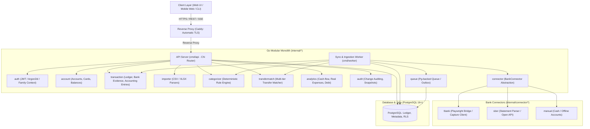
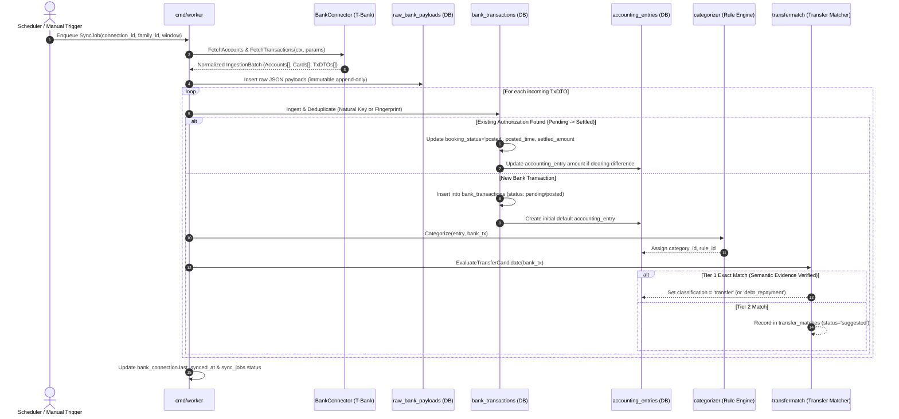
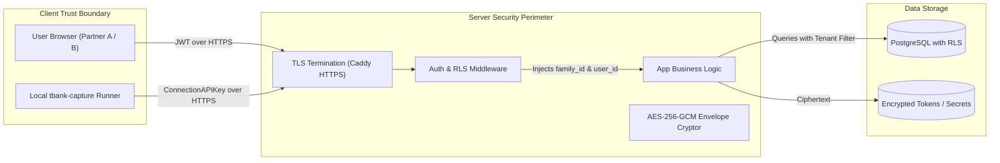

# Family Finance: System Architecture Specification

## 1. Architectural Philosophy & Principles

1. **Modular Monolith in Go:** Single compilation target, high developer velocity, zero distributed system overhead (no Kubernetes, Kafka, or microservices required for a self-hosted family deployment), with strictly enforced domain boundaries.
2. **Two-Layer Ledger (Evidence vs. Interpretation):**
   - **Bank Evidence Layer (`bank_transactions`):** Immutable, authoritative historical record of bank operations, holding raw descriptions, clearing times, MCC codes, and booking statuses (`pending`, `posted`, `cancelled`). Bank sync updates never overwrite user categorization or notes.
   - **Accounting Interpretation Layer (`accounting_entries`):** The family's categorization, payer attribution, beneficiary allocation, and split entries. Supports 1:N splits of bank transactions. Manual cash expenses exist purely in this layer.
3. **PostgreSQL as the Single Source of Truth:** All domain logic, ledger state, outbox events, and background job queues reside in PostgreSQL (leveraging `pgx/v5` and `SKIP LOCKED`).
4. **Defense-in-Depth Multi-Tenancy:** Every entity belongs to a `family_id`. PostgreSQL Row-Level Security (RLS) is applied on the database layer, complementing application-level middleware checks.
5. **Exact Financial Mathematics:** Strict prohibition of floating-point numbers (`float32`/`float64`) for money. All monetary amounts are handled as `int64` minor units (kopeks, cents) alongside ISO 4217 currency codes.
6. **Stateless API & Background Worker Separation:** Deployed as two runtimes from the same codebase (`cmd/api` and `cmd/worker`) sharing internal domain packages.

---

## 2. Component Diagram & Module Boundaries



### Module Responsibilities:

| Module | Boundary & Responsibility | Inward Dependencies | Outward Dependencies |
| :--- | :--- | :--- | :--- |
| `internal/auth` | User authentication, session management, Argon2id password hashing, JWT generation, family member permissions. | `database` | None |
| `internal/account` | Account and card lifecycle management, balance calculations, credit limit & debt tracking, manual cash accounts. | `auth`, `database` | `audit` |
| `internal/connector` | Defines `BankConnector` interface and adapters for T-Bank, Sberbank, etc. Translates external bank DTOs to normalized internal models. | `domain` | External APIs / Local browser runner |
| `internal/importer` | Parses CSV, XLSX, and 1C files from T-Bank, Sber, Alfa-Bank, and generic formats. Dispatches raw batches to the transaction pipeline. | `connector`, `domain` | None |
| `internal/transaction` | Ingestion into `bank_transactions`, raw payload preservation, deduplication, transaction lifecycle updates, and management of `accounting_entries` (including splits). | `account`, `domain` | `categorizer`, `transfermatch`, `queue`, `audit` |
| `internal/categorizer` | Rule-based hierarchical categorization engine (User rule > Merchant rule > MCC > Keyword regex > Fallback). Operates on `accounting_entries`. | `domain` | None |
| `internal/transfermatch`| Multi-tier transfer matching engine (Tier 1 exact, Tier 2 probable, Tier 3 manual) and credit card debt repayment detection. Updates `accounting_entries.classification`. | `transaction`, `domain` | `audit` |
| `internal/analytics` | High-performance read-only queries for cash flows, real consumption expenses, debt tracking, MoM comparisons, and partner attribution. | `domain`, `database` | None |
| `internal/queue` | PostgreSQL-backed persistent job queue (transactional outbox) with retry backoff and concurrency control (`SKIP LOCKED`). | `database` | None |
| `internal/audit` | Append-only audit trail recording user actions, category reclassifications, manual transfer links, and rule modifications. | `database` | None |

---

## 3. Core Data Flow & Pipelines

### 3.1 Automated Bank Sync Pipeline


---

## 4. Account and Balance Semantics

To ensure financial correctness, balance values are strictly classified by their authoritative source:

| Balance Dimension | Bank Provided vs. Locally Calculated | Meaning & Semantics | Applicable Account Types |
| :--- | :--- | :--- | :--- |
| **Current Balance (`current_balance_minor`)** | **Bank Provided** (or calculated from initial cash balance + sum of `posted` transactions). | The settled cash ledger balance physically clearing the account. | Checking, Savings, Deposit, Cash |
| **Pending Authorizations** | **Locally Calculated** from sum of `bank_transactions` with `booking_status = 'pending'`. | Total funds temporarily held by merchant card network. | Checking, Credit Card |
| **Available Balance (`available_balance_minor`)** | **Bank Provided** (verified locally: $\text{Current} - \text{Holds} + \text{Overdraft}$). | The spendable liquidity as of right now. | Checking, Credit Card |
| **Credit Card Debt (`debt_balance_minor`)** | **Bank Provided** (verified locally from cleared credit purchases net of repayments). | The principal debt owed to the bank. | Credit Card |
| **Credit Limit (`credit_limit_minor`)** | **Bank Provided** (`creditLimit.value`). | Approved revolving credit line. | Credit Card |
| **Statement Balance (`statement_balance_minor`)** | **Bank Provided** (`statements` endpoint / `billedDebt`). | Debt balance fixed at the close of the monthly billing cycle. Must be repaid by grace period date. | Credit Card |
| **Minimal Payment (`minimal_payment_minor`)** | **Bank Provided** (`currentMinimalPayment`). | Minimum mandatory payment due to avoid default penalties. | Credit Card |
| **Grace Period Date (`grace_period_end_date`)** | **Bank Provided** (`nextStatementDate` or calculated grace period). | Payment deadline for 0% interest benefit. | Credit Card |

---

## 5. Security Architecture & Threat Mitigation



### 5.1 Sidecar Authentication & Pairing Protocol
1. **Single-Use Pairing Secret:** Generated by core server (`POST /connections`), with 10-minute TTL and Argon2id hash storage.
2. **Key Issuance:** Sidecar exchanges pairing secret via TLS (`POST /connections/pair`), receiving a dedicated `ConnectionAPIKey`. Pairing secret is instantly wiped.
3. **Strict Credential Isolation:** The sidecar **never transmits** browser cookies, session tokens, passwords, OTPs, or full card numbers. Only sanitized, normalized financial JSON is transmitted.
4. **Envelope Encryption:** Secrets at rest are encrypted with **AES-256-GCM** with 96-bit unique nonces and version prefix (`v1:nonce:tag:ciphertext`).
5. **Card Hygiene:** All card numbers are strictly masked to last 4 digits (`*1234`).
6. **Immutable Audit Trail:** All manual category changes, transfer confirmations/rejections, and balance adjustments are logged in `audit_logs`.

---

## 6. BankConnector Go Interface Specification

```go
package connector

import (
	"context"
	"time"
)

type CurrencyAmount struct {
	MinorUnits int64  // e.g. 150050 for 1,500.50 RUB
	Currency   string // ISO 4217, e.g. "RUB", "USD", "EUR"
}

type AccountDTO struct {
	ExternalID       string
	Name             string
	Type             string // "checking", "credit_card", "savings", "deposit"
	Currency         string
	Balance          CurrencyAmount
	DebtAmount       *CurrencyAmount
	CreditLimit      *CurrencyAmount
	StatementBalance *CurrencyAmount
	MinimalPayment   *CurrencyAmount
	GracePeriodDate  *time.Time
	Cards            []CardDTO
}

type CardDTO struct {
	ExternalID    string
	MaskedPAN     string // e.g. "*1234"
	DisplayName   string
	PaymentSystem string // "MIR", "VISA", "MASTERCARD"
	IsVirtual     bool
	Status        string // "ACTIVE", "BLOCKED", "CLOSED"
}

type BankTransactionDTO struct {
	ExternalID          string          // Bank operation ID (operationId / id)
	ExternalAuthID      *string         // Card network authorization hold ID
	AccountExternalID   string
	CardExternalID      *string
	Amount              CurrencyAmount  // Nominal transaction amount
	AccountAmount       CurrencyAmount  // Cleared amount in account currency
	TransactionTime     time.Time
	SettledTime         *time.Time      // Nil if still pending/hold
	BookingStatus       string          // "pending", "posted", "cancelled"
	OperationType       string          // "purchase", "refund", "transfer_out", "transfer_in", "atm_cash", "fee"
	RelatedExternalID   *string         // Reference to refunded operation if available
	MerchantName        string
	RawDescription      string
	MCC                 *int
	BankCategory        string
	RawJSON             []byte
}

type SyncParams struct {
	StartDate time.Time
	EndDate   time.Time
	Accounts  []string
}

type BankConnector interface {
	ProviderCode() string
	HealthCheck(ctx context.Context, config map[string]any) error
	FetchAccounts(ctx context.Context, config map[string]any) ([]AccountDTO, error)
	FetchTransactions(ctx context.Context, config map[string]any, params SyncParams) ([]BankTransactionDTO, error)
}
```
