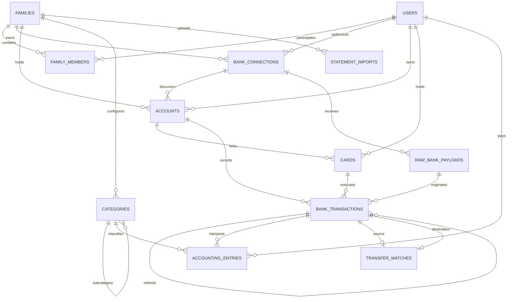

# PostgreSQL Schema & ER Design Specification

## 1. Architectural Principles of the Data Layer

1. **Two-Layer Ledger (Evidence vs. Interpretation):**
   - **Bank Evidence Layer (`bank_transactions`):** The immutable, verified record of what happened at the bank. Contains bank identifiers (`id`, `operationId`, `authorizationId`), raw descriptions, MCC codes, booking status (`pending`, `posted`, `cancelled`), and cleared timestamps. Bank sync never overwrites user categorization.
   - **Accounting Interpretation Layer (`accounting_entries`):** How the family classifies money. Contains categories, payer/beneficiary attribution, split allocations, and user notes. Every bank transaction has one or more accounting entries (supporting 1:N transaction splits). Manual cash operations exist purely in this layer (`bank_transaction_id IS NULL`).
2. **Exact Monetary Storage:** All money is stored in `BIGINT` minor units (e.g. kopeks/cents). Floating-point numeric types (`FLOAT`, `DOUBLE PRECISION`) are strictly forbidden for money.
3. **Defensive Deduplication:** Multi-level deduplication via natural bank keys (`external_id`) and synthetic fingerprint hashes with sequence collision disambiguation.
4. **Defense-in-Depth Multi-Tenancy:** Row-Level Security (RLS) is applied on every table via `family_id`.

---

## 2. Relational Entity Relationship Diagram



---

## 3. Table Schemas, Constraints & Column Types

### 3.1 Multi-Tenant Identity & Access Management

```sql
CREATE EXTENSION IF NOT EXISTS "uuid-ossp";
CREATE EXTENSION IF NOT EXISTS "pgcrypto";

-- Families: The primary tenant accounting boundary
CREATE TABLE families (
    id UUID PRIMARY KEY DEFAULT gen_random_uuid(),
    name VARCHAR(100) NOT NULL,
    default_currency VARCHAR(3) NOT NULL DEFAULT 'RUB' CHECK (default_currency ~ '^[A-Z]{3}$'),
    created_at TIMESTAMPTZ NOT NULL DEFAULT NOW(),
    updated_at TIMESTAMPTZ NOT NULL DEFAULT NOW()
);

-- Users: Partners and household members
CREATE TABLE users (
    id UUID PRIMARY KEY DEFAULT gen_random_uuid(),
    email VARCHAR(255) UNIQUE NOT NULL,
    password_hash VARCHAR(255) NOT NULL, -- Argon2id hash
    first_name VARCHAR(100) NOT NULL,
    last_name VARCHAR(100),
    is_active BOOLEAN NOT NULL DEFAULT TRUE,
    created_at TIMESTAMPTZ NOT NULL DEFAULT NOW(),
    updated_at TIMESTAMPTZ NOT NULL DEFAULT NOW()
);

-- Family Members: Association between users and families with specific roles
CREATE TABLE family_members (
    id UUID PRIMARY KEY DEFAULT gen_random_uuid(),
    family_id UUID NOT NULL REFERENCES families(id) ON DELETE CASCADE,
    user_id UUID NOT NULL REFERENCES users(id) ON DELETE CASCADE,
    role VARCHAR(30) NOT NULL DEFAULT 'partner' CHECK (role IN ('owner', 'partner', 'viewer')),
    color_code VARCHAR(7) DEFAULT '#3B82F6', -- Hex color for UI attribution
    created_at TIMESTAMPTZ NOT NULL DEFAULT NOW(),
    updated_at TIMESTAMPTZ NOT NULL DEFAULT NOW(),
    UNIQUE(family_id, user_id)
);
```

### 3.2 Bank Connections & Raw Data Layer

```sql
-- Bank Connections: Integrations with banking providers or statement import slots
CREATE TABLE bank_connections (
    id UUID PRIMARY KEY DEFAULT gen_random_uuid(),
    family_id UUID NOT NULL REFERENCES families(id) ON DELETE CASCADE,
    authorized_by_user_id UUID NOT NULL REFERENCES users(id) ON DELETE RESTRICT,
    provider VARCHAR(50) NOT NULL, -- 'tbank_sidecar', 'sber_file', 'manual'
    name VARCHAR(100) NOT NULL,
    status VARCHAR(30) NOT NULL DEFAULT 'pending_pairing' 
        CHECK (status IN ('pending_pairing', 'active', 'expired', 'error', 'disconnected')),
    
    -- Sidecar Security & Authentication
    pairing_secret_hash VARCHAR(255), -- Argon2id hash of single-use pairing secret
    pairing_secret_expires_at TIMESTAMPTZ,
    api_key_hash VARCHAR(64),         -- SHA-256 hash of active sidecar connection API key
    api_key_last_used_at TIMESTAMPTZ,
    
    encrypted_credentials BYTEA,      -- AES-256-GCM envelope (versioned: v1:nonce:tag:ciphertext)
    last_synced_at TIMESTAMPTZ,
    error_message TEXT,
    created_at TIMESTAMPTZ NOT NULL DEFAULT NOW(),
    updated_at TIMESTAMPTZ NOT NULL DEFAULT NOW()
);

CREATE INDEX idx_bank_conn_api_key ON bank_connections(api_key_hash) WHERE api_key_hash IS NOT NULL;

-- Raw Bank Payloads: Immutable storage of exact raw external payloads
CREATE TABLE raw_bank_payloads (
    id UUID PRIMARY KEY DEFAULT gen_random_uuid(),
    family_id UUID NOT NULL REFERENCES families(id) ON DELETE CASCADE,
    bank_connection_id UUID REFERENCES bank_connections(id) ON DELETE SET NULL,
    source VARCHAR(50) NOT NULL, -- 'tbank_timeline_api', 'tbank_csv', 'sber_xlsx'
    payload_hash VARCHAR(64) NOT NULL, -- SHA-256 of raw_json
    raw_json JSONB NOT NULL,
    created_at TIMESTAMPTZ NOT NULL DEFAULT NOW()
);

CREATE INDEX idx_raw_payloads_hash ON raw_bank_payloads(family_id, payload_hash);
```

### 3.3 Accounts & Cards Model

```sql
-- Accounts: The true financial balances / money pools
CREATE TABLE accounts (
    id UUID PRIMARY KEY DEFAULT gen_random_uuid(),
    family_id UUID NOT NULL REFERENCES families(id) ON DELETE CASCADE,
    bank_connection_id UUID REFERENCES bank_connections(id) ON DELETE SET NULL,
    owner_user_id UUID NOT NULL REFERENCES users(id) ON DELETE RESTRICT,
    external_id VARCHAR(100), -- Bank provider's account ID
    name VARCHAR(100) NOT NULL,
    type VARCHAR(30) NOT NULL CHECK (type IN (
        'checking',     -- Current/checking debit account
        'credit_card',  -- Revolving credit facility
        'savings',      -- Savings account / накопительный счет
        'deposit',      -- Fixed term deposit / вклад
        'cash'          -- Physical cash wallet
    )),
    currency VARCHAR(3) NOT NULL CHECK (currency ~ '^[A-Z]{3}$'),
    
    -- Balance Semantics (Minor Units, e.g. kopeks/cents)
    -- current_balance: Cleared ledger cash in bank (provided by bank or sum of settled operations)
    current_balance_minor BIGINT NOT NULL DEFAULT 0,
    -- available_balance: Spendable funds (bank reported: current - holds + overdraft/credit)
    available_balance_minor BIGINT,
    
    -- Credit Card Specific Semantics
    debt_balance_minor BIGINT DEFAULT 0,    -- Utilized debt on credit card (posted purchases - repayments)
    credit_limit_minor BIGINT DEFAULT 0,    -- Total credit line approved by bank
    statement_balance_minor BIGINT DEFAULT 0,-- Billed debt from last monthly statement
    minimal_payment_minor BIGINT DEFAULT 0, -- Mandatory minimum payment due
    grace_period_end_date DATE,             -- Due date to avoid interest
    
    is_archived BOOLEAN NOT NULL DEFAULT FALSE,
    created_at TIMESTAMPTZ NOT NULL DEFAULT NOW(),
    updated_at TIMESTAMPTZ NOT NULL DEFAULT NOW(),
    UNIQUE(family_id, bank_connection_id, external_id)
);

-- Cards: Access instruments linked to underlying bank accounts
CREATE TABLE cards (
    id UUID PRIMARY KEY DEFAULT gen_random_uuid(),
    family_id UUID NOT NULL REFERENCES families(id) ON DELETE CASCADE,
    account_id UUID NOT NULL REFERENCES accounts(id) ON DELETE CASCADE,
    owner_user_id UUID NOT NULL REFERENCES users(id) ON DELETE RESTRICT,
    external_id VARCHAR(100), -- Bank provider's card ID
    masked_pan VARCHAR(20) NOT NULL, -- Strictly masked, e.g., '*4589'
    display_name VARCHAR(100) NOT NULL,
    payment_system VARCHAR(30) NOT NULL CHECK (payment_system IN ('MIR', 'VISA', 'MASTERCARD', 'OTHER')),
    is_virtual BOOLEAN NOT NULL DEFAULT FALSE,
    is_primary BOOLEAN NOT NULL DEFAULT FALSE,
    status VARCHAR(30) NOT NULL DEFAULT 'ACTIVE' CHECK (status IN ('ACTIVE', 'BLOCKED', 'CLOSED')),
    created_at TIMESTAMPTZ NOT NULL DEFAULT NOW(),
    updated_at TIMESTAMPTZ NOT NULL DEFAULT NOW(),
    UNIQUE(family_id, account_id, external_id)
);
```

### 3.4 Bank Evidence Layer: `bank_transactions`

```sql
-- Bank Transactions: Authoritative financial evidence from the bank/importer.
-- NEVER directly mutated by user categorization or transfer linking.
CREATE TABLE bank_transactions (
    id UUID PRIMARY KEY DEFAULT gen_random_uuid(),
    family_id UUID NOT NULL REFERENCES families(id) ON DELETE CASCADE,
    account_id UUID NOT NULL REFERENCES accounts(id) ON DELETE CASCADE,
    card_id UUID REFERENCES cards(id) ON DELETE SET NULL,
    raw_payload_id UUID REFERENCES raw_bank_payloads(id) ON DELETE SET NULL,
    
    -- Identification & Non-Interchangeable Bank Keys
    external_id VARCHAR(128),     -- Bank operation ID (e.g. T-Bank operationId / id)
    external_auth_id VARCHAR(128),-- Authorization hold ID (card network authorizationCode)
    fingerprint_hash VARCHAR(64) NOT NULL, -- Synthetic fallback hash
    fingerprint_sequence INT NOT NULL DEFAULT 1, -- Disambiguates identical same-day transactions
    
    -- Monetary Values (Strict Minor Units)
    -- Positive = Inflow (Deposit / Refund / Income), Negative = Outflow (Purchase / Fee / Transfer Out)
    -- 0 is allowed ONLY for zero-amount card verification holds (e.g. 0.00 RUB auth checks)
    amount_minor BIGINT NOT NULL,
    currency VARCHAR(3) NOT NULL CHECK (currency ~ '^[A-Z]{3}$'),
    account_amount_minor BIGINT NOT NULL, -- Amount in account currency (clearing settlement)
    account_currency VARCHAR(3) NOT NULL CHECK (account_currency ~ '^[A-Z]{3}$'),
    
    -- Lifecycle Tracking
    booking_status VARCHAR(30) NOT NULL DEFAULT 'posted' CHECK (booking_status IN (
        'pending',   -- Authorization / Hold (funds reserved)
        'posted',    -- Cleared / Settled on bank balance
        'cancelled'  -- Hold dropped, expired, or voided
    )),
    
    operation_type VARCHAR(30) NOT NULL DEFAULT 'purchase' CHECK (operation_type IN (
        'purchase',
        'refund',           -- Merchant return / chargeback
        'transfer_out',     -- Outgoing transfer (SBP, c2c, wire)
        'transfer_in',      -- Incoming transfer
        'atm_cash',         -- Cash withdrawal or ATM deposit
        'fee',              -- Bank service fee, SMS fee, interest charge
        'card_check'        -- Zero-amount card verification
    )),
    
    -- Self-referential link for refunds and clearing adjustments
    related_bank_transaction_id UUID REFERENCES bank_transactions(id) ON DELETE SET NULL,
    
    transaction_time TIMESTAMPTZ NOT NULL, -- POS / Authorization timestamp
    posted_time TIMESTAMPTZ,              -- Bank clearing / settlement timestamp
    
    -- Bank Metadata
    merchant_name VARCHAR(255),
    raw_description TEXT NOT NULL,
    mcc INT,
    bank_category VARCHAR(100),
    
    created_at TIMESTAMPTZ NOT NULL DEFAULT NOW(),
    updated_at TIMESTAMPTZ NOT NULL DEFAULT NOW()
);

-- Deduplication Constraints
CREATE UNIQUE INDEX uq_bank_tx_external_id ON bank_transactions(family_id, account_id, external_id) 
    WHERE external_id IS NOT NULL;

CREATE UNIQUE INDEX uq_bank_tx_fingerprint ON bank_transactions(family_id, account_id, fingerprint_hash, fingerprint_sequence);

CREATE INDEX idx_bank_tx_time ON bank_transactions(family_id, transaction_time DESC);
CREATE INDEX idx_bank_tx_auth_id ON bank_transactions(account_id, external_auth_id) 
    WHERE external_auth_id IS NOT NULL AND booking_status = 'pending';
```

### 3.5 Accounting Interpretation Layer: `accounting_entries`

```sql
-- Categories: Hierarchical structure (parent-child)
CREATE TABLE categories (
    id UUID PRIMARY KEY DEFAULT gen_random_uuid(),
    family_id UUID NOT NULL REFERENCES families(id) ON DELETE CASCADE,
    parent_id UUID REFERENCES categories(id) ON DELETE CASCADE,
    name VARCHAR(100) NOT NULL,
    type VARCHAR(30) NOT NULL CHECK (type IN ('expense', 'income', 'transfer')),
    icon VARCHAR(50),
    color VARCHAR(7),
    is_system BOOLEAN NOT NULL DEFAULT FALSE,
    created_at TIMESTAMPTZ NOT NULL DEFAULT NOW(),
    updated_at TIMESTAMPTZ NOT NULL DEFAULT NOW(),
    UNIQUE(family_id, parent_id, name)
);

-- Accounting Entries: The family's financial interpretation of bank events.
-- Supports 1:1 mapping and 1:N splits of bank transactions.
-- Manual cash operations have bank_transaction_id = NULL.
CREATE TABLE accounting_entries (
    id UUID PRIMARY KEY DEFAULT gen_random_uuid(),
    family_id UUID NOT NULL REFERENCES families(id) ON DELETE CASCADE,
    bank_transaction_id UUID REFERENCES bank_transactions(id) ON DELETE CASCADE,
    account_id UUID NOT NULL REFERENCES accounts(id) ON DELETE CASCADE,
    
    -- Monetary Value of this split/entry (in account currency)
    amount_minor BIGINT NOT NULL,
    currency VARCHAR(3) NOT NULL CHECK (currency ~ '^[A-Z]{3}$'),
    
    -- Accounting Classification
    classification VARCHAR(30) NOT NULL DEFAULT 'expense' CHECK (classification IN (
        'expense',          -- Real family consumption
        'income',           -- Real family earnings
        'transfer',         -- Internal transfer between owned accounts
        'debt_repayment',   -- Paying off credit card debt
        'excluded'          -- Non-family flow (e.g. reimbursement pass-through)
    )),
    
    category_id UUID REFERENCES categories(id) ON DELETE SET NULL,
    payer_user_id UUID REFERENCES users(id) ON DELETE SET NULL,
    beneficiary_type VARCHAR(30) NOT NULL DEFAULT 'household' CHECK (beneficiary_type IN (
        'household',    -- Shared family expense
        'partner_a',    -- Personal expense Partner A
        'partner_b',    -- Personal expense Partner B
        'child',        -- Child expense
        'other'         -- Third-party
    )),
    
    entry_time TIMESTAMPTZ NOT NULL, -- Defaults to bank_transaction.transaction_time
    user_comment TEXT,
    is_split BOOLEAN NOT NULL DEFAULT FALSE,
    is_manual BOOLEAN NOT NULL DEFAULT FALSE,
    
    created_at TIMESTAMPTZ NOT NULL DEFAULT NOW(),
    updated_at TIMESTAMPTZ NOT NULL DEFAULT NOW()
);

CREATE INDEX idx_entries_family_time ON accounting_entries(family_id, entry_time DESC);
CREATE INDEX idx_entries_category ON accounting_entries(family_id, category_id);
CREATE INDEX idx_entries_classification ON accounting_entries(family_id, classification);
CREATE INDEX idx_entries_bank_tx ON accounting_entries(bank_transaction_id);

-- Categorization Rules
CREATE TABLE categorization_rules (
    id UUID PRIMARY KEY DEFAULT gen_random_uuid(),
    family_id UUID NOT NULL REFERENCES families(id) ON DELETE CASCADE,
    created_by_user_id UUID NOT NULL REFERENCES users(id) ON DELETE CASCADE,
    category_id UUID NOT NULL REFERENCES categories(id) ON DELETE CASCADE,
    priority INT NOT NULL DEFAULT 100,
    rule_type VARCHAR(30) NOT NULL CHECK (rule_type IN (
        'merchant_name_exact',
        'merchant_name_contains',
        'mcc_code',
        'description_regex',
        'amount_range'
    )),
    match_value VARCHAR(255) NOT NULL,
    min_amount_minor BIGINT,
    max_amount_minor BIGINT,
    currency VARCHAR(3),
    created_at TIMESTAMPTZ NOT NULL DEFAULT NOW(),
    updated_at TIMESTAMPTZ NOT NULL DEFAULT NOW()
);

CREATE INDEX idx_rules_family_priority ON categorization_rules(family_id, priority ASC);
```

### 3.6 Transfer Matcher & Credit Card Repayment Tables

```sql
-- Transfer Matches: Pairs a source outflow bank transaction with a destination inflow bank transaction
CREATE TABLE transfer_matches (
    id UUID PRIMARY KEY DEFAULT gen_random_uuid(),
    family_id UUID NOT NULL REFERENCES families(id) ON DELETE CASCADE,
    source_bank_transaction_id UUID NOT NULL REFERENCES bank_transactions(id) ON DELETE CASCADE,
    destination_bank_transaction_id UUID NOT NULL REFERENCES bank_transactions(id) ON DELETE CASCADE,
    
    match_type VARCHAR(30) NOT NULL CHECK (match_type IN ('exact', 'probable', 'manual')),
    confidence_score NUMERIC(5, 2) NOT NULL CHECK (confidence_score >= 0 AND confidence_score <= 100),
    
    status VARCHAR(30) NOT NULL DEFAULT 'suggested' CHECK (status IN (
        'auto_confirmed', -- Tier 1 automatic match
        'confirmed',      -- Confirmed by user in UI
        'rejected',       -- Rejected by user
        'suggested'       -- Awaiting user review
    )),
    
    fee_minor BIGINT NOT NULL DEFAULT 0,
    is_credit_card_repayment BOOLEAN NOT NULL DEFAULT FALSE,
    
    matched_by_user_id UUID REFERENCES users(id) ON DELETE SET NULL,
    matched_at TIMESTAMPTZ NOT NULL DEFAULT NOW(),
    created_at TIMESTAMPTZ NOT NULL DEFAULT NOW(),
    
    CONSTRAINT chk_different_tx CHECK (source_bank_transaction_id != destination_bank_transaction_id)
);

-- PARTIAL UNIQUE INDEXES: A transaction can only participate in ONE active match at a time.
-- If a match is 'rejected', the transaction is liberated to match with its true partner!
CREATE UNIQUE INDEX uq_transfer_source_active ON transfer_matches(source_bank_transaction_id) 
    WHERE status IN ('auto_confirmed', 'confirmed', 'suggested');

CREATE UNIQUE INDEX uq_transfer_dest_active ON transfer_matches(destination_bank_transaction_id) 
    WHERE status IN ('auto_confirmed', 'confirmed', 'suggested');

-- Transfer Rejections: Remembers user rejections to prevent rematching rejected pairs on subsequent syncs
CREATE TABLE transfer_rejections (
    id UUID PRIMARY KEY DEFAULT gen_random_uuid(),
    family_id UUID NOT NULL REFERENCES families(id) ON DELETE CASCADE,
    source_bank_transaction_id UUID NOT NULL REFERENCES bank_transactions(id) ON DELETE CASCADE,
    destination_bank_transaction_id UUID NOT NULL REFERENCES bank_transactions(id) ON DELETE CASCADE,
    rejected_by_user_id UUID NOT NULL REFERENCES users(id) ON DELETE CASCADE,
    rejected_at TIMESTAMPTZ NOT NULL DEFAULT NOW(),
    UNIQUE(source_bank_transaction_id, destination_bank_transaction_id)
);
```

### 3.7 Statement Imports, Audit Logging & Async Jobs

```sql
CREATE TABLE statement_imports (
    id UUID PRIMARY KEY DEFAULT gen_random_uuid(),
    family_id UUID NOT NULL REFERENCES families(id) ON DELETE CASCADE,
    account_id UUID NOT NULL REFERENCES accounts(id) ON DELETE CASCADE,
    uploaded_by_user_id UUID NOT NULL REFERENCES users(id) ON DELETE RESTRICT,
    file_name VARCHAR(255) NOT NULL,
    file_size_bytes BIGINT NOT NULL,
    file_sha256 VARCHAR(64) NOT NULL,
    status VARCHAR(30) NOT NULL DEFAULT 'pending' CHECK (status IN ('pending', 'processing', 'completed', 'failed')),
    records_total INT NOT NULL DEFAULT 0,
    records_imported INT NOT NULL DEFAULT 0,
    records_skipped_duplicate INT NOT NULL DEFAULT 0,
    error_summary TEXT,
    created_at TIMESTAMPTZ NOT NULL DEFAULT NOW(),
    updated_at TIMESTAMPTZ NOT NULL DEFAULT NOW()
);

CREATE TABLE audit_logs (
    id UUID PRIMARY KEY DEFAULT gen_random_uuid(),
    family_id UUID NOT NULL REFERENCES families(id) ON DELETE CASCADE,
    user_id UUID REFERENCES users(id) ON DELETE SET NULL,
    entity_type VARCHAR(50) NOT NULL,
    entity_id UUID NOT NULL,
    action VARCHAR(50) NOT NULL,
    old_values JSONB,
    new_values JSONB,
    ip_address INET,
    user_agent TEXT,
    created_at TIMESTAMPTZ NOT NULL DEFAULT NOW()
);

CREATE INDEX idx_audit_family_entity ON audit_logs(family_id, entity_type, entity_id);

CREATE TABLE worker_jobs (
    id UUID PRIMARY KEY DEFAULT gen_random_uuid(),
    family_id UUID REFERENCES families(id) ON DELETE CASCADE,
    queue_name VARCHAR(50) NOT NULL DEFAULT 'default',
    job_type VARCHAR(100) NOT NULL,
    payload JSONB NOT NULL,
    state VARCHAR(30) NOT NULL DEFAULT 'available' CHECK (state IN ('available', 'running', 'completed', 'failed', 'discarded')),
    attempts INT NOT NULL DEFAULT 0,
    max_attempts INT NOT NULL DEFAULT 5,
    last_error TEXT,
    scheduled_at TIMESTAMPTZ NOT NULL DEFAULT NOW(),
    created_at TIMESTAMPTZ NOT NULL DEFAULT NOW(),
    updated_at TIMESTAMPTZ NOT NULL DEFAULT NOW()
);

CREATE INDEX idx_worker_jobs_fetch ON worker_jobs(queue_name, state, scheduled_at) 
    WHERE state = 'available';
```

---

## 4. Row-Level Security (RLS) Setup

```sql
ALTER TABLE accounts ENABLE ROW LEVEL SECURITY;
ALTER TABLE cards ENABLE ROW LEVEL SECURITY;
ALTER TABLE bank_transactions ENABLE ROW LEVEL SECURITY;
ALTER TABLE accounting_entries ENABLE ROW LEVEL SECURITY;
ALTER TABLE categories ENABLE ROW LEVEL SECURITY;
ALTER TABLE categorization_rules ENABLE ROW LEVEL SECURITY;
ALTER TABLE transfer_matches ENABLE ROW LEVEL SECURITY;
ALTER TABLE transfer_rejections ENABLE ROW LEVEL SECURITY;
ALTER TABLE raw_bank_payloads ENABLE ROW LEVEL SECURITY;
ALTER TABLE statement_imports ENABLE ROW LEVEL SECURITY;
ALTER TABLE audit_logs ENABLE ROW LEVEL SECURITY;

CREATE POLICY family_isolation_accounts ON accounts
    FOR ALL USING (family_id = NULLIF(current_setting('app.current_family_id', true), '')::UUID);

CREATE POLICY family_isolation_bank_transactions ON bank_transactions
    FOR ALL USING (family_id = NULLIF(current_setting('app.current_family_id', true), '')::UUID);

CREATE POLICY family_isolation_accounting_entries ON accounting_entries
    FOR ALL USING (family_id = NULLIF(current_setting('app.current_family_id', true), '')::UUID);

CREATE POLICY family_isolation_transfer_matches ON transfer_matches
    FOR ALL USING (family_id = NULLIF(current_setting('app.current_family_id', true), '')::UUID);
```

---

## 5. Analytical Views: Separating Cash Flows, True Expenses, and Balances

```sql
-- View: Real Family Consumption (True Expenses)
-- Queries accounting_entries directly. Automatically handles refunds as negative amounts.
-- Strictly excludes transfers, debt repayments, and excluded entries.
CREATE OR REPLACE VIEW v_family_real_expenses AS
SELECT 
    e.id AS entry_id,
    e.family_id,
    e.account_id,
    a.name AS account_name,
    a.type AS account_type,
    e.payer_user_id,
    u.first_name AS payer_name,
    e.beneficiary_type,
    e.entry_time,
    e.amount_minor, -- Negative for expenses, positive for refunds
    e.currency,
    e.category_id,
    c.name AS category_name,
    c.parent_id AS parent_category_id,
    bt.merchant_name,
    bt.raw_description
FROM accounting_entries e
JOIN accounts a ON e.account_id = a.id
LEFT JOIN bank_transactions bt ON e.bank_transaction_id = bt.id
LEFT JOIN users u ON e.payer_user_id = u.id
LEFT JOIN categories c ON e.category_id = c.id
WHERE e.classification = 'expense'
  AND (bt.booking_status IS NULL OR bt.booking_status = 'posted');

-- View: Net Worth & Debt Position (Point in Time)
CREATE OR REPLACE VIEW v_family_balance_summary AS
SELECT 
    family_id,
    currency,
    SUM(CASE WHEN type IN ('checking', 'savings', 'deposit', 'cash') THEN current_balance_minor ELSE 0 END) AS total_assets_minor,
    SUM(CASE WHEN type = 'credit_card' THEN debt_balance_minor ELSE 0 END) AS total_debt_minor,
    SUM(CASE WHEN type IN ('checking', 'savings', 'deposit', 'cash') THEN current_balance_minor ELSE -debt_balance_minor END) AS net_worth_minor
FROM accounts
WHERE is_archived = FALSE
GROUP BY family_id, currency;
```
