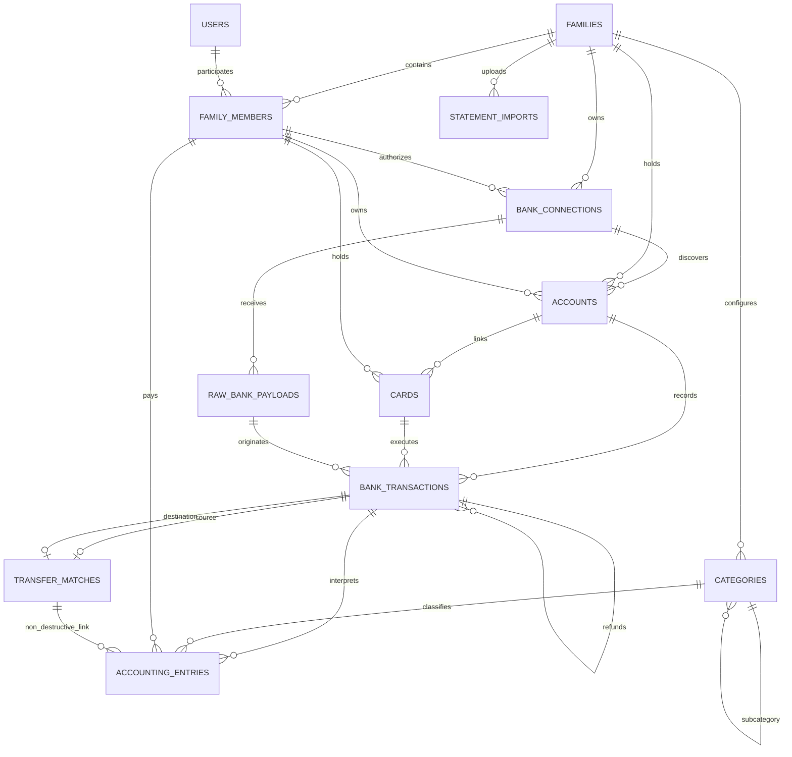

# PostgreSQL Schema & ER Design Specification

## 1. Architectural Principles of the Data Layer

1. **Minimum Supported PostgreSQL Version:** **PostgreSQL 16+** (relies on SQL-standard `ON DELETE SET NULL (column_list)` for composite foreign keys, declarative Row-Level Security with `FORCE ROW LEVEL SECURITY`, and `set_config` transaction scoping).
2. **Two-Layer Ledger (Evidence vs. Interpretation):**
   - **Bank Evidence Layer (`bank_transactions`):** The immutable, authoritative historical record of bank events. Stores bank identifiers (`id`, `operationId`, `authorizationId`), raw descriptions, MCC codes, booking status (`pending`, `posted`, `cancelled`), and cleared timestamps. Bank sync updates never overwrite user categorization, attribution, or notes.
   - **Accounting Interpretation Layer (`accounting_entries`):** The family's categorization, payer attribution, beneficiary allocation, and split entries. Supports 1:N splits of bank transactions. Manual cash operations exist purely in this layer (`bank_transaction_id IS NULL`).
3. **Strict Multi-Tenant Isolation via Composite Foreign Keys:**
   - Every tenant-owned entity has a composite key `UNIQUE (family_id, id)`.
   - Every relationship across tenant entities is enforced using **composite foreign keys** referencing `(family_id, target_id)`.
   - **Tenant Immutability:** `family_id` is strictly immutable on all tenant tables; moving entities across families is rejected by trigger.
   - **Nullable Reference Deletion:** Uses `ON DELETE SET NULL (nullable_column)` so that deleting a referenced card or category NULLs only the target attribute, preserving `family_id NOT NULL`.
   - **User Membership Ownership:** All tenant references to users enforce family membership via composite foreign key referencing `family_members(family_id, user_id)`. A user cannot own or author an entity in Family A unless they are an active member of Family A.
4. **Defense-in-Depth PostgreSQL Row-Level Security (RLS):**
   - `FORCE ROW LEVEL SECURITY` is enabled across all tenant tables so table owners cannot bypass RLS.
   - RLS is explicitly configured with both `USING` and `WITH CHECK` clauses on every tenant-owned table.
   - Transaction-scoped context injection uses parameterized `SELECT set_config('app.current_family_id', $1, true)`. Missing context strictly evaluates to deny-all.
   - **Zero Worker Security Bypass:** Custom GUCs like `app.is_worker` are strictly prohibited as security boundaries. Background workers execute under transaction-scoped `WithFamilyTx(job.family_id)` using a dedicated least-privilege `claim_next_worker_job()` function.
5. **Exact Minor-Unit Monetary Storage:**
   - All money is stored as `BIGINT` minor units (e.g. kopeks/cents). Floating-point numeric types (`FLOAT`, `DOUBLE PRECISION`) are strictly forbidden for currency amounts.

---

## 2. Relational Entity Relationship Diagram



---

## 3. Table Schemas, Constraints & Composite Foreign Keys

### 3.1 Multi-Tenant Identity & Access Management

```sql
CREATE EXTENSION IF NOT EXISTS "uuid-ossp";
CREATE EXTENSION IF NOT EXISTS "pgcrypto";

-- Families: The primary tenant accounting boundary
CREATE TABLE families (
    id UUID PRIMARY KEY DEFAULT gen_random_uuid(),
    name VARCHAR(100) NOT NULL,
    default_currency VARCHAR(3) NOT NULL DEFAULT 'RUB' CHECK (default_currency ~ '^[A-Z]{3}$'),
    created_at TIMESTAMPTZ NOT NULL DEFAULT NOW(),
    updated_at TIMESTAMPTZ NOT NULL DEFAULT NOW(),
    CONSTRAINT uq_families_tenant UNIQUE (id)
);

-- Users: Global identity pool (partners and individuals)
-- Intentional Exception: Global authentication table, not partitioned by family_id.
CREATE TABLE users (
    id UUID PRIMARY KEY DEFAULT gen_random_uuid(),
    email VARCHAR(255) UNIQUE NOT NULL,
    password_hash VARCHAR(255) NOT NULL, -- Argon2id hash
    first_name VARCHAR(100) NOT NULL,
    last_name VARCHAR(100),
    is_active BOOLEAN NOT NULL DEFAULT TRUE,
    created_at TIMESTAMPTZ NOT NULL DEFAULT NOW(),
    updated_at TIMESTAMPTZ NOT NULL DEFAULT NOW()
);

-- Family Members: Association between users and families with specific roles
CREATE TABLE family_members (
    id UUID PRIMARY KEY DEFAULT gen_random_uuid(),
    family_id UUID NOT NULL REFERENCES families(id) ON DELETE CASCADE,
    user_id UUID NOT NULL REFERENCES users(id) ON DELETE CASCADE,
    role VARCHAR(30) NOT NULL DEFAULT 'partner' CHECK (role IN ('owner', 'partner', 'viewer')),
    color_code VARCHAR(7) DEFAULT '#3B82F6',
    created_at TIMESTAMPTZ NOT NULL DEFAULT NOW(),
    updated_at TIMESTAMPTZ NOT NULL DEFAULT NOW(),
    CONSTRAINT uq_family_members_tenant UNIQUE (family_id, id),
    CONSTRAINT uq_family_members_user UNIQUE (family_id, user_id)
);
```

### 3.2 Bank Connections & Raw Data Layer

```sql
CREATE TABLE bank_connections (
    id UUID PRIMARY KEY DEFAULT gen_random_uuid(),
    family_id UUID NOT NULL REFERENCES families(id) ON DELETE CASCADE,
    authorized_by_user_id UUID NOT NULL,
    provider VARCHAR(50) NOT NULL, -- 'tbank_sidecar', 'sber_file', 'manual'
    name VARCHAR(100) NOT NULL,
    status VARCHAR(30) NOT NULL DEFAULT 'pending_pairing' 
        CHECK (status IN ('pending_pairing', 'active', 'expired', 'error', 'disconnected')),
    
    pairing_secret_hash VARCHAR(255),
    pairing_secret_expires_at TIMESTAMPTZ,
    api_key_hash VARCHAR(64),
    api_key_last_used_at TIMESTAMPTZ,
    
    encrypted_credentials BYTEA,
    last_synced_at TIMESTAMPTZ,
    error_message TEXT,
    created_at TIMESTAMPTZ NOT NULL DEFAULT NOW(),
    updated_at TIMESTAMPTZ NOT NULL DEFAULT NOW(),
    CONSTRAINT uq_bank_connections_tenant UNIQUE (family_id, id),
    CONSTRAINT fk_bank_connections_user FOREIGN KEY (family_id, authorized_by_user_id) 
        REFERENCES family_members(family_id, user_id) ON DELETE RESTRICT
);

CREATE INDEX idx_bank_conn_api_key ON bank_connections(api_key_hash) WHERE api_key_hash IS NOT NULL;

-- Raw Bank Payloads: Immutable storage of exact raw external payloads
CREATE TABLE raw_bank_payloads (
    id UUID PRIMARY KEY DEFAULT gen_random_uuid(),
    family_id UUID NOT NULL REFERENCES families(id) ON DELETE CASCADE,
    bank_connection_id UUID,
    source VARCHAR(50) NOT NULL,
    payload_hash VARCHAR(64) NOT NULL,
    raw_json JSONB NOT NULL,
    created_at TIMESTAMPTZ NOT NULL DEFAULT NOW(),
    CONSTRAINT uq_raw_bank_payloads_tenant UNIQUE (family_id, id),
    CONSTRAINT fk_raw_payloads_connection FOREIGN KEY (family_id, bank_connection_id) 
        REFERENCES bank_connections(family_id, id) ON DELETE SET NULL (bank_connection_id)
);

CREATE INDEX idx_raw_payloads_hash ON raw_bank_payloads(family_id, payload_hash);
```

### 3.3 Accounts & Cards Model

```sql
CREATE TABLE accounts (
    id UUID PRIMARY KEY DEFAULT gen_random_uuid(),
    family_id UUID NOT NULL REFERENCES families(id) ON DELETE CASCADE,
    bank_connection_id UUID,
    owner_user_id UUID NOT NULL,
    external_id VARCHAR(100),
    name VARCHAR(100) NOT NULL,
    type VARCHAR(30) NOT NULL CHECK (type IN (
        'checking',     -- Current/checking debit account
        'credit_card',  -- Revolving credit facility
        'savings',      -- Savings account / накопительный счет
        'deposit',      -- Fixed term deposit / вклад
        'cash'          -- Physical cash wallet
    )),
    currency VARCHAR(3) NOT NULL CHECK (currency ~ '^[A-Z]{3}$'),
    
    -- Balance Semantics & Nullability
    -- NULL indicates balance is currently unknown / not yet observed
    current_balance_minor BIGINT,
    available_balance_minor BIGINT,
    debt_balance_minor BIGINT,
    credit_limit_minor BIGINT,
    statement_balance_minor BIGINT,
    minimal_payment_minor BIGINT,
    grace_period_end_date DATE,
    
    balance_updated_at TIMESTAMPTZ,
    balance_source VARCHAR(30) CHECK (balance_source IN ('bank_api', 'statement_file', 'calculated', 'manual_initial')),
    
    is_archived BOOLEAN NOT NULL DEFAULT FALSE,
    created_at TIMESTAMPTZ NOT NULL DEFAULT NOW(),
    updated_at TIMESTAMPTZ NOT NULL DEFAULT NOW(),
    CONSTRAINT uq_accounts_tenant UNIQUE (family_id, id),
    CONSTRAINT uq_accounts_provider_external UNIQUE (family_id, bank_connection_id, external_id),
    CONSTRAINT fk_accounts_connection FOREIGN KEY (family_id, bank_connection_id) 
        REFERENCES bank_connections(family_id, id) ON DELETE SET NULL (bank_connection_id),
    CONSTRAINT fk_accounts_owner FOREIGN KEY (family_id, owner_user_id) 
        REFERENCES family_members(family_id, user_id) ON DELETE RESTRICT
);

CREATE TABLE cards (
    id UUID PRIMARY KEY DEFAULT gen_random_uuid(),
    family_id UUID NOT NULL REFERENCES families(id) ON DELETE CASCADE,
    account_id UUID NOT NULL,
    owner_user_id UUID NOT NULL,
    external_id VARCHAR(100),
    masked_pan VARCHAR(20) NOT NULL,
    display_name VARCHAR(100) NOT NULL,
    payment_system VARCHAR(30) NOT NULL CHECK (payment_system IN ('MIR', 'VISA', 'MASTERCARD', 'OTHER')),
    is_virtual BOOLEAN NOT NULL DEFAULT FALSE,
    is_primary BOOLEAN NOT NULL DEFAULT FALSE,
    status VARCHAR(30) NOT NULL DEFAULT 'ACTIVE' CHECK (status IN ('ACTIVE', 'BLOCKED', 'CLOSED')),
    created_at TIMESTAMPTZ NOT NULL DEFAULT NOW(),
    updated_at TIMESTAMPTZ NOT NULL DEFAULT NOW(),
    CONSTRAINT uq_cards_tenant UNIQUE (family_id, id),
    CONSTRAINT uq_cards_provider_external UNIQUE (family_id, account_id, external_id),
    CONSTRAINT fk_cards_account FOREIGN KEY (family_id, account_id) 
        REFERENCES accounts(family_id, id) ON DELETE CASCADE,
    CONSTRAINT fk_cards_owner FOREIGN KEY (family_id, owner_user_id) 
        REFERENCES family_members(family_id, user_id) ON DELETE RESTRICT
);
```

### 3.4 Bank Evidence Layer: `bank_transactions`

```sql
CREATE TABLE bank_transactions (
    id UUID PRIMARY KEY DEFAULT gen_random_uuid(),
    family_id UUID NOT NULL REFERENCES families(id) ON DELETE CASCADE,
    account_id UUID NOT NULL,
    card_id UUID,
    raw_payload_id UUID,
    
    external_id VARCHAR(128),
    external_auth_id VARCHAR(128),
    fingerprint_hash VARCHAR(64) NOT NULL,
    fingerprint_sequence INT NOT NULL DEFAULT 1,
    
    amount_minor BIGINT NOT NULL,
    currency VARCHAR(3) NOT NULL CHECK (currency ~ '^[A-Z]{3}$'),
    account_amount_minor BIGINT NOT NULL,
    account_currency VARCHAR(3) NOT NULL CHECK (account_currency ~ '^[A-Z]{3}$'),
    
    booking_status VARCHAR(30) NOT NULL DEFAULT 'posted' CHECK (booking_status IN (
        'pending',   -- Authorization / Hold
        'posted',    -- Cleared / Settled on bank balance
        'cancelled'  -- Hold dropped, expired, or voided
    )),
    
    operation_type VARCHAR(30) NOT NULL DEFAULT 'purchase' CHECK (operation_type IN (
        'purchase',
        'refund',           -- Merchant return / chargeback
        'transfer_out',     -- Outgoing transfer (SBP, c2c, wire)
        'transfer_in',      -- Incoming transfer
        'atm_cash',         -- Cash withdrawal or ATM deposit
        'fee',              -- Bank service fee, SMS fee, interest charge
        'card_check'        -- Zero-amount card verification
    )),
    
    related_bank_transaction_id UUID,
    transaction_time TIMESTAMPTZ NOT NULL,
    posted_time TIMESTAMPTZ,
    
    merchant_name VARCHAR(255),
    raw_description TEXT NOT NULL,
    mcc INT,
    bank_category VARCHAR(100),
    
    created_at TIMESTAMPTZ NOT NULL DEFAULT NOW(),
    updated_at TIMESTAMPTZ NOT NULL DEFAULT NOW(),
    
    CONSTRAINT uq_bank_transactions_tenant UNIQUE (family_id, id),
    CONSTRAINT uq_bank_tx_external_id UNIQUE (family_id, account_id, external_id),
    CONSTRAINT uq_bank_tx_fingerprint UNIQUE (family_id, account_id, fingerprint_hash, fingerprint_sequence),
    
    CONSTRAINT fk_bank_tx_account FOREIGN KEY (family_id, account_id) 
        REFERENCES accounts(family_id, id) ON DELETE CASCADE,
    CONSTRAINT fk_bank_tx_card FOREIGN KEY (family_id, card_id) 
        REFERENCES cards(family_id, id) ON DELETE SET NULL (card_id),
    CONSTRAINT fk_bank_tx_raw_payload FOREIGN KEY (family_id, raw_payload_id) 
        REFERENCES raw_bank_payloads(family_id, id) ON DELETE SET NULL (raw_payload_id),
    CONSTRAINT fk_bank_tx_related FOREIGN KEY (family_id, related_bank_transaction_id) 
        REFERENCES bank_transactions(family_id, id) ON DELETE SET NULL (related_bank_transaction_id),
        
    CONSTRAINT chk_bank_tx_amount CHECK (amount_minor != 0 OR operation_type = 'card_check')
);

CREATE INDEX idx_bank_tx_time ON bank_transactions(family_id, transaction_time DESC);
CREATE INDEX idx_bank_tx_auth_id ON bank_transactions(family_id, account_id, external_auth_id) 
    WHERE external_auth_id IS NOT NULL AND booking_status = 'pending';
```

### 3.5 Transfer Matches & Symmetric Rejection Tables

```sql
CREATE TABLE transfer_matches (
    id UUID PRIMARY KEY DEFAULT gen_random_uuid(),
    family_id UUID NOT NULL REFERENCES families(id) ON DELETE CASCADE,
    source_bank_transaction_id UUID NOT NULL,
    destination_bank_transaction_id UUID NOT NULL,
    
    match_type VARCHAR(30) NOT NULL CHECK (match_type IN ('exact', 'probable', 'manual')),
    confidence_score NUMERIC(5, 2) NOT NULL CHECK (confidence_score >= 0 AND confidence_score <= 100),
    
    status VARCHAR(30) NOT NULL DEFAULT 'suggested' CHECK (status IN (
        'auto_confirmed', -- Tier 1 automatic match
        'confirmed',      -- Confirmed by user in UI
        'rejected',       -- Rejected by user
        'suggested'       -- Awaiting user review
    )),
    
    fee_minor BIGINT NOT NULL DEFAULT 0,
    is_credit_card_repayment BOOLEAN NOT NULL DEFAULT FALSE,
    
    matched_by_user_id UUID,
    matched_at TIMESTAMPTZ NOT NULL DEFAULT NOW(),
    created_at TIMESTAMPTZ NOT NULL DEFAULT NOW(),
    updated_at TIMESTAMPTZ NOT NULL DEFAULT NOW(),
    
    CONSTRAINT uq_transfer_matches_tenant UNIQUE (family_id, id),
    CONSTRAINT chk_different_tx CHECK (source_bank_transaction_id != destination_bank_transaction_id),
    
    CONSTRAINT fk_transfer_source FOREIGN KEY (family_id, source_bank_transaction_id) 
        REFERENCES bank_transactions(family_id, id) ON DELETE CASCADE,
    CONSTRAINT fk_transfer_dest FOREIGN KEY (family_id, destination_bank_transaction_id) 
        REFERENCES bank_transactions(family_id, id) ON DELETE CASCADE,
    CONSTRAINT fk_transfer_matched_by FOREIGN KEY (family_id, matched_by_user_id) 
        REFERENCES family_members(family_id, user_id) ON DELETE SET NULL (matched_by_user_id)
);

CREATE UNIQUE INDEX uq_transfer_source_active ON transfer_matches(family_id, source_bank_transaction_id) 
    WHERE status IN ('auto_confirmed', 'confirmed', 'suggested');

CREATE UNIQUE INDEX uq_transfer_dest_active ON transfer_matches(family_id, destination_bank_transaction_id) 
    WHERE status IN ('auto_confirmed', 'confirmed', 'suggested');

-- Transfer Rejections: Remembers rejected pairs with canonical symmetric ordering
CREATE TABLE transfer_rejections (
    id UUID PRIMARY KEY DEFAULT gen_random_uuid(),
    family_id UUID NOT NULL REFERENCES families(id) ON DELETE CASCADE,
    source_bank_transaction_id UUID NOT NULL,
    destination_bank_transaction_id UUID NOT NULL,
    rejected_by_user_id UUID NOT NULL,
    reason VARCHAR(500),
    rejected_at TIMESTAMPTZ NOT NULL DEFAULT NOW(),
    CONSTRAINT uq_transfer_rejections_tenant UNIQUE (family_id, id),
    CONSTRAINT chk_rejection_different_tx CHECK (source_bank_transaction_id != destination_bank_transaction_id),
    CONSTRAINT fk_rejections_source FOREIGN KEY (family_id, source_bank_transaction_id) 
        REFERENCES bank_transactions(family_id, id) ON DELETE CASCADE,
    CONSTRAINT fk_rejections_dest FOREIGN KEY (family_id, destination_bank_transaction_id) 
        REFERENCES bank_transactions(family_id, id) ON DELETE CASCADE,
    CONSTRAINT fk_rejections_user FOREIGN KEY (family_id, rejected_by_user_id) 
        REFERENCES family_members(family_id, user_id) ON DELETE CASCADE
);

-- Symmetric Unique Index: Rejecting A -> B automatically blocks proposing B -> A
CREATE UNIQUE INDEX uq_transfer_rejections_symmetric ON transfer_rejections (
    family_id,
    LEAST(source_bank_transaction_id, destination_bank_transaction_id),
    GREATEST(source_bank_transaction_id, destination_bank_transaction_id)
);
```

### 3.6 Accounting Interpretation Layer: `accounting_entries`

```sql
CREATE TABLE categories (
    id UUID PRIMARY KEY DEFAULT gen_random_uuid(),
    family_id UUID NOT NULL REFERENCES families(id) ON DELETE CASCADE,
    parent_id UUID,
    name VARCHAR(100) NOT NULL,
    type VARCHAR(30) NOT NULL CHECK (type IN ('expense', 'income', 'transfer')),
    icon VARCHAR(50),
    color VARCHAR(7),
    is_system BOOLEAN NOT NULL DEFAULT FALSE,
    created_at TIMESTAMPTZ NOT NULL DEFAULT NOW(),
    updated_at TIMESTAMPTZ NOT NULL DEFAULT NOW(),
    CONSTRAINT uq_categories_tenant UNIQUE (family_id, id),
    CONSTRAINT uq_categories_name UNIQUE (family_id, parent_id, name),
    CONSTRAINT fk_categories_parent FOREIGN KEY (family_id, parent_id) 
        REFERENCES categories(family_id, id) ON DELETE CASCADE
);

CREATE TABLE accounting_entries (
    id UUID PRIMARY KEY DEFAULT gen_random_uuid(),
    family_id UUID NOT NULL REFERENCES families(id) ON DELETE CASCADE,
    bank_transaction_id UUID, -- NULL for manual cash expenses
    account_id UUID NOT NULL,
    category_id UUID,
    
    -- Non-Destructive Transfer Pairing Link
    transfer_match_id UUID,
    
    amount_minor BIGINT NOT NULL,
    currency VARCHAR(3) NOT NULL CHECK (currency ~ '^[A-Z]{3}$'),
    
    classification VARCHAR(30) NOT NULL DEFAULT 'expense' CHECK (classification IN (
        'expense',          -- Real family consumption
        'income',           -- Real family earnings
        'transfer',         -- Manual internal transfer
        'debt_repayment',   -- Manual credit card repayment
        'excluded'          -- Non-family flow (reimbursement, pass-through)
    )),
    
    payer_user_id UUID,
    beneficiary_type VARCHAR(30) NOT NULL DEFAULT 'household' CHECK (beneficiary_type IN (
        'household',    -- Shared family expense
        'partner_a',    -- Personal expense Partner A
        'partner_b',    -- Personal expense Partner B
        'child',        -- Child expense
        'other'         -- Third-party
    )),
    
    entry_time TIMESTAMPTZ NOT NULL,
    user_comment TEXT,
    is_split BOOLEAN NOT NULL DEFAULT FALSE,
    is_manual BOOLEAN NOT NULL DEFAULT FALSE,
    
    created_at TIMESTAMPTZ NOT NULL DEFAULT NOW(),
    updated_at TIMESTAMPTZ NOT NULL DEFAULT NOW(),
    
    CONSTRAINT uq_accounting_entries_tenant UNIQUE (family_id, id),
    CONSTRAINT fk_entries_bank_tx FOREIGN KEY (family_id, bank_transaction_id) 
        REFERENCES bank_transactions(family_id, id) ON DELETE CASCADE,
    CONSTRAINT fk_entries_account FOREIGN KEY (family_id, account_id) 
        REFERENCES accounts(family_id, id) ON DELETE CASCADE,
    CONSTRAINT fk_entries_category FOREIGN KEY (family_id, category_id) 
        REFERENCES categories(family_id, id) ON DELETE SET NULL (category_id),
    CONSTRAINT fk_entries_transfer_match FOREIGN KEY (family_id, transfer_match_id) 
        REFERENCES transfer_matches(family_id, id) ON DELETE SET NULL (transfer_match_id),
    CONSTRAINT fk_entries_payer FOREIGN KEY (family_id, payer_user_id) 
        REFERENCES family_members(family_id, user_id) ON DELETE SET NULL (payer_user_id)
);

CREATE INDEX idx_entries_family_time ON accounting_entries(family_id, entry_time DESC);
CREATE INDEX idx_entries_category ON accounting_entries(family_id, category_id);
CREATE INDEX idx_entries_classification ON accounting_entries(family_id, classification);
CREATE INDEX idx_entries_bank_tx ON accounting_entries(family_id, bank_transaction_id);

CREATE TABLE categorization_rules (
    id UUID PRIMARY KEY DEFAULT gen_random_uuid(),
    family_id UUID NOT NULL REFERENCES families(id) ON DELETE CASCADE,
    created_by_user_id UUID NOT NULL,
    category_id UUID NOT NULL,
    priority INT NOT NULL DEFAULT 100,
    rule_type VARCHAR(30) NOT NULL CHECK (rule_type IN (
        'merchant_name_exact',
        'merchant_name_contains',
        'mcc_code',
        'description_regex',
        'amount_range'
    )),
    match_value VARCHAR(255) NOT NULL,
    min_amount_minor BIGINT,
    max_amount_minor BIGINT,
    currency VARCHAR(3),
    created_at TIMESTAMPTZ NOT NULL DEFAULT NOW(),
    updated_at TIMESTAMPTZ NOT NULL DEFAULT NOW(),
    CONSTRAINT uq_categorization_rules_tenant UNIQUE (family_id, id),
    CONSTRAINT fk_rules_category FOREIGN KEY (family_id, category_id) 
        REFERENCES categories(family_id, id) ON DELETE CASCADE,
    CONSTRAINT fk_rules_creator FOREIGN KEY (family_id, created_by_user_id) 
        REFERENCES family_members(family_id, user_id) ON DELETE CASCADE
);

CREATE INDEX idx_rules_family_priority ON categorization_rules(family_id, priority ASC);
```

### 3.7 Statement Imports, Audit Logging & Worker Jobs

```sql
CREATE TABLE statement_imports (
    id UUID PRIMARY KEY DEFAULT gen_random_uuid(),
    family_id UUID NOT NULL REFERENCES families(id) ON DELETE CASCADE,
    account_id UUID NOT NULL,
    uploaded_by_user_id UUID NOT NULL,
    file_name VARCHAR(255) NOT NULL,
    file_size_bytes BIGINT NOT NULL,
    file_sha256 VARCHAR(64) NOT NULL,
    status VARCHAR(30) NOT NULL DEFAULT 'pending' CHECK (status IN ('pending', 'processing', 'completed', 'failed')),
    records_total INT NOT NULL DEFAULT 0,
    records_imported INT NOT NULL DEFAULT 0,
    records_skipped_duplicate INT NOT NULL DEFAULT 0,
    error_summary TEXT,
    created_at TIMESTAMPTZ NOT NULL DEFAULT NOW(),
    updated_at TIMESTAMPTZ NOT NULL DEFAULT NOW(),
    CONSTRAINT uq_statement_imports_tenant UNIQUE (family_id, id),
    CONSTRAINT fk_imports_account FOREIGN KEY (family_id, account_id) 
        REFERENCES accounts(family_id, id) ON DELETE CASCADE,
    CONSTRAINT fk_imports_uploader FOREIGN KEY (family_id, uploaded_by_user_id) 
        REFERENCES family_members(family_id, user_id) ON DELETE RESTRICT
);

-- Audit Logs: Non-repudiation log
-- Intentional Exception: user_id references global users(id) ON DELETE SET NULL,
-- ensuring audit history remains readable even if a user is later removed from family_members.
CREATE TABLE audit_logs (
    id UUID PRIMARY KEY DEFAULT gen_random_uuid(),
    family_id UUID NOT NULL REFERENCES families(id) ON DELETE CASCADE,
    user_id UUID REFERENCES users(id) ON DELETE SET NULL,
    entity_type VARCHAR(50) NOT NULL,
    entity_id UUID NOT NULL,
    action VARCHAR(50) NOT NULL,
    old_values JSONB,
    new_values JSONB,
    ip_address INET,
    user_agent TEXT,
    created_at TIMESTAMPTZ NOT NULL DEFAULT NOW(),
    CONSTRAINT uq_audit_logs_tenant UNIQUE (family_id, id)
);

CREATE INDEX idx_audit_family_entity ON audit_logs(family_id, entity_type, entity_id);

-- Worker Jobs: Strictly tenant-scoped background task queue (family_id NOT NULL)
CREATE TABLE worker_jobs (
    id UUID PRIMARY KEY DEFAULT gen_random_uuid(),
    family_id UUID NOT NULL REFERENCES families(id) ON DELETE CASCADE,
    queue_name VARCHAR(50) NOT NULL DEFAULT 'default',
    job_type VARCHAR(100) NOT NULL,
    payload JSONB NOT NULL,
    state VARCHAR(30) NOT NULL DEFAULT 'available' CHECK (state IN ('available', 'running', 'completed', 'failed', 'discarded')),
    locked_by VARCHAR(100),
    locked_until TIMESTAMPTZ,
    attempts INT NOT NULL DEFAULT 0,
    max_attempts INT NOT NULL DEFAULT 5,
    last_error TEXT,
    scheduled_at TIMESTAMPTZ NOT NULL DEFAULT NOW(),
    created_at TIMESTAMPTZ NOT NULL DEFAULT NOW(),
    updated_at TIMESTAMPTZ NOT NULL DEFAULT NOW(),
    CONSTRAINT uq_worker_jobs_tenant UNIQUE (family_id, id)
);

CREATE INDEX idx_worker_jobs_fetch ON worker_jobs(queue_name, state, scheduled_at) 
    WHERE state = 'available';

CREATE INDEX idx_worker_jobs_locked ON worker_jobs(queue_name, state, locked_until)
    WHERE state = 'running';
```

---

## 4. Tenant Immutability & Trigger Integrity Enforcements

### 4.1 Tenant Immutability Enforcement & Audit Matrix

Moving any tenant-owned row from Family A to Family B is strictly prohibited across all tenant-partitioned entities:

```sql
CREATE OR REPLACE FUNCTION trg_enforce_tenant_immutability()
RETURNS TRIGGER AS $$
BEGIN
    IF OLD.family_id IS DISTINCT FROM NEW.family_id THEN
        RAISE EXCEPTION 'Tenant immutability violation: modifying family_id from % to % is strictly forbidden on %', 
            OLD.family_id, NEW.family_id, TG_TABLE_NAME;
    END IF;
    RETURN NEW;
END;
$$ LANGUAGE plpgsql;

-- Comprehensive trigger coverage across all 14 tenant-owned tables:
CREATE TRIGGER trg_immutability_family_members BEFORE UPDATE OF family_id ON family_members FOR EACH ROW EXECUTE FUNCTION trg_enforce_tenant_immutability();
CREATE TRIGGER trg_immutability_bank_connections BEFORE UPDATE OF family_id ON bank_connections FOR EACH ROW EXECUTE FUNCTION trg_enforce_tenant_immutability();
CREATE TRIGGER trg_immutability_raw_bank_payloads BEFORE UPDATE OF family_id ON raw_bank_payloads FOR EACH ROW EXECUTE FUNCTION trg_enforce_tenant_immutability();
CREATE TRIGGER trg_immutability_accounts BEFORE UPDATE OF family_id ON accounts FOR EACH ROW EXECUTE FUNCTION trg_enforce_tenant_immutability();
CREATE TRIGGER trg_immutability_cards BEFORE UPDATE OF family_id ON cards FOR EACH ROW EXECUTE FUNCTION trg_enforce_tenant_immutability();
CREATE TRIGGER trg_immutability_bank_transactions BEFORE UPDATE OF family_id ON bank_transactions FOR EACH ROW EXECUTE FUNCTION trg_enforce_tenant_immutability();
CREATE TRIGGER trg_immutability_transfer_matches BEFORE UPDATE OF family_id ON transfer_matches FOR EACH ROW EXECUTE FUNCTION trg_enforce_tenant_immutability();
CREATE TRIGGER trg_immutability_transfer_rejections BEFORE UPDATE OF family_id ON transfer_rejections FOR EACH ROW EXECUTE FUNCTION trg_enforce_tenant_immutability();
CREATE TRIGGER trg_immutability_categories BEFORE UPDATE OF family_id ON categories FOR EACH ROW EXECUTE FUNCTION trg_enforce_tenant_immutability();
CREATE TRIGGER trg_immutability_accounting_entries BEFORE UPDATE OF family_id ON accounting_entries FOR EACH ROW EXECUTE FUNCTION trg_enforce_tenant_immutability();
CREATE TRIGGER trg_immutability_categorization_rules BEFORE UPDATE OF family_id ON categorization_rules FOR EACH ROW EXECUTE FUNCTION trg_enforce_tenant_immutability();
CREATE TRIGGER trg_immutability_statement_imports BEFORE UPDATE OF family_id ON statement_imports FOR EACH ROW EXECUTE FUNCTION trg_enforce_tenant_immutability();
CREATE TRIGGER trg_immutability_audit_logs BEFORE UPDATE OF family_id ON audit_logs FOR EACH ROW EXECUTE FUNCTION trg_enforce_tenant_immutability();
CREATE TRIGGER trg_immutability_worker_jobs BEFORE UPDATE OF family_id ON worker_jobs FOR EACH ROW EXECUTE FUNCTION trg_enforce_tenant_immutability();
```

#### Complete Tenant Table Immutability Audit Matrix

| Table Name | Contains `family_id` | Immutability Trigger Attached | Status / Policy |
| :--- | :--- | :--- | :--- |
| `families` | No (PK `id`) | N/A | Global boundary entity; `id` is primary key. |
| `users` | No (PK `id`) | N/A | Global auth identity pool; not partitioned by `family_id`. |
| `family_members` | Yes | `trg_immutability_family_members` | **Enforced**. User cannot be moved; new membership requires distinct row. |
| `bank_connections` | Yes | `trg_immutability_bank_connections` | **Enforced**. Bank tokens and credentials bound permanently to family. |
| `raw_bank_payloads` | Yes | `trg_immutability_raw_bank_payloads` | **Enforced**. Audit bank payload evidence immutable. |
| `accounts` | Yes | `trg_immutability_accounts` | **Enforced**. Financial accounts cannot cross family boundaries. |
| `cards` | Yes | `trg_immutability_cards` | **Enforced**. Linked cards bound permanently to family account. |
| `bank_transactions` | Yes | `trg_immutability_bank_transactions` | **Enforced**. Bank evidence layer strictly immutable. |
| `transfer_matches` | Yes | `trg_immutability_transfer_matches` | **Enforced**. Internal transfers bound to single family. |
| `transfer_rejections` | Yes | `trg_immutability_transfer_rejections` | **Enforced**. Rejection memory bound to single family. |
| `categories` | Yes | `trg_immutability_categories` | **Enforced**. Category trees cannot be transferred across families. |
| `accounting_entries` | Yes | `trg_immutability_accounting_entries` | **Enforced**. Accounting interpretation entries bound to family. |
| `categorization_rules` | Yes | `trg_immutability_categorization_rules` | **Enforced**. Categorization rules bound to family. |
| `statement_imports` | Yes | `trg_immutability_statement_imports` | **Enforced**. Import batches cannot change family owner. |
| `audit_logs` | Yes | `trg_immutability_audit_logs` | **Enforced**. Append-only compliance log strictly immutable. |
| `worker_jobs` | Yes | `trg_immutability_worker_jobs` | **Enforced**. Queue tasks cannot be reassigned across families. |
```

### 4.2 Complete Deferred Split Constraint Triggers

```sql
CREATE OR REPLACE FUNCTION validate_bank_transaction_split_integrity(p_family_id UUID, p_bank_tx_id UUID)
RETURNS VOID AS $$
DECLARE
    v_expected_amount BIGINT;
    v_actual_sum BIGINT;
    v_count INT;
    v_has_unsplit BOOLEAN;
    v_has_split BOOLEAN;
BEGIN
    IF p_bank_tx_id IS NULL THEN
        RETURN;
    END IF;

    -- Fetch bank transaction cleared amount. If deleted in same transaction, exit cleanly (cascading delete).
    SELECT account_amount_minor INTO v_expected_amount
    FROM bank_transactions
    WHERE id = p_bank_tx_id AND family_id = p_family_id;

    IF NOT FOUND THEN
        RETURN;
    END IF;

    -- Aggregate current accounting entries
    SELECT 
        COUNT(*),
        COALESCE(SUM(amount_minor), 0),
        BOOL_OR(is_split = FALSE),
        BOOL_OR(is_split = TRUE)
    INTO v_count, v_actual_sum, v_has_unsplit, v_has_split
    FROM accounting_entries
    WHERE bank_transaction_id = p_bank_tx_id AND family_id = p_family_id;

    -- Invariant 1: Bank transaction must not commit without at least 1 accounting entry
    IF v_count = 0 THEN
        RAISE EXCEPTION 'Integrity violation: bank transaction % has 0 accounting entries', p_bank_tx_id;
    END IF;

    -- Invariant 2: Unsplit transaction (count = 1) must have is_split = FALSE and amount equal to cleared amount
    IF v_count = 1 THEN
        IF v_has_split = TRUE OR v_has_unsplit = FALSE THEN
            RAISE EXCEPTION 'Integrity violation: single accounting entry for bank transaction % must have is_split = FALSE', p_bank_tx_id;
        END IF;
        IF v_actual_sum != v_expected_amount THEN
            RAISE EXCEPTION 'Integrity violation: unsplit entry amount (%) != bank transaction amount (%) for tx %', 
                v_actual_sum, v_expected_amount, p_bank_tx_id;
        END IF;
    ELSE
        -- Invariant 3: Split transaction (count >= 2) must have every entry is_split = TRUE and sum equal to cleared amount
        IF v_has_unsplit = TRUE THEN
            RAISE EXCEPTION 'Integrity violation: split bank transaction % contains entries with is_split = FALSE', p_bank_tx_id;
        END IF;
        IF v_actual_sum != v_expected_amount THEN
            RAISE EXCEPTION 'Integrity violation: split entries sum (%) != bank transaction amount (%) for tx %', 
                v_actual_sum, v_expected_amount, p_bank_tx_id;
        END IF;
    END IF;
END;
$$ LANGUAGE plpgsql;

-- Trigger Function on accounting_entries: Handles INSERT, UPDATE, DELETE, and Reassignment
CREATE OR REPLACE FUNCTION trg_accounting_entries_split_validator()
RETURNS TRIGGER AS $$
BEGIN
    IF TG_OP = 'DELETE' THEN
        PERFORM validate_bank_transaction_split_integrity(OLD.family_id, OLD.bank_transaction_id);
        RETURN OLD;
    ELSIF TG_OP = 'UPDATE' THEN
        -- If reassigned to a different parent or family, validate both OLD and NEW
        IF (OLD.family_id, OLD.bank_transaction_id) IS DISTINCT FROM (NEW.family_id, NEW.bank_transaction_id) THEN
            PERFORM validate_bank_transaction_split_integrity(OLD.family_id, OLD.bank_transaction_id);
        END IF;
        PERFORM validate_bank_transaction_split_integrity(NEW.family_id, NEW.bank_transaction_id);
        RETURN NEW;
    ELSE -- INSERT
        PERFORM validate_bank_transaction_split_integrity(NEW.family_id, NEW.bank_transaction_id);
        RETURN NEW;
    END IF;
END;
$$ LANGUAGE plpgsql;

CREATE CONSTRAINT TRIGGER trg_split_sum_entries_deferred
AFTER INSERT OR UPDATE OR DELETE ON accounting_entries
DEFERRABLE INITIALLY DEFERRED
FOR EACH ROW EXECUTE FUNCTION trg_accounting_entries_split_validator();

-- Trigger Function on bank_transactions: Validates on INSERT (cannot commit without entries) and amount updates
CREATE OR REPLACE FUNCTION trg_bank_tx_split_validator()
RETURNS TRIGGER AS $$
BEGIN
    PERFORM validate_bank_transaction_split_integrity(NEW.family_id, NEW.id);
    RETURN NEW;
END;
$$ LANGUAGE plpgsql;

CREATE CONSTRAINT TRIGGER trg_bank_tx_split_integrity_deferred
AFTER INSERT OR UPDATE OF account_amount_minor ON bank_transactions
DEFERRABLE INITIALLY DEFERRED
FOR EACH ROW EXECUTE FUNCTION trg_bank_tx_split_validator();
```

### 4.3 Transfer Match Ownership Enforcement Trigger

Ensures that every linked accounting entry strictly belongs to either the source or destination bank transaction of the referenced match:

```sql
CREATE OR REPLACE FUNCTION trg_validate_accounting_entry_transfer_match()
RETURNS TRIGGER AS $$
DECLARE
    v_valid BOOLEAN;
BEGIN
    IF NEW.transfer_match_id IS NOT NULL THEN
        SELECT EXISTS (
            SELECT 1 FROM transfer_matches tm
            WHERE tm.id = NEW.transfer_match_id
              AND tm.family_id = NEW.family_id
              AND (tm.source_bank_transaction_id = NEW.bank_transaction_id 
                   OR tm.destination_bank_transaction_id = NEW.bank_transaction_id)
        ) INTO v_valid;

        IF NOT v_valid THEN
            RAISE EXCEPTION 'Transfer match ownership violation: accounting entry % (bank_tx %) does not belong to transfer match %',
                NEW.id, NEW.bank_transaction_id, NEW.transfer_match_id;
        END IF;
    END IF;
    RETURN NEW;
END;
$$ LANGUAGE plpgsql;

CREATE CONSTRAINT TRIGGER trg_accounting_entry_transfer_match_deferred
AFTER INSERT OR UPDATE OF transfer_match_id, bank_transaction_id ON accounting_entries
DEFERRABLE INITIALLY DEFERRED
FOR EACH ROW EXECUTE FUNCTION trg_validate_accounting_entry_transfer_match();
```

### 4.4 Transfer Match Endpoint Immutability Trigger

Guarantees that once a transfer match is created, its `source_bank_transaction_id` and `destination_bank_transaction_id` endpoints can never be altered. In tandem with `trg_accounting_entry_transfer_match_deferred`, this ensures an existing linked accounting entry can never become unrelated or orphaned from its match:

```sql
CREATE OR REPLACE FUNCTION trg_enforce_transfer_match_endpoints_immutability()
RETURNS TRIGGER AS $$
BEGIN
    IF OLD.source_bank_transaction_id IS DISTINCT FROM NEW.source_bank_transaction_id OR
       OLD.destination_bank_transaction_id IS DISTINCT FROM NEW.destination_bank_transaction_id THEN
        RAISE EXCEPTION 'Transfer match endpoints are immutable: cannot modify source (%) or destination (%) on match %',
            OLD.source_bank_transaction_id, OLD.destination_bank_transaction_id, OLD.id;
    END IF;
    RETURN NEW;
END;
$$ LANGUAGE plpgsql;

CREATE TRIGGER trg_immutability_transfer_endpoints
BEFORE UPDATE OF source_bank_transaction_id, destination_bank_transaction_id ON transfer_matches
FOR EACH ROW EXECUTE FUNCTION trg_enforce_transfer_match_endpoints_immutability();
```

---

## 5. Row-Level Security: Secure Tenant Isolation

### 5.1 PostgreSQL Role Model & Least-Privilege Separation

To strictly enforce multi-tenant isolation, prevent RLS recursion, and maintain defense-in-depth under `FORCE ROW LEVEL SECURITY`, the data layer defines five distinct database roles:

1. **`family_admin` (DDL Schema Owner):** Role used solely by migration tools (`golang-migrate`). Owns tables and schema; does not run application queries.
2. **`family_app` (Application Runtime):** Connection pool role used by the Go API monolith (`cmd/api`). Has `LOGIN`. Can execute tenant CRUD queries governed by RLS.
3. **`family_worker` (Worker Runtime):** Connection pool role used by the background worker daemon (`cmd/worker`). Has `LOGIN`. Executes `claim_next_worker_job()` and executes tenant tasks within `WithFamilyTx(job.family_id)`.
4. **`family_queue_definer` (Queue Definer Role):** Internal `NOLOGIN` role. Solely owns `claim_next_worker_job()`. Granted `SELECT` and `UPDATE` on `public.worker_jobs` only; has **zero permissions on any financial or ledger tables**.
5. **`family_auth_definer` (Auth Discovery Role):** Internal `NOLOGIN` role. Solely owns `get_current_user_family_ids()`. Granted `SELECT (family_id, user_id)` on `public.family_members` and `SELECT (id, is_active)` on `public.users` only; has **zero permissions on any financial, ledger, or queue tables**.

```sql
-- Role Provisioning (DDL)
CREATE ROLE family_admin;
CREATE ROLE family_app LOGIN PASSWORD 'app_secret_placeholder';
CREATE ROLE family_worker LOGIN PASSWORD 'worker_secret_placeholder';
CREATE ROLE family_queue_definer NOLOGIN;
CREATE ROLE family_auth_definer NOLOGIN;

-- Schema Permissions
GRANT USAGE ON SCHEMA public TO family_app, family_worker, family_queue_definer, family_auth_definer;

-- family_queue_definer: Least-privilege access restricted strictly to worker_jobs
GRANT SELECT, UPDATE ON public.worker_jobs TO family_queue_definer;

-- family_auth_definer: Least-privilege access restricted strictly to membership discovery columns
GRANT SELECT (family_id, user_id) ON public.family_members TO family_auth_definer;
GRANT SELECT (id, is_active) ON public.users TO family_auth_definer;

-- family_app and family_worker standard table grants (governed by RLS)
GRANT ALL ON ALL TABLES IN SCHEMA public TO family_app, family_worker;
```

> [!IMPORTANT]
> **Authentication Trust Boundary Clarification:**
> In this three-tier architecture, custom GUC settings (`app.current_user_id`, `app.current_family_id`) represent **trusted application context** transmitted across an authenticated connection pool role (`family_app`, `family_worker`) after server-side cryptographic JWT / session validation. PostgreSQL does not independently verify JWT signatures; PostgreSQL enforces tenant row-level security and foreign key invariants assuming the application server correctly authenticates the client and binds the context via `SELECT set_config(..., true)`.

---

### 5.2 Membership Helper & Anti-Enumeration Defense (`get_current_user_family_ids`)

When an authenticated user connects without an active family context (e.g. at login or `/auth/me`), the application needs to discover which family spaces that user belongs to.

To prevent RLS recursion under `FORCE ROW LEVEL SECURITY` and completely eliminate the vulnerability where a caller could pass an arbitrary user ID to enumerate other users' families:
1. The function accepts **zero parameters** and reads `app.current_user_id` directly.
2. The function executes as `SECURITY DEFINER` owned by `family_auth_definer`.
3. Table `family_members` defines a dedicated RLS policy for `family_auth_definer` comparing `user_id = NULLIF(current_setting('app.current_user_id', true), '')::UUID`. This check is direct and **causes zero recursion**.

```sql
CREATE OR REPLACE FUNCTION public.get_current_user_family_ids()
RETURNS SETOF UUID
LANGUAGE sql
SECURITY DEFINER
SET search_path = pg_catalog, public, pg_temp
STABLE
AS $$
    SELECT fm.family_id 
    FROM public.family_members fm
    JOIN public.users u ON u.id = fm.user_id
    WHERE fm.user_id = NULLIF(current_setting('app.current_user_id', true), '')::UUID
      AND u.is_active = TRUE;
$$;

ALTER FUNCTION public.get_current_user_family_ids() OWNER TO family_auth_definer;
REVOKE ALL ON FUNCTION public.get_current_user_family_ids() FROM PUBLIC;
GRANT EXECUTE ON FUNCTION public.get_current_user_family_ids() TO family_app, family_worker;
```

---

### 5.3 Atomic Worker Job Claiming Model (`claim_next_worker_job`)

To allow background workers to claim jobs across multiple families without requiring a global `BYPASSRLS` role or client-settable GUC bypass:
1. The function executes as `SECURITY DEFINER` owned by `family_queue_definer`.
2. Dedicated RLS policies on `worker_jobs` grant `family_queue_definer` permission to inspect and update jobs across all tenants (`USING (true)`).
3. The function uses `FOR UPDATE SKIP LOCKED` to prevent concurrency collisions.
4. It claims available jobs and automatically reclaims stalled jobs where `state = 'running' AND locked_until < NOW()`.
5. Once claimed, the function returns `(job_id, family_id, job_type, payload)` to `family_worker`. The worker process then initiates job processing strictly inside `WithFamilyTx(job.family_id)`!

```sql
CREATE OR REPLACE FUNCTION public.claim_next_worker_job(
    p_queue_name VARCHAR(50),
    p_worker_id VARCHAR(100),
    p_lock_duration_seconds INT DEFAULT 600
)
RETURNS TABLE (
    job_id UUID,
    family_id UUID,
    job_type VARCHAR(100),
    payload JSONB
)
LANGUAGE plpgsql
SECURITY DEFINER
SET search_path = pg_catalog, public, pg_temp
AS $$
DECLARE
    v_job RECORD;
BEGIN
    SELECT wj.id, wj.family_id, wj.job_type, wj.payload
    INTO v_job
    FROM public.worker_jobs wj
    WHERE wj.queue_name = p_queue_name
      AND (
          wj.state = 'available' 
          OR (wj.state = 'running' AND wj.locked_until < NOW())
      )
      AND wj.scheduled_at <= NOW()
    ORDER BY wj.scheduled_at ASC
    FOR UPDATE OF wj SKIP LOCKED
    LIMIT 1;

    IF v_job.id IS NOT NULL THEN
        UPDATE public.worker_jobs
        SET state = 'running',
            locked_by = p_worker_id,
            locked_until = NOW() + (p_lock_duration_seconds || ' seconds')::INTERVAL,
            attempts = attempts + 1,
            updated_at = NOW()
        WHERE id = v_job.id;

        RETURN QUERY SELECT v_job.id, v_job.family_id, v_job.job_type, v_job.payload;
    END IF;
END;
$$;

ALTER FUNCTION public.claim_next_worker_job(VARCHAR, VARCHAR, INT) OWNER TO family_queue_definer;
REVOKE ALL ON FUNCTION public.claim_next_worker_job(VARCHAR, VARCHAR, INT) FROM PUBLIC;
GRANT EXECUTE ON FUNCTION public.claim_next_worker_job(VARCHAR, VARCHAR, INT) TO family_worker;
```

---

### 5.4 Table RLS Policies with `FORCE ROW LEVEL SECURITY`

```sql
CREATE OR REPLACE FUNCTION get_current_family_id() RETURNS UUID AS $$
    SELECT NULLIF(current_setting('app.current_family_id', true), '')::UUID;
$$ LANGUAGE SQL STABLE;

-- Force RLS on all tenant tables (table owners cannot bypass)
ALTER TABLE families ENABLE ROW LEVEL SECURITY;
ALTER TABLE families FORCE ROW LEVEL SECURITY;
ALTER TABLE family_members ENABLE ROW LEVEL SECURITY;
ALTER TABLE family_members FORCE ROW LEVEL SECURITY;
ALTER TABLE bank_connections ENABLE ROW LEVEL SECURITY;
ALTER TABLE bank_connections FORCE ROW LEVEL SECURITY;
ALTER TABLE accounts ENABLE ROW LEVEL SECURITY;
ALTER TABLE accounts FORCE ROW LEVEL SECURITY;
ALTER TABLE cards ENABLE ROW LEVEL SECURITY;
ALTER TABLE cards FORCE ROW LEVEL SECURITY;
ALTER TABLE bank_transactions ENABLE ROW LEVEL SECURITY;
ALTER TABLE bank_transactions FORCE ROW LEVEL SECURITY;
ALTER TABLE accounting_entries ENABLE ROW LEVEL SECURITY;
ALTER TABLE accounting_entries FORCE ROW LEVEL SECURITY;
ALTER TABLE categories ENABLE ROW LEVEL SECURITY;
ALTER TABLE categories FORCE ROW LEVEL SECURITY;
ALTER TABLE categorization_rules ENABLE ROW LEVEL SECURITY;
ALTER TABLE categorization_rules FORCE ROW LEVEL SECURITY;
ALTER TABLE transfer_matches ENABLE ROW LEVEL SECURITY;
ALTER TABLE transfer_matches FORCE ROW LEVEL SECURITY;
ALTER TABLE transfer_rejections ENABLE ROW LEVEL SECURITY;
ALTER TABLE transfer_rejections FORCE ROW LEVEL SECURITY;
ALTER TABLE raw_bank_payloads ENABLE ROW LEVEL SECURITY;
ALTER TABLE raw_bank_payloads FORCE ROW LEVEL SECURITY;
ALTER TABLE statement_imports ENABLE ROW LEVEL SECURITY;
ALTER TABLE statement_imports FORCE ROW LEVEL SECURITY;
ALTER TABLE audit_logs ENABLE ROW LEVEL SECURITY;
ALTER TABLE audit_logs FORCE ROW LEVEL SECURITY;
ALTER TABLE worker_jobs ENABLE ROW LEVEL SECURITY;
ALTER TABLE worker_jobs FORCE ROW LEVEL SECURITY;

-- 1. families: member visibility
CREATE POLICY rls_families_select ON public.families
    FOR SELECT TO family_app, family_worker
    USING (
        id = get_current_family_id()
        OR id IN (SELECT public.get_current_user_family_ids())
    );

CREATE POLICY rls_families_update ON public.families
    FOR UPDATE TO family_app, family_worker
    USING (id = get_current_family_id()) 
    WITH CHECK (id = get_current_family_id());

-- 2. family_members: discovery policy for family_auth_definer (no recursion)
CREATE POLICY rls_family_members_auth_definer ON public.family_members
    FOR SELECT TO family_auth_definer
    USING (user_id = NULLIF(current_setting('app.current_user_id', true), '')::UUID);

-- family_members: standard policy for application and worker
CREATE POLICY rls_family_members_select ON public.family_members
    FOR SELECT TO family_app, family_worker
    USING (
        family_id = get_current_family_id()
        OR family_id IN (SELECT public.get_current_user_family_ids())
    );

CREATE POLICY rls_family_members_mod ON public.family_members
    FOR ALL TO family_app, family_worker
    USING (family_id = get_current_family_id()) 
    WITH CHECK (family_id = get_current_family_id());

-- 3. worker_jobs: cross-tenant claiming for family_queue_definer
CREATE POLICY rls_worker_jobs_claim_select ON public.worker_jobs
    FOR SELECT TO family_queue_definer
    USING (true);

CREATE POLICY rls_worker_jobs_claim_update ON public.worker_jobs
    FOR UPDATE TO family_queue_definer
    USING (true)
    WITH CHECK (true);

-- worker_jobs: tenant isolation for application and worker
CREATE POLICY rls_worker_jobs_tenant ON public.worker_jobs
    FOR ALL TO family_app, family_worker
    USING (family_id = get_current_family_id()) 
    WITH CHECK (family_id = get_current_family_id());

-- 4. Standard tenant isolation policies for business entities (USING & WITH CHECK)
CREATE POLICY rls_bank_connections_all ON public.bank_connections
    FOR ALL TO family_app, family_worker
    USING (family_id = get_current_family_id()) WITH CHECK (family_id = get_current_family_id());

CREATE POLICY rls_accounts_all ON public.accounts
    FOR ALL TO family_app, family_worker
    USING (family_id = get_current_family_id()) WITH CHECK (family_id = get_current_family_id());

CREATE POLICY rls_cards_all ON public.cards
    FOR ALL TO family_app, family_worker
    USING (family_id = get_current_family_id()) WITH CHECK (family_id = get_current_family_id());

CREATE POLICY rls_bank_transactions_all ON public.bank_transactions
    FOR ALL TO family_app, family_worker
    USING (family_id = get_current_family_id()) WITH CHECK (family_id = get_current_family_id());

CREATE POLICY rls_accounting_entries_all ON public.accounting_entries
    FOR ALL TO family_app, family_worker
    USING (family_id = get_current_family_id()) WITH CHECK (family_id = get_current_family_id());

CREATE POLICY rls_categories_all ON public.categories
    FOR ALL TO family_app, family_worker
    USING (family_id = get_current_family_id()) WITH CHECK (family_id = get_current_family_id());

CREATE POLICY rls_categorization_rules_all ON public.categorization_rules
    FOR ALL TO family_app, family_worker
    USING (family_id = get_current_family_id()) WITH CHECK (family_id = get_current_family_id());

CREATE POLICY rls_transfer_matches_all ON public.transfer_matches
    FOR ALL TO family_app, family_worker
    USING (family_id = get_current_family_id()) WITH CHECK (family_id = get_current_family_id());

CREATE POLICY rls_transfer_rejections_all ON public.transfer_rejections
    FOR ALL TO family_app, family_worker
    USING (family_id = get_current_family_id()) WITH CHECK (family_id = get_current_family_id());

CREATE POLICY rls_raw_bank_payloads_all ON public.raw_bank_payloads
    FOR ALL TO family_app, family_worker
    USING (family_id = get_current_family_id()) WITH CHECK (family_id = get_current_family_id());

CREATE POLICY rls_statement_imports_all ON public.statement_imports
    FOR ALL TO family_app, family_worker
    USING (family_id = get_current_family_id()) WITH CHECK (family_id = get_current_family_id());

CREATE POLICY rls_audit_logs_all ON public.audit_logs
    FOR ALL TO family_app, family_worker
    USING (family_id = get_current_family_id()) WITH CHECK (family_id = get_current_family_id());
```
```

---

## 6. Analytical Views: Non-Destructive Transfer Representation

```sql
-- View: Real Family Consumption (True Expenses)
CREATE OR REPLACE VIEW v_family_real_expenses AS
SELECT 
    e.id AS entry_id,
    e.family_id,
    e.account_id,
    a.name AS account_name,
    a.type AS account_type,
    e.payer_user_id,
    u.first_name AS payer_name,
    e.beneficiary_type,
    e.entry_time,
    e.amount_minor,
    e.currency,
    e.category_id,
    c.name AS category_name,
    c.parent_id AS parent_category_id,
    bt.merchant_name,
    bt.raw_description
FROM accounting_entries e
JOIN accounts a ON e.account_id = a.id
LEFT JOIN bank_transactions bt ON e.bank_transaction_id = bt.id
LEFT JOIN family_members fm ON e.payer_user_id = fm.user_id AND e.family_id = fm.family_id
LEFT JOIN users u ON fm.user_id = u.id
LEFT JOIN categories c ON e.category_id = c.id
LEFT JOIN transfer_matches tm ON e.transfer_match_id = tm.id
WHERE e.classification = 'expense'
  AND (tm.id IS NULL OR tm.status NOT IN ('auto_confirmed', 'confirmed'))
  AND (bt.booking_status IS NULL OR bt.booking_status = 'posted');

-- View: Net Worth & Debt Position (Point in Time)
CREATE OR REPLACE VIEW v_family_balance_summary AS
SELECT 
    family_id,
    currency,
    SUM(CASE WHEN type IN ('checking', 'savings', 'deposit', 'cash') THEN COALESCE(current_balance_minor, 0) ELSE 0 END) AS total_assets_minor,
    SUM(CASE WHEN type = 'credit_card' THEN COALESCE(debt_balance_minor, 0) ELSE 0 END) AS total_debt_minor,
    SUM(CASE WHEN type IN ('checking', 'savings', 'deposit', 'cash') THEN COALESCE(current_balance_minor, 0) ELSE -COALESCE(debt_balance_minor, 0) END) AS net_worth_minor
FROM accounts
WHERE is_archived = FALSE
GROUP BY family_id, currency;
```
