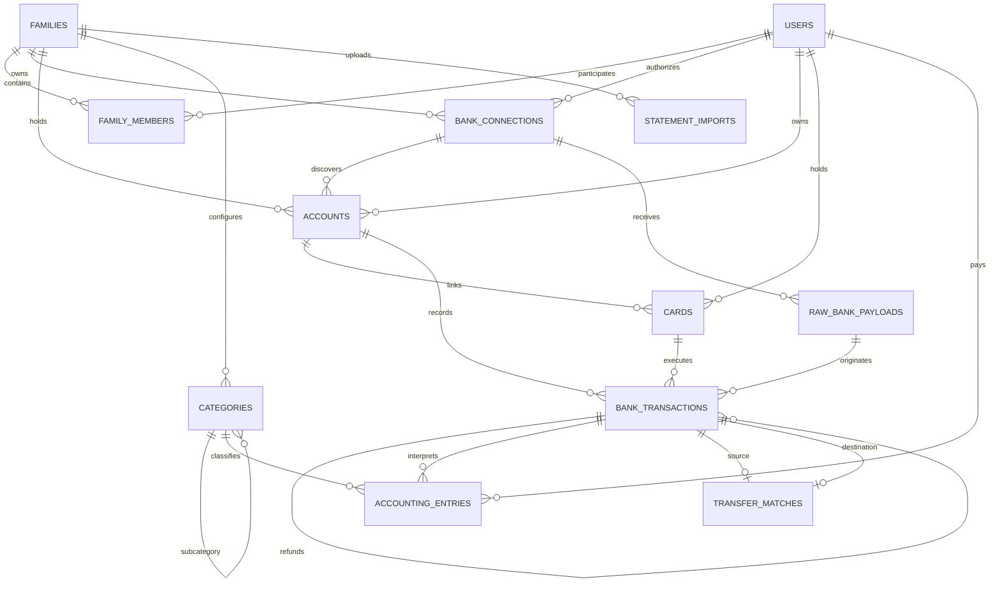

# PostgreSQL Schema & ER Design Specification

## 1. Architectural Principles of the Data Layer

1. **Two-Layer Ledger (Evidence vs. Interpretation):**
   - **Bank Evidence Layer (`bank_transactions`):** The immutable, authoritative historical record of bank events. Stores bank identifiers (`id`, `operationId`, `authorizationId`), raw descriptions, MCC codes, booking status (`pending`, `posted`, `cancelled`), and cleared timestamps. Bank sync updates never overwrite user categorization, attribution, or notes.
   - **Accounting Interpretation Layer (`accounting_entries`):** The family's categorization, payer attribution, beneficiary allocation, and split entries. Supports 1:N splits of bank transactions. Manual cash operations exist purely in this layer (`bank_transaction_id IS NULL`).
2. **Strict Multi-Tenant Isolation via Composite Foreign Keys:**
   - Every tenant-owned entity has a composite key `UNIQUE (family_id, id)`.
   - Every relationship between tenant-owned entities is enforced using **composite foreign keys** referencing `(family_id, target_id)`. It is physically impossible at the database level for an entity in Family A to reference an account, card, category, transaction, or rule belonging to Family B.
3. **Defense-in-Depth PostgreSQL Row-Level Security (RLS):**
   - RLS is explicitly configured with both `USING` and `WITH CHECK` clauses on every tenant-owned table.
   - `SET LOCAL app.current_family_id = '...'` is executed inside every transaction. If missing, RLS defaults to deny-all.
4. **Exact Minor-Unit Monetary Storage:**
   - All money is stored as `BIGINT` minor units (e.g. kopeks/cents). Floating-point numeric types (`FLOAT`, `DOUBLE PRECISION`) are strictly forbidden for currency amounts.

---

## 2. Relational Entity Relationship Diagram



---

## 3. Table Schemas, Constraints & Composite Foreign Keys

### 3.1 Multi-Tenant Identity & Access Management

```sql
CREATE EXTENSION IF NOT EXISTS "uuid-ossp";
CREATE EXTENSION IF NOT EXISTS "pgcrypto";

-- Families: The primary tenant accounting boundary
CREATE TABLE families (
    id UUID PRIMARY KEY DEFAULT gen_random_uuid(),
    name VARCHAR(100) NOT NULL,
    default_currency VARCHAR(3) NOT NULL DEFAULT 'RUB' CHECK (default_currency ~ '^[A-Z]{3}$'),
    created_at TIMESTAMPTZ NOT NULL DEFAULT NOW(),
    updated_at TIMESTAMPTZ NOT NULL DEFAULT NOW(),
    CONSTRAINT uq_families_tenant UNIQUE (id)
);

-- Users: Global identity pool (partners and individuals)
-- Intentional Exception: Global table, not partitioned by family_id.
CREATE TABLE users (
    id UUID PRIMARY KEY DEFAULT gen_random_uuid(),
    email VARCHAR(255) UNIQUE NOT NULL,
    password_hash VARCHAR(255) NOT NULL, -- Argon2id hash
    first_name VARCHAR(100) NOT NULL,
    last_name VARCHAR(100),
    is_active BOOLEAN NOT NULL DEFAULT TRUE,
    created_at TIMESTAMPTZ NOT NULL DEFAULT NOW(),
    updated_at TIMESTAMPTZ NOT NULL DEFAULT NOW()
);

-- Family Members: Association between users and families with specific roles
CREATE TABLE family_members (
    id UUID PRIMARY KEY DEFAULT gen_random_uuid(),
    family_id UUID NOT NULL REFERENCES families(id) ON DELETE CASCADE,
    user_id UUID NOT NULL REFERENCES users(id) ON DELETE CASCADE,
    role VARCHAR(30) NOT NULL DEFAULT 'partner' CHECK (role IN ('owner', 'partner', 'viewer')),
    color_code VARCHAR(7) DEFAULT '#3B82F6',
    created_at TIMESTAMPTZ NOT NULL DEFAULT NOW(),
    updated_at TIMESTAMPTZ NOT NULL DEFAULT NOW(),
    CONSTRAINT uq_family_members_tenant UNIQUE (family_id, id),
    CONSTRAINT uq_family_members_user UNIQUE (family_id, user_id)
);
```

### 3.2 Bank Connections & Raw Data Layer

```sql
CREATE TABLE bank_connections (
    id UUID PRIMARY KEY DEFAULT gen_random_uuid(),
    family_id UUID NOT NULL REFERENCES families(id) ON DELETE CASCADE,
    authorized_by_user_id UUID NOT NULL REFERENCES users(id) ON DELETE RESTRICT,
    provider VARCHAR(50) NOT NULL, -- 'tbank_sidecar', 'sber_file', 'manual'
    name VARCHAR(100) NOT NULL,
    status VARCHAR(30) NOT NULL DEFAULT 'pending_pairing' 
        CHECK (status IN ('pending_pairing', 'active', 'expired', 'error', 'disconnected')),
    
    -- Sidecar Security & Authentication
    pairing_secret_hash VARCHAR(255), -- Argon2id hash of single-use pairing secret
    pairing_secret_expires_at TIMESTAMPTZ,
    api_key_hash VARCHAR(64),         -- SHA-256 hash of active sidecar connection API key
    api_key_last_used_at TIMESTAMPTZ,
    
    encrypted_credentials BYTEA,      -- AES-256-GCM envelope (versioned: v1:nonce:tag:ciphertext)
    last_synced_at TIMESTAMPTZ,
    error_message TEXT,
    created_at TIMESTAMPTZ NOT NULL DEFAULT NOW(),
    updated_at TIMESTAMPTZ NOT NULL DEFAULT NOW(),
    CONSTRAINT uq_bank_connections_tenant UNIQUE (family_id, id)
);

CREATE INDEX idx_bank_conn_api_key ON bank_connections(api_key_hash) WHERE api_key_hash IS NOT NULL;

-- Raw Bank Payloads: Immutable storage of exact raw external payloads
CREATE TABLE raw_bank_payloads (
    id UUID PRIMARY KEY DEFAULT gen_random_uuid(),
    family_id UUID NOT NULL REFERENCES families(id) ON DELETE CASCADE,
    bank_connection_id UUID,
    source VARCHAR(50) NOT NULL, -- 'tbank_timeline_api', 'tbank_csv', 'sber_xlsx'
    payload_hash VARCHAR(64) NOT NULL, -- SHA-256 of raw_json
    raw_json JSONB NOT NULL,
    created_at TIMESTAMPTZ NOT NULL DEFAULT NOW(),
    CONSTRAINT uq_raw_bank_payloads_tenant UNIQUE (family_id, id),
    -- Composite foreign key enforces family isolation
    CONSTRAINT fk_raw_payloads_connection FOREIGN KEY (family_id, bank_connection_id) 
        REFERENCES bank_connections(family_id, id) ON DELETE SET NULL
);

CREATE INDEX idx_raw_payloads_hash ON raw_bank_payloads(family_id, payload_hash);
```

### 3.3 Accounts & Cards Model

```sql
CREATE TABLE accounts (
    id UUID PRIMARY KEY DEFAULT gen_random_uuid(),
    family_id UUID NOT NULL REFERENCES families(id) ON DELETE CASCADE,
    bank_connection_id UUID,
    owner_user_id UUID NOT NULL REFERENCES users(id) ON DELETE RESTRICT,
    external_id VARCHAR(100), -- Bank provider's account ID
    name VARCHAR(100) NOT NULL,
    type VARCHAR(30) NOT NULL CHECK (type IN (
        'checking',     -- Current/checking debit account
        'credit_card',  -- Revolving credit facility
        'savings',      -- Savings account / накопительный счет
        'deposit',      -- Fixed term deposit / вклад
        'cash'          -- Physical cash wallet
    )),
    currency VARCHAR(3) NOT NULL CHECK (currency ~ '^[A-Z]{3}$'),
    
    -- Balance Semantics (Minor Units, e.g. kopeks/cents)
    -- current_balance: Settled ledger cash (provided by bank or sum of settled operations)
    current_balance_minor BIGINT NOT NULL DEFAULT 0,
    -- available_balance: Spendable funds as reported by the bank
    available_balance_minor BIGINT,
    
    -- Credit Card Specific Semantics
    debt_balance_minor BIGINT DEFAULT 0,    -- Utilized debt on credit card (posted purchases - repayments)
    credit_limit_minor BIGINT DEFAULT 0,    -- Total credit line approved by bank
    statement_balance_minor BIGINT DEFAULT 0,-- Billed debt from last monthly statement
    minimal_payment_minor BIGINT DEFAULT 0, -- Mandatory minimum payment due
    grace_period_end_date DATE,             -- Due date to avoid interest
    
    is_archived BOOLEAN NOT NULL DEFAULT FALSE,
    created_at TIMESTAMPTZ NOT NULL DEFAULT NOW(),
    updated_at TIMESTAMPTZ NOT NULL DEFAULT NOW(),
    CONSTRAINT uq_accounts_tenant UNIQUE (family_id, id),
    CONSTRAINT uq_accounts_provider_external UNIQUE (family_id, bank_connection_id, external_id),
    -- Composite foreign key enforces family isolation
    CONSTRAINT fk_accounts_connection FOREIGN KEY (family_id, bank_connection_id) 
        REFERENCES bank_connections(family_id, id) ON DELETE SET NULL
);

CREATE TABLE cards (
    id UUID PRIMARY KEY DEFAULT gen_random_uuid(),
    family_id UUID NOT NULL REFERENCES families(id) ON DELETE CASCADE,
    account_id UUID NOT NULL,
    owner_user_id UUID NOT NULL REFERENCES users(id) ON DELETE RESTRICT,
    external_id VARCHAR(100),
    masked_pan VARCHAR(20) NOT NULL, -- Strictly masked, e.g., '*4589'
    display_name VARCHAR(100) NOT NULL,
    payment_system VARCHAR(30) NOT NULL CHECK (payment_system IN ('MIR', 'VISA', 'MASTERCARD', 'OTHER')),
    is_virtual BOOLEAN NOT NULL DEFAULT FALSE,
    is_primary BOOLEAN NOT NULL DEFAULT FALSE,
    status VARCHAR(30) NOT NULL DEFAULT 'ACTIVE' CHECK (status IN ('ACTIVE', 'BLOCKED', 'CLOSED')),
    created_at TIMESTAMPTZ NOT NULL DEFAULT NOW(),
    updated_at TIMESTAMPTZ NOT NULL DEFAULT NOW(),
    CONSTRAINT uq_cards_tenant UNIQUE (family_id, id),
    CONSTRAINT uq_cards_provider_external UNIQUE (family_id, account_id, external_id),
    -- Composite foreign key guarantees card belongs to an account in the SAME family
    CONSTRAINT fk_cards_account FOREIGN KEY (family_id, account_id) 
        REFERENCES accounts(family_id, id) ON DELETE CASCADE
);
```

### 3.4 Bank Evidence Layer: `bank_transactions`

```sql
CREATE TABLE bank_transactions (
    id UUID PRIMARY KEY DEFAULT gen_random_uuid(),
    family_id UUID NOT NULL REFERENCES families(id) ON DELETE CASCADE,
    account_id UUID NOT NULL,
    card_id UUID,
    raw_payload_id UUID,
    
    -- Identification & Non-Interchangeable Bank Keys
    external_id VARCHAR(128),     -- Bank operation ID (e.g. T-Bank operationId / id)
    external_auth_id VARCHAR(128),-- Authorization hold ID (card network authorizationCode)
    fingerprint_hash VARCHAR(64) NOT NULL,
    fingerprint_sequence INT NOT NULL DEFAULT 1,
    
    -- Monetary Values (Strict Minor Units)
    amount_minor BIGINT NOT NULL,
    currency VARCHAR(3) NOT NULL CHECK (currency ~ '^[A-Z]{3}$'),
    account_amount_minor BIGINT NOT NULL,
    account_currency VARCHAR(3) NOT NULL CHECK (account_currency ~ '^[A-Z]{3}$'),
    
    -- Lifecycle Tracking
    booking_status VARCHAR(30) NOT NULL DEFAULT 'posted' CHECK (booking_status IN (
        'pending',   -- Authorization / Hold (funds reserved)
        'posted',    -- Cleared / Settled on bank balance
        'cancelled'  -- Hold dropped, expired, or voided
    )),
    
    operation_type VARCHAR(30) NOT NULL DEFAULT 'purchase' CHECK (operation_type IN (
        'purchase',
        'refund',           -- Merchant return / chargeback
        'transfer_out',     -- Outgoing transfer (SBP, c2c, wire)
        'transfer_in',      -- Incoming transfer
        'atm_cash',         -- Cash withdrawal or ATM deposit
        'fee',              -- Bank service fee, SMS fee, interest charge
        'card_check'        -- Zero-amount card verification
    )),
    
    -- Self-referential composite link for refunds and clearing adjustments
    related_bank_transaction_id UUID,
    
    transaction_time TIMESTAMPTZ NOT NULL, -- POS / Authorization timestamp
    posted_time TIMESTAMPTZ,              -- Bank clearing / settlement timestamp
    
    merchant_name VARCHAR(255),
    raw_description TEXT NOT NULL,
    mcc INT,
    bank_category VARCHAR(100),
    
    created_at TIMESTAMPTZ NOT NULL DEFAULT NOW(),
    updated_at TIMESTAMPTZ NOT NULL DEFAULT NOW(),
    
    CONSTRAINT uq_bank_transactions_tenant UNIQUE (family_id, id),
    CONSTRAINT uq_bank_tx_external_id UNIQUE (family_id, account_id, external_id),
    CONSTRAINT uq_bank_tx_fingerprint UNIQUE (family_id, account_id, fingerprint_hash, fingerprint_sequence),
    
    -- Composite Foreign Keys Enforcing Strict Family Isolation
    CONSTRAINT fk_bank_tx_account FOREIGN KEY (family_id, account_id) 
        REFERENCES accounts(family_id, id) ON DELETE CASCADE,
    CONSTRAINT fk_bank_tx_card FOREIGN KEY (family_id, card_id) 
        REFERENCES cards(family_id, id) ON DELETE SET NULL,
    CONSTRAINT fk_bank_tx_raw_payload FOREIGN KEY (family_id, raw_payload_id) 
        REFERENCES raw_bank_payloads(family_id, id) ON DELETE SET NULL,
    CONSTRAINT fk_bank_tx_related FOREIGN KEY (family_id, related_bank_transaction_id) 
        REFERENCES bank_transactions(family_id, id) ON DELETE SET NULL,
        
    -- Check Constraint: 0 amount allowed ONLY for card_check
    CONSTRAINT chk_bank_tx_amount CHECK (amount_minor != 0 OR operation_type = 'card_check')
);

CREATE INDEX idx_bank_tx_time ON bank_transactions(family_id, transaction_time DESC);
CREATE INDEX idx_bank_tx_auth_id ON bank_transactions(family_id, account_id, external_auth_id) 
    WHERE external_auth_id IS NOT NULL AND booking_status = 'pending';
```

### 3.5 Accounting Interpretation Layer: `accounting_entries`

```sql
CREATE TABLE categories (
    id UUID PRIMARY KEY DEFAULT gen_random_uuid(),
    family_id UUID NOT NULL REFERENCES families(id) ON DELETE CASCADE,
    parent_id UUID,
    name VARCHAR(100) NOT NULL,
    type VARCHAR(30) NOT NULL CHECK (type IN ('expense', 'income', 'transfer')),
    icon VARCHAR(50),
    color VARCHAR(7),
    is_system BOOLEAN NOT NULL DEFAULT FALSE,
    created_at TIMESTAMPTZ NOT NULL DEFAULT NOW(),
    updated_at TIMESTAMPTZ NOT NULL DEFAULT NOW(),
    CONSTRAINT uq_categories_tenant UNIQUE (family_id, id),
    CONSTRAINT uq_categories_name UNIQUE (family_id, parent_id, name),
    -- Composite foreign key ensures parent category belongs to SAME family
    CONSTRAINT fk_categories_parent FOREIGN KEY (family_id, parent_id) 
        REFERENCES categories(family_id, id) ON DELETE CASCADE
);

CREATE TABLE accounting_entries (
    id UUID PRIMARY KEY DEFAULT gen_random_uuid(),
    family_id UUID NOT NULL REFERENCES families(id) ON DELETE CASCADE,
    bank_transaction_id UUID, -- NULL for manual cash expenses
    account_id UUID NOT NULL,
    category_id UUID,
    
    -- Monetary Value of this split/entry (in account currency)
    amount_minor BIGINT NOT NULL,
    currency VARCHAR(3) NOT NULL CHECK (currency ~ '^[A-Z]{3}$'),
    
    classification VARCHAR(30) NOT NULL DEFAULT 'expense' CHECK (classification IN (
        'expense',          -- Real family consumption
        'income',           -- Real family earnings
        'transfer',         -- Internal transfer between owned accounts
        'debt_repayment',   -- Paying off credit card debt
        'excluded'          -- Non-family flow (reimbursement, pass-through)
    )),
    
    payer_user_id UUID REFERENCES users(id) ON DELETE SET NULL,
    beneficiary_type VARCHAR(30) NOT NULL DEFAULT 'household' CHECK (beneficiary_type IN (
        'household',    -- Shared family expense
        'partner_a',    -- Personal expense Partner A
        'partner_b',    -- Personal expense Partner B
        'child',        -- Child expense
        'other'         -- Third-party
    )),
    
    entry_time TIMESTAMPTZ NOT NULL,
    user_comment TEXT,
    is_split BOOLEAN NOT NULL DEFAULT FALSE,
    is_manual BOOLEAN NOT NULL DEFAULT FALSE,
    
    created_at TIMESTAMPTZ NOT NULL DEFAULT NOW(),
    updated_at TIMESTAMPTZ NOT NULL DEFAULT NOW(),
    
    CONSTRAINT uq_accounting_entries_tenant UNIQUE (family_id, id),
    
    -- Composite Foreign Keys Enforcing Strict Family Isolation
    CONSTRAINT fk_entries_bank_tx FOREIGN KEY (family_id, bank_transaction_id) 
        REFERENCES bank_transactions(family_id, id) ON DELETE CASCADE,
    CONSTRAINT fk_entries_account FOREIGN KEY (family_id, account_id) 
        REFERENCES accounts(family_id, id) ON DELETE CASCADE,
    CONSTRAINT fk_entries_category FOREIGN KEY (family_id, category_id) 
        REFERENCES categories(family_id, id) ON DELETE SET NULL
);

CREATE INDEX idx_entries_family_time ON accounting_entries(family_id, entry_time DESC);
CREATE INDEX idx_entries_category ON accounting_entries(family_id, category_id);
CREATE INDEX idx_entries_classification ON accounting_entries(family_id, classification);
CREATE INDEX idx_entries_bank_tx ON accounting_entries(family_id, bank_transaction_id);

CREATE TABLE categorization_rules (
    id UUID PRIMARY KEY DEFAULT gen_random_uuid(),
    family_id UUID NOT NULL REFERENCES families(id) ON DELETE CASCADE,
    created_by_user_id UUID NOT NULL REFERENCES users(id) ON DELETE CASCADE,
    category_id UUID NOT NULL,
    priority INT NOT NULL DEFAULT 100,
    rule_type VARCHAR(30) NOT NULL CHECK (rule_type IN (
        'merchant_name_exact',
        'merchant_name_contains',
        'mcc_code',
        'description_regex',
        'amount_range'
    )),
    match_value VARCHAR(255) NOT NULL,
    min_amount_minor BIGINT,
    max_amount_minor BIGINT,
    currency VARCHAR(3),
    created_at TIMESTAMPTZ NOT NULL DEFAULT NOW(),
    updated_at TIMESTAMPTZ NOT NULL DEFAULT NOW(),
    CONSTRAINT uq_categorization_rules_tenant UNIQUE (family_id, id),
    CONSTRAINT fk_rules_category FOREIGN KEY (family_id, category_id) 
        REFERENCES categories(family_id, id) ON DELETE CASCADE
);

CREATE INDEX idx_rules_family_priority ON categorization_rules(family_id, priority ASC);
```

### 3.6 Transfer Matcher & Rejection Tables

```sql
CREATE TABLE transfer_matches (
    id UUID PRIMARY KEY DEFAULT gen_random_uuid(),
    family_id UUID NOT NULL REFERENCES families(id) ON DELETE CASCADE,
    source_bank_transaction_id UUID NOT NULL,
    destination_bank_transaction_id UUID NOT NULL,
    
    match_type VARCHAR(30) NOT NULL CHECK (match_type IN ('exact', 'probable', 'manual')),
    confidence_score NUMERIC(5, 2) NOT NULL CHECK (confidence_score >= 0 AND confidence_score <= 100),
    
    status VARCHAR(30) NOT NULL DEFAULT 'suggested' CHECK (status IN (
        'auto_confirmed', -- Tier 1 automatic match
        'confirmed',      -- Confirmed by user in UI
        'rejected',       -- Rejected by user
        'suggested'       -- Awaiting user review
    )),
    
    fee_minor BIGINT NOT NULL DEFAULT 0,
    is_credit_card_repayment BOOLEAN NOT NULL DEFAULT FALSE,
    
    matched_by_user_id UUID REFERENCES users(id) ON DELETE SET NULL,
    matched_at TIMESTAMPTZ NOT NULL DEFAULT NOW(),
    created_at TIMESTAMPTZ NOT NULL DEFAULT NOW(),
    
    CONSTRAINT uq_transfer_matches_tenant UNIQUE (family_id, id),
    CONSTRAINT chk_different_tx CHECK (source_bank_transaction_id != destination_bank_transaction_id),
    
    -- Composite Foreign Keys Enforcing Strict Family Isolation
    CONSTRAINT fk_transfer_source FOREIGN KEY (family_id, source_bank_transaction_id) 
        REFERENCES bank_transactions(family_id, id) ON DELETE CASCADE,
    CONSTRAINT fk_transfer_dest FOREIGN KEY (family_id, destination_bank_transaction_id) 
        REFERENCES bank_transactions(family_id, id) ON DELETE CASCADE
);

-- Partial Unique Indexes: Prevent active double-matching while unblocking rejected transactions
CREATE UNIQUE INDEX uq_transfer_source_active ON transfer_matches(family_id, source_bank_transaction_id) 
    WHERE status IN ('auto_confirmed', 'confirmed', 'suggested');

CREATE UNIQUE INDEX uq_transfer_dest_active ON transfer_matches(family_id, destination_bank_transaction_id) 
    WHERE status IN ('auto_confirmed', 'confirmed', 'suggested');

CREATE TABLE transfer_rejections (
    id UUID PRIMARY KEY DEFAULT gen_random_uuid(),
    family_id UUID NOT NULL REFERENCES families(id) ON DELETE CASCADE,
    source_bank_transaction_id UUID NOT NULL,
    destination_bank_transaction_id UUID NOT NULL,
    rejected_by_user_id UUID NOT NULL REFERENCES users(id) ON DELETE CASCADE,
    rejected_at TIMESTAMPTZ NOT NULL DEFAULT NOW(),
    CONSTRAINT uq_transfer_rejections_tenant UNIQUE (family_id, id),
    CONSTRAINT uq_transfer_rejection_pair UNIQUE (family_id, source_bank_transaction_id, destination_bank_transaction_id),
    CONSTRAINT fk_rejections_source FOREIGN KEY (family_id, source_bank_transaction_id) 
        REFERENCES bank_transactions(family_id, id) ON DELETE CASCADE,
    CONSTRAINT fk_rejections_dest FOREIGN KEY (family_id, destination_bank_transaction_id) 
        REFERENCES bank_transactions(family_id, id) ON DELETE CASCADE
);
```

### 3.7 Statement Imports, Audit Logging & Async Jobs

```sql
CREATE TABLE statement_imports (
    id UUID PRIMARY KEY DEFAULT gen_random_uuid(),
    family_id UUID NOT NULL REFERENCES families(id) ON DELETE CASCADE,
    account_id UUID NOT NULL,
    uploaded_by_user_id UUID NOT NULL REFERENCES users(id) ON DELETE RESTRICT,
    file_name VARCHAR(255) NOT NULL,
    file_size_bytes BIGINT NOT NULL,
    file_sha256 VARCHAR(64) NOT NULL,
    status VARCHAR(30) NOT NULL DEFAULT 'pending' CHECK (status IN ('pending', 'processing', 'completed', 'failed')),
    records_total INT NOT NULL DEFAULT 0,
    records_imported INT NOT NULL DEFAULT 0,
    records_skipped_duplicate INT NOT NULL DEFAULT 0,
    error_summary TEXT,
    created_at TIMESTAMPTZ NOT NULL DEFAULT NOW(),
    updated_at TIMESTAMPTZ NOT NULL DEFAULT NOW(),
    CONSTRAINT uq_statement_imports_tenant UNIQUE (family_id, id),
    CONSTRAINT fk_imports_account FOREIGN KEY (family_id, account_id) 
        REFERENCES accounts(family_id, id) ON DELETE CASCADE
);

CREATE TABLE audit_logs (
    id UUID PRIMARY KEY DEFAULT gen_random_uuid(),
    family_id UUID NOT NULL REFERENCES families(id) ON DELETE CASCADE,
    user_id UUID REFERENCES users(id) ON DELETE SET NULL,
    entity_type VARCHAR(50) NOT NULL,
    entity_id UUID NOT NULL,
    action VARCHAR(50) NOT NULL,
    old_values JSONB,
    new_values JSONB,
    ip_address INET,
    user_agent TEXT,
    created_at TIMESTAMPTZ NOT NULL DEFAULT NOW(),
    CONSTRAINT uq_audit_logs_tenant UNIQUE (family_id, id)
);

CREATE INDEX idx_audit_family_entity ON audit_logs(family_id, entity_type, entity_id);

CREATE TABLE worker_jobs (
    id UUID PRIMARY KEY DEFAULT gen_random_uuid(),
    family_id UUID REFERENCES families(id) ON DELETE CASCADE, -- NULL for global/system maintenance jobs
    queue_name VARCHAR(50) NOT NULL DEFAULT 'default',
    job_type VARCHAR(100) NOT NULL,
    payload JSONB NOT NULL,
    state VARCHAR(30) NOT NULL DEFAULT 'available' CHECK (state IN ('available', 'running', 'completed', 'failed', 'discarded')),
    attempts INT NOT NULL DEFAULT 0,
    max_attempts INT NOT NULL DEFAULT 5,
    last_error TEXT,
    scheduled_at TIMESTAMPTZ NOT NULL DEFAULT NOW(),
    created_at TIMESTAMPTZ NOT NULL DEFAULT NOW(),
    updated_at TIMESTAMPTZ NOT NULL DEFAULT NOW()
);

CREATE INDEX idx_worker_jobs_fetch ON worker_jobs(queue_name, state, scheduled_at) 
    WHERE state = 'available';
```

---

## 4. Defense-in-Depth: Explicit PostgreSQL Row-Level Security (RLS)

Every tenant table is protected by explicit PostgreSQL RLS policies defining both `USING` and `WITH CHECK` clauses.

### 4.1 Safe Tenant Context Implementation in Go (`pgx/v5`)

> [!CRITICAL]
> **Why `SET LOCAL` Outside a Transaction is Broken:**
> Executing `SET LOCAL` in a connection-acquire hook outside an active transaction block is discarded or defaults to `SET SESSION`, leaking tenant context across pooled connections.
> **Mandatory Rule:** `SET LOCAL` must execute inside the transaction block for every request.

```go
// WithFamilyTx executes fn within an explicit transaction scoped to familyID.
func WithFamilyTx(ctx context.Context, pool *pgxpool.Pool, familyID uuid.UUID, fn func(pgx.Tx) error) error {
    tx, err := pool.Begin(ctx)
    if err != nil {
        return fmt.Errorf("begin tx: %w", err)
    }
    defer tx.Rollback(ctx)

    // SET LOCAL is strictly scoped to this transaction
    _, err = tx.Exec(ctx, "SET LOCAL app.current_family_id = $1", familyID.String())
    if err != nil {
        return fmt.Errorf("set tenant context: %w", err)
    }

    if err := fn(tx); err != nil {
        return err
    }
    return tx.Commit(ctx)
}
```

### 4.2 Explicit Table RLS Policies

```sql
-- Helper function to retrieve authenticated family ID
CREATE OR REPLACE FUNCTION get_current_family_id() RETURNS UUID AS $$
    SELECT NULLIF(current_setting('app.current_family_id', true), '')::UUID;
$$ LANGUAGE SQL STABLE;

-- 1. families: user can only see families they are members of
ALTER TABLE families ENABLE ROW LEVEL SECURITY;
CREATE POLICY rls_families_select ON families
    FOR SELECT USING (
        id IN (SELECT family_id FROM family_members WHERE user_id = NULLIF(current_setting('app.current_user_id', true), '')::UUID)
        OR current_setting('app.is_worker', true) = 'true'
    );
CREATE POLICY rls_families_update ON families
    FOR UPDATE 
    USING (id = get_current_family_id())
    WITH CHECK (id = get_current_family_id());

-- 2. family_members
ALTER TABLE family_members ENABLE ROW LEVEL SECURITY;
CREATE POLICY rls_family_members_all ON family_members
    FOR ALL
    USING (family_id = get_current_family_id() OR current_setting('app.is_worker', true) = 'true')
    WITH CHECK (family_id = get_current_family_id());

-- 3. bank_connections
ALTER TABLE bank_connections ENABLE ROW LEVEL SECURITY;
CREATE POLICY rls_bank_connections_all ON bank_connections
    FOR ALL
    USING (family_id = get_current_family_id() OR current_setting('app.is_worker', true) = 'true')
    WITH CHECK (family_id = get_current_family_id());

-- 4. accounts
ALTER TABLE accounts ENABLE ROW LEVEL SECURITY;
CREATE POLICY rls_accounts_all ON accounts
    FOR ALL
    USING (family_id = get_current_family_id() OR current_setting('app.is_worker', true) = 'true')
    WITH CHECK (family_id = get_current_family_id());

-- 5. cards
ALTER TABLE cards ENABLE ROW LEVEL SECURITY;
CREATE POLICY rls_cards_all ON cards
    FOR ALL
    USING (family_id = get_current_family_id() OR current_setting('app.is_worker', true) = 'true')
    WITH CHECK (family_id = get_current_family_id());

-- 6. bank_transactions
ALTER TABLE bank_transactions ENABLE ROW LEVEL SECURITY;
CREATE POLICY rls_bank_transactions_all ON bank_transactions
    FOR ALL
    USING (family_id = get_current_family_id() OR current_setting('app.is_worker', true) = 'true')
    WITH CHECK (family_id = get_current_family_id());

-- 7. accounting_entries
ALTER TABLE accounting_entries ENABLE ROW LEVEL SECURITY;
CREATE POLICY rls_accounting_entries_all ON accounting_entries
    FOR ALL
    USING (family_id = get_current_family_id() OR current_setting('app.is_worker', true) = 'true')
    WITH CHECK (family_id = get_current_family_id());

-- 8. categories
ALTER TABLE categories ENABLE ROW LEVEL SECURITY;
CREATE POLICY rls_categories_all ON categories
    FOR ALL
    USING (family_id = get_current_family_id() OR current_setting('app.is_worker', true) = 'true')
    WITH CHECK (family_id = get_current_family_id());

-- 9. categorization_rules
ALTER TABLE categorization_rules ENABLE ROW LEVEL SECURITY;
CREATE POLICY rls_categorization_rules_all ON categorization_rules
    FOR ALL
    USING (family_id = get_current_family_id() OR current_setting('app.is_worker', true) = 'true')
    WITH CHECK (family_id = get_current_family_id());

-- 10. transfer_matches
ALTER TABLE transfer_matches ENABLE ROW LEVEL SECURITY;
CREATE POLICY rls_transfer_matches_all ON transfer_matches
    FOR ALL
    USING (family_id = get_current_family_id() OR current_setting('app.is_worker', true) = 'true')
    WITH CHECK (family_id = get_current_family_id());

-- 11. transfer_rejections
ALTER TABLE transfer_rejections ENABLE ROW LEVEL SECURITY;
CREATE POLICY rls_transfer_rejections_all ON transfer_rejections
    FOR ALL
    USING (family_id = get_current_family_id() OR current_setting('app.is_worker', true) = 'true')
    WITH CHECK (family_id = get_current_family_id());

-- 12. raw_bank_payloads
ALTER TABLE raw_bank_payloads ENABLE ROW LEVEL SECURITY;
CREATE POLICY rls_raw_bank_payloads_all ON raw_bank_payloads
    FOR ALL
    USING (family_id = get_current_family_id() OR current_setting('app.is_worker', true) = 'true')
    WITH CHECK (family_id = get_current_family_id());

-- 13. statement_imports
ALTER TABLE statement_imports ENABLE ROW LEVEL SECURITY;
CREATE POLICY rls_statement_imports_all ON statement_imports
    FOR ALL
    USING (family_id = get_current_family_id() OR current_setting('app.is_worker', true) = 'true')
    WITH CHECK (family_id = get_current_family_id());

-- 14. audit_logs
ALTER TABLE audit_logs ENABLE ROW LEVEL SECURITY;
CREATE POLICY rls_audit_logs_all ON audit_logs
    FOR ALL
    USING (family_id = get_current_family_id() OR current_setting('app.is_worker', true) = 'true')
    WITH CHECK (family_id = get_current_family_id());

-- 15. worker_jobs: Accessible by worker or when scoped to family
ALTER TABLE worker_jobs ENABLE ROW LEVEL SECURITY;
CREATE POLICY rls_worker_jobs_worker ON worker_jobs
    FOR ALL
    USING (current_setting('app.is_worker', true) = 'true' OR family_id = get_current_family_id())
    WITH CHECK (current_setting('app.is_worker', true) = 'true' OR family_id = get_current_family_id());
```

### 4.3 Registration & Bootstrap Protocol
During initial registration (`POST /auth/register`), no family context exists yet.
* The registration flow executes inside a transaction invoking a PostgreSQL `SECURITY DEFINER` function `bootstrap_family_and_user(email, password_hash, user_name, family_name, default_currency)`:
  1. Inserts the new row into `users`.
  2. Inserts the new row into `families`.
  3. Inserts the association into `family_members` with `role = 'owner'`.
  4. Seeds default household categories for that new `family_id`.
* The transaction then returns the user and family tokens. Subsequent requests must supply the JWT and execute within standard `WithFamilyTx`.

---

## 5. Split and Clearing Invariants

### 5.1 Operational Split Representation
1. **Unsplit Representation:** Every non-split `bank_transaction` is linked to exactly one `accounting_entry` where:
   - `accounting_entry.bank_transaction_id = bank_transaction.id`
   - `accounting_entry.amount_minor = bank_transaction.account_amount_minor`
   - `accounting_entry.is_split = FALSE`
2. **Transitioning to a Split:**
   - When a user splits a transaction (e.g., 5,000 RUB supermarket receipt into 3,500 RUB groceries and 1,500 RUB pharmacy):
     - The original default entry is marked `is_split = TRUE` (or replaced atomically inside a transaction with $N \ge 2$ child entries).
     - **Mathematical Split Invariant:**
       $$\sum_{i=1}^{N} \text{accounting\_entries}[i].\text{amount\_minor} == \text{bank\_transaction.account\_amount\_minor}$$
3. **Validation Mechanism:**
   - Multi-row sum constraints cannot be enforced by standard column SQL `CHECK` constraints.
   - Enforced by:
     1. **Service-Level Transaction Check:** The application validates `sum(splits) == bank_tx.account_amount_minor` before committing.
     2. **Deferred PostgreSQL Constraint Trigger:**
        ```sql
        CREATE OR REPLACE FUNCTION check_split_entries_sum() RETURNS TRIGGER AS $$
        DECLARE
            v_expected_amount BIGINT;
            v_actual_sum BIGINT;
        BEGIN
            IF NEW.bank_transaction_id IS NOT NULL AND NEW.is_split = TRUE THEN
                SELECT account_amount_minor INTO v_expected_amount 
                FROM bank_transactions WHERE id = NEW.bank_transaction_id;
                
                SELECT COALESCE(SUM(amount_minor), 0) INTO v_actual_sum 
                FROM accounting_entries WHERE bank_transaction_id = NEW.bank_transaction_id;
                
                IF v_expected_amount != v_actual_sum THEN
                    RAISE EXCEPTION 'Split sum (%) does not match bank transaction amount (%)', 
                        v_actual_sum, v_expected_amount;
                END IF;
            END IF;
            RETURN NEW;
        END;
        $$ LANGUAGE plpgsql;

        CREATE CONSTRAINT TRIGGER trg_split_sum_deferred
        AFTER INSERT OR UPDATE OR DELETE ON accounting_entries
        DEFERRABLE INITIALLY DEFERRED
        FOR EACH ROW EXECUTE FUNCTION check_split_entries_sum();
        ```

### 5.2 Settlement Drift Handling (Hold $\rightarrow$ Cleared Difference)
When an authorization hold clears for a different amount (e.g., restaurant tip or FX conversion drift):
* **Unsplit Transactions:** The linked `accounting_entry.amount_minor` is automatically updated to the new `account_amount_minor`.
* **Split Transactions:** The system **preserves user category allocations**. It does not perform arbitrary rounding:
  - An audit record is created.
  - The split difference is placed into an unallocated split line (`is_reconciliation_needed = TRUE`) or flagged for user 1-click confirmation in the UI.

---

## 6. Analytical Views: Separating Cash Flows, True Expenses, and Balances

```sql
-- View: Real Family Consumption (True Expenses)
CREATE OR REPLACE VIEW v_family_real_expenses AS
SELECT 
    e.id AS entry_id,
    e.family_id,
    e.account_id,
    a.name AS account_name,
    a.type AS account_type,
    e.payer_user_id,
    u.first_name AS payer_name,
    e.beneficiary_type,
    e.entry_time,
    e.amount_minor, -- Negative for expenses, positive for refunds
    e.currency,
    e.category_id,
    c.name AS category_name,
    c.parent_id AS parent_category_id,
    bt.merchant_name,
    bt.raw_description
FROM accounting_entries e
JOIN accounts a ON e.account_id = a.id
LEFT JOIN bank_transactions bt ON e.bank_transaction_id = bt.id
LEFT JOIN users u ON e.payer_user_id = u.id
LEFT JOIN categories c ON e.category_id = c.id
WHERE e.classification = 'expense'
  AND (bt.booking_status IS NULL OR bt.booking_status = 'posted');

-- View: Net Worth & Debt Position (Point in Time)
CREATE OR REPLACE VIEW v_family_balance_summary AS
SELECT 
    family_id,
    currency,
    SUM(CASE WHEN type IN ('checking', 'savings', 'deposit', 'cash') THEN current_balance_minor ELSE 0 END) AS total_assets_minor,
    SUM(CASE WHEN type = 'credit_card' THEN debt_balance_minor ELSE 0 END) AS total_debt_minor,
    SUM(CASE WHEN type IN ('checking', 'savings', 'deposit', 'cash') THEN current_balance_minor ELSE -debt_balance_minor END) AS net_worth_minor
FROM accounts
WHERE is_archived = FALSE
GROUP BY family_id, currency;
```
