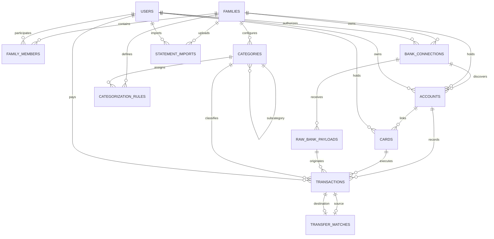

# PostgreSQL Schema & ER Design Specification

## 1. Relational Entity Relationship Diagram



---

## 2. Table Schemas, Constraints & Column Types

### 2.1 Multi-Tenant Identity & Access Management

```sql
-- Extension requirements
CREATE EXTENSION IF NOT EXISTS "uuid-ossp";
CREATE EXTENSION IF NOT EXISTS "pgcrypto";

-- Families: The primary tenant accounting boundary
CREATE TABLE families (
    id UUID PRIMARY KEY DEFAULT gen_random_uuid(),
    name VARCHAR(100) NOT NULL,
    default_currency VARCHAR(3) NOT NULL DEFAULT 'RUB' CHECK (default_currency ~ '^[A-Z]{3}$'),
    created_at TIMESTAMPTZ NOT NULL DEFAULT NOW(),
    updated_at TIMESTAMPTZ NOT NULL DEFAULT NOW()
);

-- Users: Partners and individuals
CREATE TABLE users (
    id UUID PRIMARY KEY DEFAULT gen_random_uuid(),
    email VARCHAR(255) UNIQUE NOT NULL,
    password_hash VARCHAR(255) NOT NULL, -- Argon2id hash
    first_name VARCHAR(100) NOT NULL,
    last_name VARCHAR(100),
    is_active BOOLEAN NOT NULL DEFAULT TRUE,
    created_at TIMESTAMPTZ NOT NULL DEFAULT NOW(),
    updated_at TIMESTAMPTZ NOT NULL DEFAULT NOW()
);

-- Family Members: Association between users and families with specific roles
CREATE TABLE family_members (
    id UUID PRIMARY KEY DEFAULT gen_random_uuid(),
    family_id UUID NOT NULL REFERENCES families(id) ON DELETE CASCADE,
    user_id UUID NOT NULL REFERENCES users(id) ON DELETE CASCADE,
    role VARCHAR(30) NOT NULL DEFAULT 'partner' CHECK (role IN ('owner', 'partner', 'viewer')),
    color_code VARCHAR(7) DEFAULT '#3B82F6', -- Hex color for UI attribution
    created_at TIMESTAMPTZ NOT NULL DEFAULT NOW(),
    updated_at TIMESTAMPTZ NOT NULL DEFAULT NOW(),
    UNIQUE(family_id, user_id)
);
```

### 2.2 Bank Connections & Raw Data Layer

```sql
-- Bank Connections: Integrations with banking providers or statement import slots
CREATE TABLE bank_connections (
    id UUID PRIMARY KEY DEFAULT gen_random_uuid(),
    family_id UUID NOT NULL REFERENCES families(id) ON DELETE CASCADE,
    authorized_by_user_id UUID NOT NULL REFERENCES users(id) ON DELETE RESTRICT,
    provider VARCHAR(50) NOT NULL, -- 'tbank_capture', 'tbank_api', 'sber_file', 'manual'
    name VARCHAR(100) NOT NULL,
    status VARCHAR(30) NOT NULL DEFAULT 'active' CHECK (status IN ('active', 'expired', 'error', 'disconnected')),
    encrypted_credentials BYTEA, -- AES-256-GCM encrypted token/sidecar pairing key
    last_synced_at TIMESTAMPTZ,
    error_message TEXT,
    created_at TIMESTAMPTZ NOT NULL DEFAULT NOW(),
    updated_at TIMESTAMPTZ NOT NULL DEFAULT NOW()
);

-- Raw Bank Payloads: Immutable storage of exact raw external payloads
CREATE TABLE raw_bank_payloads (
    id UUID PRIMARY KEY DEFAULT gen_random_uuid(),
    family_id UUID NOT NULL REFERENCES families(id) ON DELETE CASCADE,
    bank_connection_id UUID REFERENCES bank_connections(id) ON DELETE SET NULL,
    source VARCHAR(50) NOT NULL, -- 'tbank_operations_api', 'tbank_csv', etc.
    payload_hash VARCHAR(64) NOT NULL, -- SHA-256 of raw_json
    raw_json JSONB NOT NULL,
    created_at TIMESTAMPTZ NOT NULL DEFAULT NOW()
);

CREATE INDEX idx_raw_payloads_hash ON raw_bank_payloads(family_id, payload_hash);
```

### 2.3 Accounts & Cards Model

```sql
-- Accounts: The true financial balances / money pools
CREATE TABLE accounts (
    id UUID PRIMARY KEY DEFAULT gen_random_uuid(),
    family_id UUID NOT NULL REFERENCES families(id) ON DELETE CASCADE,
    bank_connection_id UUID REFERENCES bank_connections(id) ON DELETE SET NULL,
    owner_user_id UUID NOT NULL REFERENCES users(id) ON DELETE RESTRICT,
    external_id VARCHAR(100), -- Bank provider's account ID
    name VARCHAR(100) NOT NULL,
    type VARCHAR(30) NOT NULL CHECK (type IN (
        'checking',     -- Current/checking debit account
        'credit_card',  -- Revolving credit facility
        'savings',      -- Savings account / накопительный счет
        'deposit',      -- Fixed term deposit / вклад
        'cash'          -- Physical cash wallet
    )),
    currency VARCHAR(3) NOT NULL CHECK (currency ~ '^[A-Z]{3}$'),
    current_balance_minor BIGINT NOT NULL DEFAULT 0, -- Minor units: e.g. 10000 = 100.00 RUB
    available_balance_minor BIGINT,                  -- Balance including overdraft/credit
    debt_balance_minor BIGINT DEFAULT 0,             -- For credit cards: current outstanding debt
    credit_limit_minor BIGINT DEFAULT 0,             -- For credit cards: approved limit
    minimal_payment_minor BIGINT DEFAULT 0,          -- Next required payment
    grace_period_end_date DATE,                      -- End of interest-free period
    is_archived BOOLEAN NOT NULL DEFAULT FALSE,
    created_at TIMESTAMPTZ NOT NULL DEFAULT NOW(),
    updated_at TIMESTAMPTZ NOT NULL DEFAULT NOW(),
    UNIQUE(family_id, bank_connection_id, external_id)
);

-- Cards: Access instruments linked to underlying bank accounts
CREATE TABLE cards (
    id UUID PRIMARY KEY DEFAULT gen_random_uuid(),
    family_id UUID NOT NULL REFERENCES families(id) ON DELETE CASCADE,
    account_id UUID NOT NULL REFERENCES accounts(id) ON DELETE CASCADE,
    owner_user_id UUID NOT NULL REFERENCES users(id) ON DELETE RESTRICT,
    external_id VARCHAR(100), -- Bank provider's card ID
    masked_pan VARCHAR(20) NOT NULL, -- Strictly masked, e.g., '*4589'
    display_name VARCHAR(100) NOT NULL,
    payment_system VARCHAR(30) NOT NULL CHECK (payment_system IN ('MIR', 'VISA', 'MASTERCARD', 'OTHER')),
    is_virtual BOOLEAN NOT NULL DEFAULT FALSE,
    is_primary BOOLEAN NOT NULL DEFAULT FALSE,
    status VARCHAR(30) NOT NULL DEFAULT 'ACTIVE' CHECK (status IN ('ACTIVE', 'BLOCKED', 'CLOSED')),
    created_at TIMESTAMPTZ NOT NULL DEFAULT NOW(),
    updated_at TIMESTAMPTZ NOT NULL DEFAULT NOW(),
    UNIQUE(family_id, account_id, external_id)
);
```

### 2.4 Categories & Deterministic Rules Engine

```sql
-- Categories: Hierarchical structure (parent-child)
CREATE TABLE categories (
    id UUID PRIMARY KEY DEFAULT gen_random_uuid(),
    family_id UUID NOT NULL REFERENCES families(id) ON DELETE CASCADE,
    parent_id UUID REFERENCES categories(id) ON DELETE CASCADE,
    name VARCHAR(100) NOT NULL,
    type VARCHAR(30) NOT NULL CHECK (type IN ('expense', 'income', 'transfer')),
    icon VARCHAR(50), -- Lucide icon identifier
    color VARCHAR(7), -- Hex code
    is_system BOOLEAN NOT NULL DEFAULT FALSE,
    created_at TIMESTAMPTZ NOT NULL DEFAULT NOW(),
    updated_at TIMESTAMPTZ NOT NULL DEFAULT NOW(),
    UNIQUE(family_id, parent_id, name)
);

-- Categorization Rules: Ordered precedence rules for automatic categorization
CREATE TABLE categorization_rules (
    id UUID PRIMARY KEY DEFAULT gen_random_uuid(),
    family_id UUID NOT NULL REFERENCES families(id) ON DELETE CASCADE,
    created_by_user_id UUID NOT NULL REFERENCES users(id) ON DELETE CASCADE,
    category_id UUID NOT NULL REFERENCES categories(id) ON DELETE CASCADE,
    priority INT NOT NULL DEFAULT 100, -- Lower value = evaluated first
    rule_type VARCHAR(30) NOT NULL CHECK (rule_type IN (
        'merchant_name_exact',
        'merchant_name_contains',
        'mcc_code',
        'description_regex',
        'amount_range'
    )),
    match_value VARCHAR(255) NOT NULL, -- e.g. "5411", "Яндекс.Лавка", "^SPB\*"
    min_amount_minor BIGINT,
    max_amount_minor BIGINT,
    currency VARCHAR(3),
    created_at TIMESTAMPTZ NOT NULL DEFAULT NOW(),
    updated_at TIMESTAMPTZ NOT NULL DEFAULT NOW()
);

CREATE INDEX idx_rules_family_priority ON categorization_rules(family_id, priority ASC);
```

### 2.5 The Core Ledger: Transactions

```sql
-- Transactions: The immutable accounting truth
CREATE TABLE transactions (
    id UUID PRIMARY KEY DEFAULT gen_random_uuid(),
    family_id UUID NOT NULL REFERENCES families(id) ON DELETE CASCADE,
    account_id UUID NOT NULL REFERENCES accounts(id) ON DELETE CASCADE,
    card_id UUID REFERENCES cards(id) ON DELETE SET NULL,
    raw_payload_id UUID REFERENCES raw_bank_payloads(id) ON DELETE SET NULL,
    
    -- Identification & Natural Deduplication Keys
    external_id VARCHAR(128),     -- Bank operation ID / timeline ID
    external_auth_id VARCHAR(128),-- Authorization hold ID
    fingerprint_hash VARCHAR(64) NOT NULL, -- Fallback hash (account_id + amount + timestamp + counterparty)
    
    -- Monetary Values (Strict Minor Units)
    -- Positive amount = Inflow (Income/Deposit), Negative amount = Outflow (Expense/Transfer Out)
    amount_minor BIGINT NOT NULL CHECK (amount_minor != 0),
    currency VARCHAR(3) NOT NULL CHECK (currency ~ '^[A-Z]{3}$'),
    
    -- Account-specific currency amount (handles currency conversion fees / FX)
    account_amount_minor BIGINT NOT NULL CHECK (account_amount_minor != 0),
    account_currency VARCHAR(3) NOT NULL CHECK (account_currency ~ '^[A-Z]{3}$'),
    
    -- Lifecycle Tracking
    status VARCHAR(30) NOT NULL DEFAULT 'posted' CHECK (status IN (
        'pending',   -- Authorization / Hold (funds reserved, not yet settled)
        'posted',    -- Cleared / Settled on bank balance
        'cancelled', -- Hold released without settlement
        'refunded'   -- Returned to card/account (acts as negative expense)
    )),
    transaction_time TIMESTAMPTZ NOT NULL, -- When transaction occurred at POS
    posted_time TIMESTAMPTZ,              -- When bank debited account
    
    -- Bank Metadata
    merchant_name VARCHAR(255),
    raw_description TEXT NOT NULL,
    mcc INT,
    bank_category VARCHAR(100),
    
    -- Attribution Dimensions
    category_id UUID REFERENCES categories(id) ON DELETE SET NULL,
    payer_user_id UUID REFERENCES users(id) ON DELETE SET NULL,
    beneficiary_type VARCHAR(30) NOT NULL DEFAULT 'household' CHECK (beneficiary_type IN (
        'household',    -- Shared family expense
        'partner_a',    -- Personal expense Partner A
        'partner_b',    -- Personal expense Partner B
        'child',        -- Child expense
        'other'         -- Third-party
    )),
    
    -- Transfer Flag & Link
    is_internal_transfer BOOLEAN NOT NULL DEFAULT FALSE,
    transfer_match_id UUID, -- References transfer_matches(id)
    
    -- Notes & Manual Overrides
    user_comment TEXT,
    is_category_manual BOOLEAN NOT NULL DEFAULT FALSE,
    
    created_at TIMESTAMPTZ NOT NULL DEFAULT NOW(),
    updated_at TIMESTAMPTZ NOT NULL DEFAULT NOW()
);

-- Primary Unique Constraints for Deduplication
-- 1. Deduplication by Bank External ID (when available)
CREATE UNIQUE INDEX uq_tx_external_id ON transactions(family_id, account_id, external_id) 
    WHERE external_id IS NOT NULL;

-- 2. Deduplication Fallback by Synthetic Fingerprint Hash
CREATE UNIQUE INDEX uq_tx_fingerprint ON transactions(family_id, account_id, fingerprint_hash);

-- High-Performance Query Indexes
CREATE INDEX idx_tx_family_time ON transactions(family_id, transaction_time DESC);
CREATE INDEX idx_tx_account_time ON transactions(account_id, transaction_time DESC);
CREATE INDEX idx_tx_category ON transactions(family_id, category_id) WHERE is_internal_transfer = FALSE;
CREATE INDEX idx_tx_status ON transactions(family_id, status);
CREATE INDEX idx_tx_auth_id ON transactions(account_id, external_auth_id) WHERE external_auth_id IS NOT NULL;
```

### 2.6 Transfer Matcher & Credit Card Repayment Tables

```sql
-- Transfer Matches: Paired records connecting debit outflow to credit/debit inflow
CREATE TABLE transfer_matches (
    id UUID PRIMARY KEY DEFAULT gen_random_uuid(),
    family_id UUID NOT NULL REFERENCES families(id) ON DELETE CASCADE,
    source_transaction_id UUID NOT NULL REFERENCES transactions(id) ON DELETE CASCADE,
    destination_transaction_id UUID NOT NULL REFERENCES transactions(id) ON DELETE CASCADE,
    
    match_type VARCHAR(30) NOT NULL CHECK (match_type IN ('exact', 'probable', 'manual')),
    confidence_score NUMERIC(5, 2) NOT NULL CHECK (confidence_score >= 0 AND confidence_score <= 100),
    
    status VARCHAR(30) NOT NULL DEFAULT 'suggested' CHECK (status IN (
        'auto_confirmed', -- Tier 1 automatic match
        'confirmed',      -- Confirmed by user in UI
        'rejected',       -- Rejected by user (treated as separate income/expense)
        'suggested'       -- Awaiting user review
    )),
    
    fee_minor BIGINT NOT NULL DEFAULT 0, -- Inter-bank transfer fee, if any
    is_credit_card_repayment BOOLEAN NOT NULL DEFAULT FALSE,
    
    matched_by_user_id UUID REFERENCES users(id) ON DELETE SET NULL,
    matched_at TIMESTAMPTZ NOT NULL DEFAULT NOW(),
    created_at TIMESTAMPTZ NOT NULL DEFAULT NOW(),
    
    CONSTRAINT chk_different_transactions CHECK (source_transaction_id != destination_transaction_id),
    UNIQUE(source_transaction_id),
    UNIQUE(destination_transaction_id)
);

-- Add foreign key constraint back to transactions table
ALTER TABLE transactions 
    ADD CONSTRAINT fk_tx_transfer_match 
    FOREIGN KEY (transfer_match_id) REFERENCES transfer_matches(id) ON DELETE SET NULL;
```

### 2.7 Statement Imports, Audit Logging & Async Jobs

```sql
-- Statement Imports: Tracks manual CSV/XLSX file uploads
CREATE TABLE statement_imports (
    id UUID PRIMARY KEY DEFAULT gen_random_uuid(),
    family_id UUID NOT NULL REFERENCES families(id) ON DELETE CASCADE,
    account_id UUID NOT NULL REFERENCES accounts(id) ON DELETE CASCADE,
    uploaded_by_user_id UUID NOT NULL REFERENCES users(id) ON DELETE RESTRICT,
    file_name VARCHAR(255) NOT NULL,
    file_size_bytes BIGINT NOT NULL,
    file_sha256 VARCHAR(64) NOT NULL,
    status VARCHAR(30) NOT NULL DEFAULT 'pending' CHECK (status IN ('pending', 'processing', 'completed', 'failed')),
    records_total INT NOT NULL DEFAULT 0,
    records_imported INT NOT NULL DEFAULT 0,
    records_skipped_duplicate INT NOT NULL DEFAULT 0,
    error_summary TEXT,
    created_at TIMESTAMPTZ NOT NULL DEFAULT NOW(),
    updated_at TIMESTAMPTZ NOT NULL DEFAULT NOW()
);

-- Audit Logs: Complete history of critical manual edits
CREATE TABLE audit_logs (
    id UUID PRIMARY KEY DEFAULT gen_random_uuid(),
    family_id UUID NOT NULL REFERENCES families(id) ON DELETE CASCADE,
    user_id UUID REFERENCES users(id) ON DELETE SET NULL,
    entity_type VARCHAR(50) NOT NULL, -- 'transaction', 'category_rule', 'transfer_match', 'account'
    entity_id UUID NOT NULL,
    action VARCHAR(50) NOT NULL,      -- 'UPDATE_CATEGORY', 'LINK_TRANSFER', 'UNLINK_TRANSFER', 'RECONCILE_BALANCE'
    old_values JSONB,
    new_values JSONB,
    ip_address INET,
    user_agent TEXT,
    created_at TIMESTAMPTZ NOT NULL DEFAULT NOW()
);

CREATE INDEX idx_audit_family_entity ON audit_logs(family_id, entity_type, entity_id);

-- Worker Jobs: Transactional PostgreSQL-backed async task queue
CREATE TABLE worker_jobs (
    id UUID PRIMARY KEY DEFAULT gen_random_uuid(),
    family_id UUID REFERENCES families(id) ON DELETE CASCADE,
    queue_name VARCHAR(50) NOT NULL DEFAULT 'default',
    job_type VARCHAR(100) NOT NULL, -- 'sync_bank_connection', 'process_statement_import', 'recalc_analytics'
    payload JSONB NOT NULL,
    state VARCHAR(30) NOT NULL DEFAULT 'available' CHECK (state IN ('available', 'running', 'completed', 'failed', 'discarded')),
    attempts INT NOT NULL DEFAULT 0,
    max_attempts INT NOT NULL DEFAULT 5,
    last_error TEXT,
    scheduled_at TIMESTAMPTZ NOT NULL DEFAULT NOW(),
    created_at TIMESTAMPTZ NOT NULL DEFAULT NOW(),
    updated_at TIMESTAMPTZ NOT NULL DEFAULT NOW()
);

CREATE INDEX idx_worker_jobs_fetch ON worker_jobs(queue_name, state, scheduled_at) 
    WHERE state = 'available';
```

---

## 3. Defense-in-Depth: PostgreSQL Row-Level Security (RLS)

To eliminate any chance of data leaking between families, we enable PostgreSQL RLS across all financial tables.

### 3.1 Session Variable Configuration
Before executing any query on a pooled connection, the application middleware executes:
```sql
-- App injects the authenticated family context
SET LOCAL app.current_family_id = 'c4d1872a-191d-482a-a9e9-74d6c2ce9123';
```

### 3.2 Enabling RLS and Defining Policies
```sql
-- Enable RLS on core tables
ALTER TABLE accounts ENABLE ROW LEVEL SECURITY;
ALTER TABLE cards ENABLE ROW LEVEL SECURITY;
ALTER TABLE transactions ENABLE ROW LEVEL SECURITY;
ALTER TABLE categories ENABLE ROW LEVEL SECURITY;
ALTER TABLE categorization_rules ENABLE ROW LEVEL SECURITY;
ALTER TABLE transfer_matches ENABLE ROW LEVEL SECURITY;
ALTER TABLE raw_bank_payloads ENABLE ROW LEVEL SECURITY;
ALTER TABLE statement_imports ENABLE ROW LEVEL SECURITY;
ALTER TABLE audit_logs ENABLE ROW LEVEL SECURITY;

-- Accounts RLS Policy
CREATE POLICY family_isolation_accounts ON accounts
    FOR ALL
    USING (family_id = NULLIF(current_setting('app.current_family_id', true), '')::UUID)
    WITH CHECK (family_id = NULLIF(current_setting('app.current_family_id', true), '')::UUID);

-- Transactions RLS Policy
CREATE POLICY family_isolation_transactions ON transactions
    FOR ALL
    USING (family_id = NULLIF(current_setting('app.current_family_id', true), '')::UUID)
    WITH CHECK (family_id = NULLIF(current_setting('app.current_family_id', true), '')::UUID);

-- Transfer Matches RLS Policy
CREATE POLICY family_isolation_transfer_matches ON transfer_matches
    FOR ALL
    USING (family_id = NULLIF(current_setting('app.current_family_id', true), '')::UUID)
    WITH CHECK (family_id = NULLIF(current_setting('app.current_family_id', true), '')::UUID);
```

---

## 4. Analytical Views: Separating Cash Flows, True Expenses, and Balances

```sql
-- View: Real Family Consumption (True Expenses)
-- Excludes internal transfers, credit card debt payoffs, and properly handles refunds as negative expenses
CREATE OR REPLACE VIEW v_family_real_expenses AS
SELECT 
    t.id AS transaction_id,
    t.family_id,
    t.account_id,
    a.name AS account_name,
    a.type AS account_type,
    t.payer_user_id,
    u.first_name AS payer_name,
    t.beneficiary_type,
    t.transaction_time,
    t.amount_minor, -- Negative for expenses, positive for refunds
    t.currency,
    t.category_id,
    c.name AS category_name,
    c.parent_id AS parent_category_id,
    t.merchant_name
FROM transactions t
JOIN accounts a ON t.account_id = a.id
LEFT JOIN users u ON t.payer_user_id = u.id
LEFT JOIN categories c ON t.category_id = c.id
WHERE t.status IN ('posted', 'refunded')
  AND t.is_internal_transfer = FALSE
  AND (c.type = 'expense' OR c.type IS NULL);

-- View: Net Worth & Debt Position (Point in Time)
CREATE OR REPLACE VIEW v_family_balance_summary AS
SELECT 
    family_id,
    currency,
    SUM(CASE WHEN type IN ('checking', 'savings', 'deposit', 'cash') THEN current_balance_minor ELSE 0 END) AS total_assets_minor,
    SUM(CASE WHEN type = 'credit_card' THEN debt_balance_minor ELSE 0 END) AS total_debt_minor,
    SUM(CASE WHEN type IN ('checking', 'savings', 'deposit', 'cash') THEN current_balance_minor ELSE -debt_balance_minor END) AS net_worth_minor
FROM accounts
WHERE is_archived = FALSE
GROUP BY family_id, currency;
```
