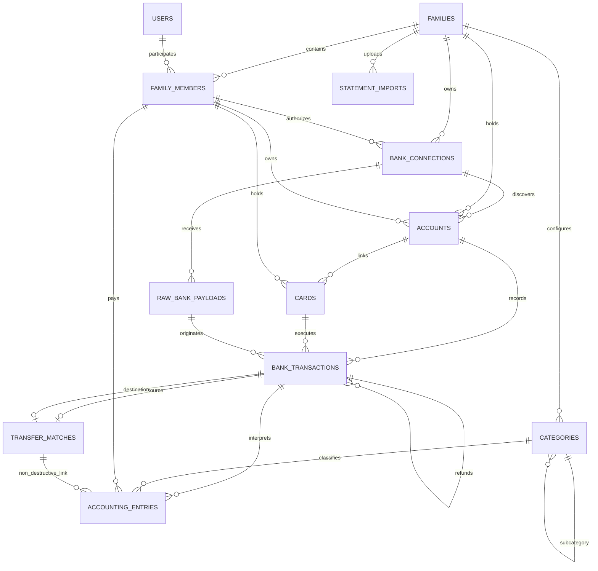

# PostgreSQL Schema & ER Design Specification

## 1. Architectural Principles of the Data Layer

1. **Minimum Supported PostgreSQL Version:** **PostgreSQL 16+** (relies on SQL-standard `ON DELETE SET NULL (column_list)` for composite foreign keys, declarative Row-Level Security with `FORCE ROW LEVEL SECURITY`, and `set_config` transaction scoping).
2. **Two-Layer Ledger (Evidence vs. Interpretation):**
   - **Bank Evidence Layer (`bank_transactions`):** The immutable, authoritative historical record of bank events. Stores bank identifiers (`id`, `operationId`, `authorizationId`), raw descriptions, MCC codes, booking status (`pending`, `posted`, `cancelled`), and cleared timestamps. Bank sync updates never overwrite user categorization, attribution, or notes.
   - **Accounting Interpretation Layer (`accounting_entries`):** The family's categorization, payer attribution, beneficiary allocation, and split entries. Supports 1:N splits of bank transactions. Manual cash operations exist purely in this layer (`bank_transaction_id IS NULL`).
3. **Strict Multi-Tenant Isolation via Composite Foreign Keys & Immutability:**
   - Every tenant-owned entity has a composite key `UNIQUE (family_id, id)`.
   - Every relationship across tenant entities is enforced using **composite foreign keys** referencing `(family_id, target_id)`.
   - **Tenant Immutability:** `family_id` is strictly immutable across all 14 tenant-owned tables; moving entities across families is rejected by trigger.
   - **Row Evidence Immutability:** Historical bank facts in `bank_transactions` and `raw_bank_payloads` cannot be deleted or arbitrarily updated by runtime roles. Only monotonic `pending` -> `posted`/`cancelled` lifecycle transitions are allowed for `family_worker`.
   - **Append-Only Compliance:** `audit_logs` and `transfer_rejections` can be appended, but runtime roles cannot execute `UPDATE` or `DELETE`.
   - **Nullable Reference Deletion:** Uses `ON DELETE SET NULL (nullable_column)` so that deleting a referenced card or category NULLs only the target attribute, preserving `family_id NOT NULL`.
   - **User Membership Ownership:** All tenant references to users enforce family membership via composite foreign key referencing `family_members(family_id, user_id)`. A user cannot own or author an entity in Family A unless they are an active member of Family A.
4. **Least-Privilege Role Model & Defense-in-Depth RLS:**
   - Six distinct roles enforce separation of duties: `family_admin` (schema owner), `family_app` (API runtime), `family_worker` (queue/sync runtime), `family_queue_definer` (job claimer), `family_auth_definer` (membership reader), and `family_auth_verifier` (credential verifier).
   - Blanket runtime grants (`GRANT ALL ON ALL TABLES`) are strictly forbidden. Explicit column and operation grants govern runtime access.
   - Global user credentials (`password_hash`) are isolated: neither `family_worker` nor `family_app` can directly query `password_hash` across `users`.
   - `FORCE ROW LEVEL SECURITY` is enabled across all tenant tables so table owners cannot accidentally bypass RLS.
   - RLS is explicitly configured with operation-specific policies (`SELECT`, `INSERT`, `UPDATE`) avoiding blanket `FOR ALL` policies on evidence tables.
   - Transaction-scoped context injection uses parameterized `SELECT set_config('app.current_family_id', $1, true)`. Missing context strictly evaluates to deny-all.
   - **Zero Worker Security Bypass:** Custom GUCs like `app.is_worker` are strictly prohibited as security boundaries. Background workers execute under transaction-scoped `WithFamilyTx(job.family_id)` using a dedicated least-privilege `claim_next_worker_job()` function.
5. **Exact Minor-Unit Monetary Storage:**
   - All money is stored as `BIGINT` minor units (e.g. kopeks/cents). Floating-point numeric types (`FLOAT`, `DOUBLE PRECISION`) are strictly forbidden for currency amounts.

---

## 2. Relational Entity Relationship Diagram



---

## 3. Table Schemas, Constraints & Composite Foreign Keys

### 3.1 Multi-Tenant Identity & Access Management

```sql
CREATE EXTENSION IF NOT EXISTS "uuid-ossp";
CREATE EXTENSION IF NOT EXISTS "pgcrypto";

-- Families: The primary tenant accounting boundary
CREATE TABLE families (
    id UUID PRIMARY KEY DEFAULT gen_random_uuid(),
    name VARCHAR(100) NOT NULL,
    default_currency VARCHAR(3) NOT NULL DEFAULT 'RUB' CHECK (default_currency ~ '^[A-Z]{3}$'),
    created_at TIMESTAMPTZ NOT NULL DEFAULT NOW(),
    updated_at TIMESTAMPTZ NOT NULL DEFAULT NOW(),
    CONSTRAINT uq_families_tenant UNIQUE (id)
);

-- Users: Global identity pool (partners and individuals)
-- Intentional Exception: Global authentication table, not partitioned by family_id.
CREATE TABLE users (
    id UUID PRIMARY KEY DEFAULT gen_random_uuid(),
    email VARCHAR(255) UNIQUE NOT NULL,
    password_hash VARCHAR(255) NOT NULL, -- Argon2id hash
    first_name VARCHAR(100) NOT NULL,
    last_name VARCHAR(100),
    is_active BOOLEAN NOT NULL DEFAULT TRUE,
    created_at TIMESTAMPTZ NOT NULL DEFAULT NOW(),
    updated_at TIMESTAMPTZ NOT NULL DEFAULT NOW()
);

-- Family Members: Association between users and families with specific roles
CREATE TABLE family_members (
    id UUID PRIMARY KEY DEFAULT gen_random_uuid(),
    family_id UUID NOT NULL REFERENCES families(id) ON DELETE CASCADE,
    user_id UUID NOT NULL REFERENCES users(id) ON DELETE CASCADE,
    role VARCHAR(30) NOT NULL DEFAULT 'partner' CHECK (role IN ('owner', 'partner', 'viewer')),
    color_code VARCHAR(7) DEFAULT '#3B82F6',
    created_at TIMESTAMPTZ NOT NULL DEFAULT NOW(),
    updated_at TIMESTAMPTZ NOT NULL DEFAULT NOW(),
    CONSTRAINT uq_family_members_tenant UNIQUE (family_id, id),
    CONSTRAINT uq_family_members_user UNIQUE (family_id, user_id)
);
```

### 3.2 Bank Connections & Raw Data Layer

```sql
CREATE TABLE bank_connections (
    id UUID PRIMARY KEY DEFAULT gen_random_uuid(),
    family_id UUID NOT NULL REFERENCES families(id) ON DELETE CASCADE,
    authorized_by_user_id UUID NOT NULL,
    provider VARCHAR(50) NOT NULL, -- 'tbank_sidecar', 'sber_file', 'manual'
    name VARCHAR(100) NOT NULL,
    status VARCHAR(30) NOT NULL DEFAULT 'pending_pairing' 
        CHECK (status IN ('pending_pairing', 'active', 'expired', 'error', 'disconnected')),
    
    pairing_secret_hash VARCHAR(255),
    pairing_secret_expires_at TIMESTAMPTZ,
    api_key_hash VARCHAR(64),
    api_key_last_used_at TIMESTAMPTZ,
    
    encrypted_credentials BYTEA,
    last_synced_at TIMESTAMPTZ,
    error_message TEXT,
    created_at TIMESTAMPTZ NOT NULL DEFAULT NOW(),
    updated_at TIMESTAMPTZ NOT NULL DEFAULT NOW(),
    CONSTRAINT uq_bank_connections_tenant UNIQUE (family_id, id),
    CONSTRAINT fk_bank_connections_user FOREIGN KEY (family_id, authorized_by_user_id) 
        REFERENCES family_members(family_id, user_id) ON DELETE RESTRICT
);

CREATE INDEX idx_bank_conn_api_key ON bank_connections(api_key_hash) WHERE api_key_hash IS NOT NULL;

-- Raw Bank Payloads: Immutable storage of sanitized provider business payloads.
-- Transport-layer HTTP headers, cookies, auth tokens, full PANs, and passwords
-- MUST be stripped by the connector adapter prior to insertion.
CREATE TABLE raw_bank_payloads (
    id UUID PRIMARY KEY DEFAULT gen_random_uuid(),
    family_id UUID NOT NULL REFERENCES families(id) ON DELETE CASCADE,
    bank_connection_id UUID,
    source VARCHAR(50) NOT NULL,
    payload_hash VARCHAR(64) NOT NULL,
    raw_json JSONB NOT NULL,
    created_at TIMESTAMPTZ NOT NULL DEFAULT NOW(),
    CONSTRAINT uq_raw_bank_payloads_tenant UNIQUE (family_id, id),
    CONSTRAINT fk_raw_payloads_connection FOREIGN KEY (family_id, bank_connection_id) 
        REFERENCES bank_connections(family_id, id) ON DELETE SET NULL (bank_connection_id)
);

CREATE INDEX idx_raw_payloads_hash ON raw_bank_payloads(family_id, payload_hash);
```

### 3.3 Accounts & Cards Model

```sql
CREATE TABLE accounts (
    id UUID PRIMARY KEY DEFAULT gen_random_uuid(),
    family_id UUID NOT NULL REFERENCES families(id) ON DELETE CASCADE,
    bank_connection_id UUID,
    owner_user_id UUID NOT NULL,
    external_id VARCHAR(100),
    name VARCHAR(100) NOT NULL,
    type VARCHAR(30) NOT NULL CHECK (type IN (
        'checking',     -- Current/checking debit account
        'credit_card',  -- Revolving credit facility
        'savings',      -- Savings account / накопительный счет
        'deposit',      -- Fixed term deposit / вклад
        'cash'          -- Physical cash wallet
    )),
    currency VARCHAR(3) NOT NULL CHECK (currency ~ '^[A-Z]{3}$'),
    
    -- Balance Semantics & Nullability
    -- NULL indicates balance is currently unknown / not yet observed
    current_balance_minor BIGINT,
    available_balance_minor BIGINT,
    debt_balance_minor BIGINT,
    credit_limit_minor BIGINT,
    statement_balance_minor BIGINT,
    minimal_payment_minor BIGINT,
    grace_period_end_date DATE,
    
    balance_updated_at TIMESTAMPTZ,
    balance_source VARCHAR(30) CHECK (balance_source IN ('bank_api', 'statement_file', 'calculated', 'manual_initial')),
    
    is_archived BOOLEAN NOT NULL DEFAULT FALSE,
    created_at TIMESTAMPTZ NOT NULL DEFAULT NOW(),
    updated_at TIMESTAMPTZ NOT NULL DEFAULT NOW(),
    CONSTRAINT uq_accounts_tenant UNIQUE (family_id, id),
    CONSTRAINT uq_accounts_provider_external UNIQUE (family_id, bank_connection_id, external_id),
    CONSTRAINT fk_accounts_connection FOREIGN KEY (family_id, bank_connection_id) 
        REFERENCES bank_connections(family_id, id) ON DELETE SET NULL (bank_connection_id),
    CONSTRAINT fk_accounts_owner FOREIGN KEY (family_id, owner_user_id) 
        REFERENCES family_members(family_id, user_id) ON DELETE RESTRICT
);

CREATE TABLE cards (
    id UUID PRIMARY KEY DEFAULT gen_random_uuid(),
    family_id UUID NOT NULL REFERENCES families(id) ON DELETE CASCADE,
    account_id UUID NOT NULL,
    owner_user_id UUID NOT NULL,
    external_id VARCHAR(100),
    masked_pan VARCHAR(20) NOT NULL,
    display_name VARCHAR(100) NOT NULL,
    payment_system VARCHAR(30) NOT NULL CHECK (payment_system IN ('MIR', 'VISA', 'MASTERCARD', 'OTHER')),
    is_virtual BOOLEAN NOT NULL DEFAULT FALSE,
    is_primary BOOLEAN NOT NULL DEFAULT FALSE,
    status VARCHAR(30) NOT NULL DEFAULT 'ACTIVE' CHECK (status IN ('ACTIVE', 'BLOCKED', 'CLOSED')),
    created_at TIMESTAMPTZ NOT NULL DEFAULT NOW(),
    updated_at TIMESTAMPTZ NOT NULL DEFAULT NOW(),
    CONSTRAINT uq_cards_tenant UNIQUE (family_id, id),
    CONSTRAINT uq_cards_provider_external UNIQUE (family_id, account_id, external_id),
    CONSTRAINT fk_cards_account FOREIGN KEY (family_id, account_id) 
        REFERENCES accounts(family_id, id) ON DELETE CASCADE,
    CONSTRAINT fk_cards_owner FOREIGN KEY (family_id, owner_user_id) 
        REFERENCES family_members(family_id, user_id) ON DELETE RESTRICT
);
```

### 3.4 Bank Evidence Layer: `bank_transactions`

```sql
CREATE TABLE bank_transactions (
    -- (1) Immutable bank facts: Identity, tenant boundary, and account/card instruments
    id UUID PRIMARY KEY DEFAULT gen_random_uuid(),
    family_id UUID NOT NULL REFERENCES families(id) ON DELETE CASCADE,
    account_id UUID NOT NULL,
    card_id UUID,
    raw_payload_id UUID,
    
    -- (2) Mutable only during pending -> posted (external_id); (1) Immutable (external_auth_id, fingerprints)
    external_id VARCHAR(128),
    external_auth_id VARCHAR(128),
    fingerprint_hash VARCHAR(64) NOT NULL,
    fingerprint_sequence INT NOT NULL DEFAULT 1,
    
    -- (1) Immutable bank facts: Original charge amount & currency; Account currency
    amount_minor BIGINT NOT NULL,
    currency VARCHAR(3) NOT NULL CHECK (currency ~ '^[A-Z]{3}$'),
    -- (2) Mutable only during pending -> posted: Account debited minor units (settlement FX or tip adjustment)
    account_amount_minor BIGINT NOT NULL,
    account_currency VARCHAR(3) NOT NULL CHECK (account_currency ~ '^[A-Z]{3}$'),
    
    -- (2) & (3) Monotonic lifecycle status: pending -> posted or pending -> cancelled; terminal states permanently immutable
    booking_status VARCHAR(30) NOT NULL DEFAULT 'posted' CHECK (booking_status IN (
        'pending',   -- Authorization / Hold
        'posted',    -- Cleared / Settled on bank balance
        'cancelled'  -- Hold dropped, expired, or voided
    )),
    
    -- (1) Immutable bank facts: Transaction semantics, lineage, and capture time
    operation_type VARCHAR(30) NOT NULL DEFAULT 'purchase' CHECK (operation_type IN (
        'purchase',
        'refund',           -- Merchant return / chargeback
        'transfer_out',     -- Outgoing transfer (SBP, c2c, wire)
        'transfer_in',      -- Incoming transfer
        'atm_cash',         -- Cash withdrawal or ATM deposit
        'fee',              -- Bank service fee, SMS fee, interest charge
        'card_check'        -- Zero-amount card verification
    )),
    
    related_bank_transaction_id UUID,
    transaction_time TIMESTAMPTZ NOT NULL,
    -- (2) Mutable only during pending -> posted: Settlement clearing timestamp
    posted_time TIMESTAMPTZ,
    
    -- (1) Immutable bank facts: Merchant metadata, description, and classification
    merchant_name VARCHAR(255),
    raw_description TEXT NOT NULL,
    mcc INT,
    bank_category VARCHAR(100),
    
    -- (1) Immutable: Creation timestamp; (4) Database-maintained metadata: Updated timestamp
    created_at TIMESTAMPTZ NOT NULL DEFAULT NOW(),
    updated_at TIMESTAMPTZ NOT NULL DEFAULT NOW(),
    
    CONSTRAINT uq_bank_transactions_tenant UNIQUE (family_id, id),
    CONSTRAINT uq_bank_tx_external_id UNIQUE (family_id, account_id, external_id),
    CONSTRAINT uq_bank_tx_fingerprint UNIQUE (family_id, account_id, fingerprint_hash, fingerprint_sequence),
    
    CONSTRAINT fk_bank_tx_account FOREIGN KEY (family_id, account_id) 
        REFERENCES accounts(family_id, id) ON DELETE CASCADE,
    CONSTRAINT fk_bank_tx_card FOREIGN KEY (family_id, card_id) 
        REFERENCES cards(family_id, id) ON DELETE SET NULL (card_id),
    CONSTRAINT fk_bank_tx_raw_payload FOREIGN KEY (family_id, raw_payload_id) 
        REFERENCES raw_bank_payloads(family_id, id) ON DELETE SET NULL (raw_payload_id),
    CONSTRAINT fk_bank_tx_related FOREIGN KEY (family_id, related_bank_transaction_id) 
        REFERENCES bank_transactions(family_id, id) ON DELETE SET NULL (related_bank_transaction_id),
        
    CONSTRAINT chk_bank_tx_amount CHECK (amount_minor != 0 OR operation_type = 'card_check')
);

CREATE INDEX idx_bank_tx_time ON bank_transactions(family_id, transaction_time DESC);
CREATE INDEX idx_bank_tx_auth_id ON bank_transactions(family_id, account_id, external_auth_id) 
    WHERE external_auth_id IS NOT NULL AND booking_status = 'pending';
```

#### Bank Evidence Column Audit Matrix (24 Columns)

| # | Column Name | Data Type | Mutability Classification | Permitted Lifecycle Transitions | Description & Architectural Invariant |
| :- | :--- | :--- | :--- | :--- | :--- |
| 1 | `id` | `UUID` | **(1) Immutable bank fact** | None (Permanent) | Internal surrogate primary key. Assigned on initial ingestion. |
| 2 | `family_id` | `UUID` | **(1) Immutable bank fact** | None (Permanent) | Tenant isolation partition boundary. Strictly immutable. |
| 3 | `account_id` | `UUID` | **(1) Immutable bank fact** | None (Permanent) | Parent account holding or charging the operation. |
| 4 | `card_id` | `UUID` | **(1) Immutable bank fact** | None (Permanent) | Card access instrument used at swipe/authorization. |
| 5 | `raw_payload_id` | `UUID` | **(1) Immutable bank fact** | None (Permanent) | Foreign key pointer to initial raw bank payload. |
| 6 | `external_id` | `VARCHAR(128)` | **(2) Mutable on Settlement** | `pending` $\rightarrow$ `posted` | Bank clearing/operation ID (`operationId`). Null/auth-ref while pending; assigned on settlement. Immutable once posted; forbidden to mutate during cancellation. |
| 7 | `external_auth_id`| `VARCHAR(128)` | **(1) Immutable bank fact** | None (Permanent) | Card scheme authorization reference (`authorizationId`) issued at hold creation. |
| 8 | `fingerprint_hash`| `VARCHAR(64)` | **(1) Immutable bank fact** | None (Permanent) | Deterministic idempotency hash. Strictly immutable. |
| 9 | `fingerprint_seq` | `INT` | **(1) Immutable bank fact** | None (Permanent) | Sequence counter disambiguating duplicate events. |
| 10| `amount_minor` | `BIGINT` | **(1) Immutable bank fact** | None (Permanent) | Original charge amount in merchant currency. Strictly immutable. |
| 11| `currency` | `VARCHAR(3)` | **(1) Immutable bank fact** | None (Permanent) | ISO 4217 original transaction currency. Strictly immutable. |
| 12| `account_amount` | `BIGINT` | **(2) Mutable on Settlement** | `pending` $\rightarrow$ `posted` | Debited amount in account currency. Pre-auth estimate at pending; finalized on settlement (clearing FX rate / tip). Immutable once posted; forbidden to mutate during cancellation. |
| 13| `account_currency`| `VARCHAR(3)` | **(1) Immutable bank fact** | None (Permanent) | ISO 4217 currency of the underlying account. |
| 14| `booking_status` | `VARCHAR(30)` | **(2) & (3) Monotonic State**| `pending` $\rightarrow$ `posted` / `cancelled` | Monotonic lifecycle status (`pending`, `posted`, `cancelled`). Terminal states (`posted`, `cancelled`) are permanently immutable. |
| 15| `operation_type` | `VARCHAR(30)` | **(1) Immutable bank fact** | None (Permanent) | Operation category (`purchase`, `refund`, `transfer_out`, etc.). |
| 16| `related_bank_tx` | `UUID` | **(1) Immutable bank fact** | None (Permanent) | Lineage pointer linking refunds or reversals to the original transaction. |
| 17| `transaction_time`| `TIMESTAMPTZ` | **(1) Immutable bank fact** | None (Permanent) | Historical timestamp when transaction was initiated by user/merchant. |
| 18| `posted_time` | `TIMESTAMPTZ` | **(2) Mutable on Settlement** | `pending` $\rightarrow$ `posted` | Timestamp when bank settled the transaction (`debitingTime`). Null/empty on hold; populated on settlement. Forbidden to mutate during cancellation. |
| 19| `merchant_name` | `VARCHAR(255)` | **(1) Immutable bank fact** | None (Permanent) | Merchant trade name from bank authorization stream. |
| 20| `raw_description` | `TEXT` | **(1) Immutable bank fact** | None (Permanent) | Exact verbatim statement narrative from bank payload. |
| 21| `mcc` | `INT` | **(1) Immutable bank fact** | None (Permanent) | ISO 18245 4-digit merchant category code. |
| 22| `bank_category` | `VARCHAR(100)` | **(1) Immutable bank fact** | None (Permanent) | Bank's proprietary classification label at capture time. |
| 23| `created_at` | `TIMESTAMPTZ` | **(1) Immutable bank fact** | None (Permanent) | Database insertion timestamp. |
| 24| `updated_at` | `TIMESTAMPTZ` | **(4) DB Metadata** | Maintained by trigger | Refreshed to `NOW()` by database trigger on valid transitions. |

### 3.5 Transfer Matches & Symmetric Rejection Tables

```sql
CREATE TABLE transfer_matches (
    id UUID PRIMARY KEY DEFAULT gen_random_uuid(),
    family_id UUID NOT NULL REFERENCES families(id) ON DELETE CASCADE,
    source_bank_transaction_id UUID NOT NULL,
    destination_bank_transaction_id UUID NOT NULL,
    
    match_type VARCHAR(30) NOT NULL CHECK (match_type IN ('exact', 'probable', 'manual')),
    confidence_score NUMERIC(5, 2) NOT NULL CHECK (confidence_score >= 0 AND confidence_score <= 100),
    
    status VARCHAR(30) NOT NULL DEFAULT 'suggested' CHECK (status IN (
        'auto_confirmed', -- Tier 1 automatic match
        'confirmed',      -- Confirmed by user in UI
        'rejected',       -- Rejected by user
        'suggested'       -- Awaiting user review
    )),
    
    fee_minor BIGINT NOT NULL DEFAULT 0,
    is_credit_card_repayment BOOLEAN NOT NULL DEFAULT FALSE,
    
    matched_by_user_id UUID,
    matched_at TIMESTAMPTZ NOT NULL DEFAULT NOW(),
    created_at TIMESTAMPTZ NOT NULL DEFAULT NOW(),
    updated_at TIMESTAMPTZ NOT NULL DEFAULT NOW(),
    
    CONSTRAINT uq_transfer_matches_tenant UNIQUE (family_id, id),
    CONSTRAINT chk_different_tx CHECK (source_bank_transaction_id != destination_bank_transaction_id),
    
    CONSTRAINT fk_transfer_source FOREIGN KEY (family_id, source_bank_transaction_id) 
        REFERENCES bank_transactions(family_id, id) ON DELETE CASCADE,
    CONSTRAINT fk_transfer_dest FOREIGN KEY (family_id, destination_bank_transaction_id) 
        REFERENCES bank_transactions(family_id, id) ON DELETE CASCADE,
    CONSTRAINT fk_transfer_matched_by FOREIGN KEY (family_id, matched_by_user_id) 
        REFERENCES family_members(family_id, user_id) ON DELETE SET NULL (matched_by_user_id)
);

CREATE UNIQUE INDEX uq_transfer_source_active ON transfer_matches(family_id, source_bank_transaction_id) 
    WHERE status IN ('auto_confirmed', 'confirmed', 'suggested');

CREATE UNIQUE INDEX uq_transfer_dest_active ON transfer_matches(family_id, destination_bank_transaction_id) 
    WHERE status IN ('auto_confirmed', 'confirmed', 'suggested');

-- Transfer Rejections: Remembers rejected pairs with canonical symmetric ordering
CREATE TABLE transfer_rejections (
    id UUID PRIMARY KEY DEFAULT gen_random_uuid(),
    family_id UUID NOT NULL REFERENCES families(id) ON DELETE CASCADE,
    source_bank_transaction_id UUID NOT NULL,
    destination_bank_transaction_id UUID NOT NULL,
    rejected_by_user_id UUID NOT NULL,
    reason VARCHAR(500),
    rejected_at TIMESTAMPTZ NOT NULL DEFAULT NOW(),
    CONSTRAINT uq_transfer_rejections_tenant UNIQUE (family_id, id),
    CONSTRAINT chk_rejection_different_tx CHECK (source_bank_transaction_id != destination_bank_transaction_id),
    CONSTRAINT fk_rejections_source FOREIGN KEY (family_id, source_bank_transaction_id) 
        REFERENCES bank_transactions(family_id, id) ON DELETE CASCADE,
    CONSTRAINT fk_rejections_dest FOREIGN KEY (family_id, destination_bank_transaction_id) 
        REFERENCES bank_transactions(family_id, id) ON DELETE CASCADE,
    CONSTRAINT fk_rejections_user FOREIGN KEY (family_id, rejected_by_user_id) 
        REFERENCES family_members(family_id, user_id) ON DELETE CASCADE
);

-- Symmetric Unique Index: Rejecting A -> B automatically blocks proposing B -> A
CREATE UNIQUE INDEX uq_transfer_rejections_symmetric ON transfer_rejections (
    family_id,
    LEAST(source_bank_transaction_id, destination_bank_transaction_id),
    GREATEST(source_bank_transaction_id, destination_bank_transaction_id)
);
```

### 3.6 Accounting Interpretation Layer: `accounting_entries`

```sql
CREATE TABLE categories (
    id UUID PRIMARY KEY DEFAULT gen_random_uuid(),
    family_id UUID NOT NULL REFERENCES families(id) ON DELETE CASCADE,
    parent_id UUID,
    name VARCHAR(100) NOT NULL,
    type VARCHAR(30) NOT NULL CHECK (type IN ('expense', 'income', 'transfer')),
    icon VARCHAR(50),
    color VARCHAR(7),
    is_system BOOLEAN NOT NULL DEFAULT FALSE,
    created_at TIMESTAMPTZ NOT NULL DEFAULT NOW(),
    updated_at TIMESTAMPTZ NOT NULL DEFAULT NOW(),
    CONSTRAINT uq_categories_tenant UNIQUE (family_id, id),
    CONSTRAINT uq_categories_name UNIQUE (family_id, parent_id, name),
    CONSTRAINT fk_categories_parent FOREIGN KEY (family_id, parent_id) 
        REFERENCES categories(family_id, id) ON DELETE CASCADE
);

CREATE TABLE accounting_entries (
    id UUID PRIMARY KEY DEFAULT gen_random_uuid(),
    family_id UUID NOT NULL REFERENCES families(id) ON DELETE CASCADE,
    bank_transaction_id UUID, -- NULL for manual cash expenses
    account_id UUID NOT NULL,
    category_id UUID,
    
    -- Non-Destructive Transfer Pairing Link
    transfer_match_id UUID,
    
    amount_minor BIGINT NOT NULL,
    currency VARCHAR(3) NOT NULL CHECK (currency ~ '^[A-Z]{3}$'),
    
    classification VARCHAR(30) NOT NULL DEFAULT 'expense' CHECK (classification IN (
        'expense',          -- Real family consumption
        'income',           -- Real family earnings
        'transfer',         -- Manual internal transfer
        'debt_repayment',   -- Manual credit card repayment
        'excluded'          -- Non-family flow (reimbursement, pass-through)
    )),
    
    payer_user_id UUID,
    beneficiary_type VARCHAR(30) NOT NULL DEFAULT 'household' CHECK (beneficiary_type IN (
        'household',    -- Shared family expense
        'partner_a',    -- Personal expense Partner A
        'partner_b',    -- Personal expense Partner B
        'child',        -- Child expense
        'other'         -- Third-party
    )),
    
    entry_time TIMESTAMPTZ NOT NULL,
    user_comment TEXT,
    is_split BOOLEAN NOT NULL DEFAULT FALSE,
    is_manual BOOLEAN NOT NULL DEFAULT FALSE,
    
    created_at TIMESTAMPTZ NOT NULL DEFAULT NOW(),
    updated_at TIMESTAMPTZ NOT NULL DEFAULT NOW(),
    
    CONSTRAINT uq_accounting_entries_tenant UNIQUE (family_id, id),
    CONSTRAINT fk_entries_bank_tx FOREIGN KEY (family_id, bank_transaction_id) 
        REFERENCES bank_transactions(family_id, id) ON DELETE CASCADE,
    CONSTRAINT fk_entries_account FOREIGN KEY (family_id, account_id) 
        REFERENCES accounts(family_id, id) ON DELETE CASCADE,
    CONSTRAINT fk_entries_category FOREIGN KEY (family_id, category_id) 
        REFERENCES categories(family_id, id) ON DELETE SET NULL (category_id),
    CONSTRAINT fk_entries_transfer_match FOREIGN KEY (family_id, transfer_match_id) 
        REFERENCES transfer_matches(family_id, id) ON DELETE SET NULL (transfer_match_id),
    CONSTRAINT fk_entries_payer FOREIGN KEY (family_id, payer_user_id) 
        REFERENCES family_members(family_id, user_id) ON DELETE SET NULL (payer_user_id)
);

CREATE INDEX idx_entries_family_time ON accounting_entries(family_id, entry_time DESC);
CREATE INDEX idx_entries_category ON accounting_entries(family_id, category_id);
CREATE INDEX idx_entries_classification ON accounting_entries(family_id, classification);
CREATE INDEX idx_entries_bank_tx ON accounting_entries(family_id, bank_transaction_id);

CREATE TABLE categorization_rules (
    id UUID PRIMARY KEY DEFAULT gen_random_uuid(),
    family_id UUID NOT NULL REFERENCES families(id) ON DELETE CASCADE,
    created_by_user_id UUID NOT NULL,
    category_id UUID NOT NULL,
    priority INT NOT NULL DEFAULT 100,
    rule_type VARCHAR(30) NOT NULL CHECK (rule_type IN (
        'merchant_name_exact',
        'merchant_name_contains',
        'mcc_code',
        'description_regex',
        'amount_range'
    )),
    match_value VARCHAR(255) NOT NULL,
    min_amount_minor BIGINT,
    max_amount_minor BIGINT,
    currency VARCHAR(3),
    created_at TIMESTAMPTZ NOT NULL DEFAULT NOW(),
    updated_at TIMESTAMPTZ NOT NULL DEFAULT NOW(),
    CONSTRAINT uq_categorization_rules_tenant UNIQUE (family_id, id),
    CONSTRAINT fk_rules_category FOREIGN KEY (family_id, category_id) 
        REFERENCES categories(family_id, id) ON DELETE CASCADE,
    CONSTRAINT fk_rules_creator FOREIGN KEY (family_id, created_by_user_id) 
        REFERENCES family_members(family_id, user_id) ON DELETE CASCADE
);

CREATE INDEX idx_rules_family_priority ON categorization_rules(family_id, priority ASC);
```

### 3.7 Statement Imports, Audit Logging & Worker Jobs

```sql
CREATE TABLE statement_imports (
    id UUID PRIMARY KEY DEFAULT gen_random_uuid(),
    family_id UUID NOT NULL REFERENCES families(id) ON DELETE CASCADE,
    account_id UUID NOT NULL,
    uploaded_by_user_id UUID NOT NULL,
    file_name VARCHAR(255) NOT NULL,
    file_size_bytes BIGINT NOT NULL,
    file_sha256 VARCHAR(64) NOT NULL,
    status VARCHAR(30) NOT NULL DEFAULT 'pending' CHECK (status IN ('pending', 'processing', 'completed', 'failed')),
    records_total INT NOT NULL DEFAULT 0,
    records_imported INT NOT NULL DEFAULT 0,
    records_skipped_duplicate INT NOT NULL DEFAULT 0,
    error_summary TEXT,
    created_at TIMESTAMPTZ NOT NULL DEFAULT NOW(),
    updated_at TIMESTAMPTZ NOT NULL DEFAULT NOW(),
    CONSTRAINT uq_statement_imports_tenant UNIQUE (family_id, id),
    CONSTRAINT fk_imports_account FOREIGN KEY (family_id, account_id) 
        REFERENCES accounts(family_id, id) ON DELETE CASCADE,
    CONSTRAINT fk_imports_uploader FOREIGN KEY (family_id, uploaded_by_user_id) 
        REFERENCES family_members(family_id, user_id) ON DELETE RESTRICT
);

-- Audit Logs: Non-repudiation log
-- Intentional Exception: user_id references global users(id) ON DELETE SET NULL,
-- ensuring audit history remains readable even if a user is later removed from family_members.
CREATE TABLE audit_logs (
    id UUID PRIMARY KEY DEFAULT gen_random_uuid(),
    family_id UUID NOT NULL REFERENCES families(id) ON DELETE CASCADE,
    user_id UUID REFERENCES users(id) ON DELETE SET NULL,
    entity_type VARCHAR(50) NOT NULL,
    entity_id UUID NOT NULL,
    action VARCHAR(50) NOT NULL,
    old_values JSONB,
    new_values JSONB,
    ip_address INET,
    user_agent TEXT,
    created_at TIMESTAMPTZ NOT NULL DEFAULT NOW(),
    CONSTRAINT uq_audit_logs_tenant UNIQUE (family_id, id)
);

CREATE INDEX idx_audit_family_entity ON audit_logs(family_id, entity_type, entity_id);

-- Worker Jobs: Strictly tenant-scoped background task queue (family_id NOT NULL)
CREATE TABLE worker_jobs (
    id UUID PRIMARY KEY DEFAULT gen_random_uuid(),
    family_id UUID NOT NULL REFERENCES families(id) ON DELETE CASCADE,
    queue_name VARCHAR(50) NOT NULL DEFAULT 'default',
    job_type VARCHAR(100) NOT NULL,
    payload JSONB NOT NULL,
    state VARCHAR(30) NOT NULL DEFAULT 'available' CHECK (state IN ('available', 'running', 'completed', 'failed', 'discarded')),
    locked_by VARCHAR(100),
    locked_until TIMESTAMPTZ,
    attempts INT NOT NULL DEFAULT 0,
    max_attempts INT NOT NULL DEFAULT 5,
    last_error TEXT,
    scheduled_at TIMESTAMPTZ NOT NULL DEFAULT NOW(),
    created_at TIMESTAMPTZ NOT NULL DEFAULT NOW(),
    updated_at TIMESTAMPTZ NOT NULL DEFAULT NOW(),
    CONSTRAINT uq_worker_jobs_tenant UNIQUE (family_id, id)
);

CREATE INDEX idx_worker_jobs_fetch ON worker_jobs(queue_name, state, scheduled_at) 
    WHERE state = 'available';

CREATE INDEX idx_worker_jobs_locked ON worker_jobs(queue_name, state, locked_until)
    WHERE state = 'running';
```

---

## 4. Tenant Immutability & Trigger Integrity Enforcements

### 4.1 Tenant Immutability Enforcement & Audit Matrix

Moving any tenant-owned row from Family A to Family B is strictly prohibited across all tenant-partitioned entities:

```sql
CREATE OR REPLACE FUNCTION trg_enforce_tenant_immutability()
RETURNS TRIGGER AS $$
BEGIN
    IF OLD.family_id IS DISTINCT FROM NEW.family_id THEN
        RAISE EXCEPTION 'Tenant immutability violation: modifying family_id from % to % is strictly forbidden on %', 
            OLD.family_id, NEW.family_id, TG_TABLE_NAME;
    END IF;
    RETURN NEW;
END;
$$ LANGUAGE plpgsql;

-- Comprehensive trigger coverage across all 14 tenant-owned tables:
CREATE TRIGGER trg_immutability_family_members BEFORE UPDATE OF family_id ON family_members FOR EACH ROW EXECUTE FUNCTION trg_enforce_tenant_immutability();
CREATE TRIGGER trg_immutability_bank_connections BEFORE UPDATE OF family_id ON bank_connections FOR EACH ROW EXECUTE FUNCTION trg_enforce_tenant_immutability();
CREATE TRIGGER trg_immutability_raw_bank_payloads BEFORE UPDATE OF family_id ON raw_bank_payloads FOR EACH ROW EXECUTE FUNCTION trg_enforce_tenant_immutability();
CREATE TRIGGER trg_immutability_accounts BEFORE UPDATE OF family_id ON accounts FOR EACH ROW EXECUTE FUNCTION trg_enforce_tenant_immutability();
CREATE TRIGGER trg_immutability_cards BEFORE UPDATE OF family_id ON cards FOR EACH ROW EXECUTE FUNCTION trg_enforce_tenant_immutability();
CREATE TRIGGER trg_immutability_bank_transactions BEFORE UPDATE OF family_id ON bank_transactions FOR EACH ROW EXECUTE FUNCTION trg_enforce_tenant_immutability();
CREATE TRIGGER trg_immutability_transfer_matches BEFORE UPDATE OF family_id ON transfer_matches FOR EACH ROW EXECUTE FUNCTION trg_enforce_tenant_immutability();
CREATE TRIGGER trg_immutability_transfer_rejections BEFORE UPDATE OF family_id ON transfer_rejections FOR EACH ROW EXECUTE FUNCTION trg_enforce_tenant_immutability();
CREATE TRIGGER trg_immutability_categories BEFORE UPDATE OF family_id ON categories FOR EACH ROW EXECUTE FUNCTION trg_enforce_tenant_immutability();
CREATE TRIGGER trg_immutability_accounting_entries BEFORE UPDATE OF family_id ON accounting_entries FOR EACH ROW EXECUTE FUNCTION trg_enforce_tenant_immutability();
CREATE TRIGGER trg_immutability_categorization_rules BEFORE UPDATE OF family_id ON categorization_rules FOR EACH ROW EXECUTE FUNCTION trg_enforce_tenant_immutability();
CREATE TRIGGER trg_immutability_statement_imports BEFORE UPDATE OF family_id ON statement_imports FOR EACH ROW EXECUTE FUNCTION trg_enforce_tenant_immutability();
CREATE TRIGGER trg_immutability_audit_logs BEFORE UPDATE OF family_id ON audit_logs FOR EACH ROW EXECUTE FUNCTION trg_enforce_tenant_immutability();
CREATE TRIGGER trg_immutability_worker_jobs BEFORE UPDATE OF family_id ON worker_jobs FOR EACH ROW EXECUTE FUNCTION trg_enforce_tenant_immutability();
```

#### Complete Tenant Table Immutability Audit Matrix

| Table Name | Contains `family_id` | Immutability Trigger Attached | Status / Policy |
| :--- | :--- | :--- | :--- |
| `families` | No (PK `id`) | N/A | Global boundary entity; `id` is primary key. |
| `users` | No (PK `id`) | N/A | Global auth identity pool; not partitioned by `family_id`. |
| `family_members` | Yes | `trg_immutability_family_members` | **Enforced**. User cannot be moved; new membership requires distinct row. |
| `bank_connections` | Yes | `trg_immutability_bank_connections` | **Enforced**. Bank tokens and credentials bound permanently to family. |
| `raw_bank_payloads` | Yes | `trg_immutability_raw_bank_payloads` | **Enforced**. Audit bank payload evidence immutable. |
| `accounts` | Yes | `trg_immutability_accounts` | **Enforced**. Financial accounts cannot cross family boundaries. |
| `cards` | Yes | `trg_immutability_cards` | **Enforced**. Linked cards bound permanently to family account. |
| `bank_transactions` | Yes | `trg_immutability_bank_transactions` | **Enforced**. Bank evidence layer strictly immutable. |
| `transfer_matches` | Yes | `trg_immutability_transfer_matches` | **Enforced**. Internal transfers bound to single family. |
| `transfer_rejections` | Yes | `trg_immutability_transfer_rejections` | **Enforced**. Rejection memory bound to single family. |
| `categories` | Yes | `trg_immutability_categories` | **Enforced**. Category trees cannot be transferred across families. |
| `accounting_entries` | Yes | `trg_immutability_accounting_entries` | **Enforced**. Accounting interpretation entries bound to family. |
| `categorization_rules` | Yes | `trg_immutability_categorization_rules` | **Enforced**. Categorization rules bound to family. |
| `statement_imports` | Yes | `trg_immutability_statement_imports` | **Enforced**. Import batches cannot change family owner. |
| `audit_logs` | Yes | `trg_immutability_audit_logs` | **Enforced**. Append-only compliance log strictly immutable. |
| `worker_jobs` | Yes | `trg_immutability_worker_jobs` | **Enforced**. Queue tasks cannot be reassigned across families. |
```

### 4.2 Complete Deferred Split Constraint Triggers

```sql
CREATE OR REPLACE FUNCTION validate_bank_transaction_split_integrity(p_family_id UUID, p_bank_tx_id UUID)
RETURNS VOID AS $$
DECLARE
    v_expected_amount BIGINT;
    v_actual_sum BIGINT;
    v_count INT;
    v_has_unsplit BOOLEAN;
    v_has_split BOOLEAN;
BEGIN
    IF p_bank_tx_id IS NULL THEN
        RETURN;
    END IF;

    -- Fetch bank transaction cleared amount. If deleted in same transaction, exit cleanly (cascading delete).
    SELECT account_amount_minor INTO v_expected_amount
    FROM bank_transactions
    WHERE id = p_bank_tx_id AND family_id = p_family_id;

    IF NOT FOUND THEN
        RETURN;
    END IF;

    -- Aggregate current accounting entries
    SELECT 
        COUNT(*),
        COALESCE(SUM(amount_minor), 0),
        BOOL_OR(is_split = FALSE),
        BOOL_OR(is_split = TRUE)
    INTO v_count, v_actual_sum, v_has_unsplit, v_has_split
    FROM accounting_entries
    WHERE bank_transaction_id = p_bank_tx_id AND family_id = p_family_id;

    -- Invariant 1: Bank transaction must not commit without at least 1 accounting entry
    IF v_count = 0 THEN
        RAISE EXCEPTION 'Integrity violation: bank transaction % has 0 accounting entries', p_bank_tx_id;
    END IF;

    -- Invariant 2: Unsplit transaction (count = 1) must have is_split = FALSE and amount equal to cleared amount
    IF v_count = 1 THEN
        IF v_has_split = TRUE OR v_has_unsplit = FALSE THEN
            RAISE EXCEPTION 'Integrity violation: single accounting entry for bank transaction % must have is_split = FALSE', p_bank_tx_id;
        END IF;
        IF v_actual_sum != v_expected_amount THEN
            RAISE EXCEPTION 'Integrity violation: unsplit entry amount (%) != bank transaction amount (%) for tx %', 
                v_actual_sum, v_expected_amount, p_bank_tx_id;
        END IF;
    ELSE
        -- Invariant 3: Split transaction (count >= 2) must have every entry is_split = TRUE and sum equal to cleared amount
        IF v_has_unsplit = TRUE THEN
            RAISE EXCEPTION 'Integrity violation: split bank transaction % contains entries with is_split = FALSE', p_bank_tx_id;
        END IF;
        IF v_actual_sum != v_expected_amount THEN
            RAISE EXCEPTION 'Integrity violation: split entries sum (%) != bank transaction amount (%) for tx %', 
                v_actual_sum, v_expected_amount, p_bank_tx_id;
        END IF;
    END IF;
END;
$$ LANGUAGE plpgsql;

-- Trigger Function on accounting_entries: Handles INSERT, UPDATE, DELETE, and Reassignment
CREATE OR REPLACE FUNCTION trg_accounting_entries_split_validator()
RETURNS TRIGGER AS $$
BEGIN
    IF TG_OP = 'DELETE' THEN
        PERFORM validate_bank_transaction_split_integrity(OLD.family_id, OLD.bank_transaction_id);
        RETURN OLD;
    ELSIF TG_OP = 'UPDATE' THEN
        -- If reassigned to a different parent or family, validate both OLD and NEW
        IF (OLD.family_id, OLD.bank_transaction_id) IS DISTINCT FROM (NEW.family_id, NEW.bank_transaction_id) THEN
            PERFORM validate_bank_transaction_split_integrity(OLD.family_id, OLD.bank_transaction_id);
        END IF;
        PERFORM validate_bank_transaction_split_integrity(NEW.family_id, NEW.bank_transaction_id);
        RETURN NEW;
    ELSE -- INSERT
        PERFORM validate_bank_transaction_split_integrity(NEW.family_id, NEW.bank_transaction_id);
        RETURN NEW;
    END IF;
END;
$$ LANGUAGE plpgsql;

CREATE CONSTRAINT TRIGGER trg_split_sum_entries_deferred
AFTER INSERT OR UPDATE OR DELETE ON accounting_entries
DEFERRABLE INITIALLY DEFERRED
FOR EACH ROW EXECUTE FUNCTION trg_accounting_entries_split_validator();

-- Trigger Function on bank_transactions: Validates on INSERT (cannot commit without entries) and amount updates
CREATE OR REPLACE FUNCTION trg_bank_tx_split_validator()
RETURNS TRIGGER AS $$
BEGIN
    PERFORM validate_bank_transaction_split_integrity(NEW.family_id, NEW.id);
    RETURN NEW;
END;
$$ LANGUAGE plpgsql;

CREATE CONSTRAINT TRIGGER trg_bank_tx_split_integrity_deferred
AFTER INSERT OR UPDATE OF account_amount_minor ON bank_transactions
DEFERRABLE INITIALLY DEFERRED
FOR EACH ROW EXECUTE FUNCTION trg_bank_tx_split_validator();
```

### 4.3 Transfer Match Ownership Enforcement Trigger

Ensures that every linked accounting entry strictly belongs to either the source or destination bank transaction of the referenced match:

```sql
CREATE OR REPLACE FUNCTION trg_validate_accounting_entry_transfer_match()
RETURNS TRIGGER AS $$
DECLARE
    v_valid BOOLEAN;
BEGIN
    IF NEW.transfer_match_id IS NOT NULL THEN
        SELECT EXISTS (
            SELECT 1 FROM transfer_matches tm
            WHERE tm.id = NEW.transfer_match_id
              AND tm.family_id = NEW.family_id
              AND (tm.source_bank_transaction_id = NEW.bank_transaction_id 
                   OR tm.destination_bank_transaction_id = NEW.bank_transaction_id)
        ) INTO v_valid;

        IF NOT v_valid THEN
            RAISE EXCEPTION 'Transfer match ownership violation: accounting entry % (bank_tx %) does not belong to transfer match %',
                NEW.id, NEW.bank_transaction_id, NEW.transfer_match_id;
        END IF;
    END IF;
    RETURN NEW;
END;
$$ LANGUAGE plpgsql;

CREATE CONSTRAINT TRIGGER trg_accounting_entry_transfer_match_deferred
AFTER INSERT OR UPDATE OF transfer_match_id, bank_transaction_id ON accounting_entries
DEFERRABLE INITIALLY DEFERRED
FOR EACH ROW EXECUTE FUNCTION trg_validate_accounting_entry_transfer_match();
```

### 4.4 Transfer Match Endpoint Immutability Trigger

Guarantees that once a transfer match is created, its `source_bank_transaction_id` and `destination_bank_transaction_id` endpoints can never be altered. In tandem with `trg_accounting_entry_transfer_match_deferred`, this ensures an existing linked accounting entry can never become unrelated or orphaned from its match:

```sql
CREATE OR REPLACE FUNCTION trg_enforce_transfer_match_endpoints_immutability()
RETURNS TRIGGER AS $$
BEGIN
    IF OLD.source_bank_transaction_id IS DISTINCT FROM NEW.source_bank_transaction_id OR
       OLD.destination_bank_transaction_id IS DISTINCT FROM NEW.destination_bank_transaction_id THEN
        RAISE EXCEPTION 'Transfer match endpoints are immutable: cannot modify source (%) or destination (%) on match %',
            OLD.source_bank_transaction_id, OLD.destination_bank_transaction_id, OLD.id;
    END IF;
    RETURN NEW;
END;
$$ LANGUAGE plpgsql;

CREATE TRIGGER trg_immutability_transfer_endpoints
BEFORE UPDATE OF source_bank_transaction_id, destination_bank_transaction_id ON transfer_matches
FOR EACH ROW EXECUTE FUNCTION trg_enforce_transfer_match_endpoints_immutability();
```

### 4.5 Bank Evidence Immutability & Monotonic State Machine Triggers

The physical bank evidence layer (`bank_transactions`) is protected against tampering, retro-active mutation, and historical rewrites:
1. **Category 1 (19 Immutable Attributes):** Identity, tenant boundaries, instruments, original charge values, and captured narrative (`id`, `family_id`, `account_id`, `card_id`, `raw_payload_id`, `external_auth_id`, `fingerprint_hash`, `fingerprint_sequence`, `amount_minor`, `currency`, `account_currency`, `operation_type`, `related_bank_transaction_id`, `transaction_time`, `merchant_name`, `raw_description`, `mcc`, `bank_category`, `created_at`) are strictly immutable across all transitions.
2. **Monotonic State Machine & Settlement Invariants:**
   - `pending` $\rightarrow$ `posted`: Permitted exclusively for bank settlement. Enforces strict settlement invariants:
     * **Mandatory Timestamp:** `posted_time` is strictly mandatory (`IS NOT NULL`). Normalization of date-only provider clearing dates and cross-timezone settlements is handled by the ingestion adapter; rigid intra-day `< transaction_time` database aborts are omitted to prevent rejecting batch-cleared operations.
     * **Final Monetary Amount:** `account_amount_minor` must be non-zero (unless `operation_type = 'card_check'`) and cannot invert debit/credit direction.
     * **External Provider Identity:** `external_id` cannot be wiped to `NULL` if previously set, and cannot be set to a blank string. Optional if the provider legitimately supplies none.
     * **Settlement Column Isolation:** Only `posted_time`, `account_amount_minor`, `external_id`, and `updated_at` may change.
   - `pending` $\rightarrow$ `cancelled`: Permitted for dropped or voided holds. Only `booking_status` and `updated_at` may change. Settlement fields (`account_amount_minor`, `posted_time`, `external_id`) MUST remain unchanged.
   - `posted` $\rightarrow$ *anything*: Forbidden. Terminal state.
   - `cancelled` $\rightarrow$ *anything*: Forbidden. Terminal state.
   - `posted` $\rightarrow$ `posted`: No changes to historical or settlement fields (`account_amount_minor`, `posted_time`, `external_id`) permitted.
   - `cancelled` $\rightarrow$ `cancelled`: No changes to historical or settlement fields permitted.
   - `pending` $\rightarrow$ `pending`: No changes to settlement fields without transition to `posted`.
   - **Reversals, Refunds & Bank Corrections:** Never overwrite or mutate a `posted` transaction. They are ingested as separate immutable operations with `related_bank_transaction_id` pointing to the original transaction.
   - **Late Arrivals & Idempotent Deduplication:** Re-observing an already-`posted` transaction skips updates (idempotent no-op). Late-arriving authorizations for already-settled transactions are skipped.
3. **Role Restriction:** Only `family_worker` (or administrative maintenance roles `family_admin`, `postgres`) can perform lifecycle transitions on `bank_transactions`. `family_app` has zero update privileges.
4. **Append/Transition Only:** `DELETE` operations on `bank_transactions` are completely blocked for all runtime roles (`family_app`, `family_worker`).

```sql
CREATE OR REPLACE FUNCTION trg_enforce_bank_evidence_immutability()
RETURNS TRIGGER AS $$
BEGIN
    -- 1. Restrict caller role
    IF CURRENT_USER NOT IN ('family_worker', 'family_admin', 'postgres') THEN
        RAISE EXCEPTION 'Bank evidence immutability violation: role % is not permitted to update bank_transactions', CURRENT_USER;
    END IF;

    -- 2. Category 1: Strict Immutable Bank Facts (never mutable under ANY transition)
    IF OLD.id IS DISTINCT FROM NEW.id OR
       OLD.family_id IS DISTINCT FROM NEW.family_id OR
       OLD.account_id IS DISTINCT FROM NEW.account_id OR
       OLD.card_id IS DISTINCT FROM NEW.card_id OR
       OLD.raw_payload_id IS DISTINCT FROM NEW.raw_payload_id OR
       OLD.external_auth_id IS DISTINCT FROM NEW.external_auth_id OR
       OLD.fingerprint_hash IS DISTINCT FROM NEW.fingerprint_hash OR
       OLD.fingerprint_sequence IS DISTINCT FROM NEW.fingerprint_sequence OR
       OLD.amount_minor IS DISTINCT FROM NEW.amount_minor OR
       OLD.currency IS DISTINCT FROM NEW.currency OR
       OLD.account_currency IS DISTINCT FROM NEW.account_currency OR
       OLD.operation_type IS DISTINCT FROM NEW.operation_type OR
       OLD.related_bank_transaction_id IS DISTINCT FROM NEW.related_bank_transaction_id OR
       OLD.transaction_time IS DISTINCT FROM NEW.transaction_time OR
       OLD.merchant_name IS DISTINCT FROM NEW.merchant_name OR
       OLD.raw_description IS DISTINCT FROM NEW.raw_description OR
       OLD.mcc IS DISTINCT FROM NEW.mcc OR
       OLD.bank_category IS DISTINCT FROM NEW.bank_category OR
       OLD.created_at IS DISTINCT FROM NEW.created_at THEN
        RAISE EXCEPTION 'Bank evidence immutability violation: immutable bank fact attributes on transaction % cannot be modified', OLD.id;
    END IF;

    -- 3. Monotonic State Machine Verification
    IF OLD.booking_status = 'posted' THEN
        -- Terminal state: posted
        IF NEW.booking_status != 'posted' THEN
            RAISE EXCEPTION 'Bank evidence lifecycle violation: terminal status posted cannot be changed to % on transaction %',
                NEW.booking_status, OLD.id;
        END IF;
        -- posted -> posted: No changes to historical or settlement fields allowed
        IF OLD.account_amount_minor IS DISTINCT FROM NEW.account_amount_minor OR
           OLD.posted_time IS DISTINCT FROM NEW.posted_time OR
           OLD.external_id IS DISTINCT FROM NEW.external_id THEN
            RAISE EXCEPTION 'Bank evidence immutability violation: settlement fields on terminal posted transaction % cannot be modified', OLD.id;
        END IF;

    ELSIF OLD.booking_status = 'cancelled' THEN
        -- Terminal state: cancelled
        IF NEW.booking_status != 'cancelled' THEN
            RAISE EXCEPTION 'Bank evidence lifecycle violation: terminal status cancelled cannot be changed to % on transaction %',
                NEW.booking_status, OLD.id;
        END IF;
        -- cancelled -> cancelled: No changes to historical or settlement fields allowed
        IF OLD.account_amount_minor IS DISTINCT FROM NEW.account_amount_minor OR
           OLD.posted_time IS DISTINCT FROM NEW.posted_time OR
           OLD.external_id IS DISTINCT FROM NEW.external_id THEN
            RAISE EXCEPTION 'Bank evidence immutability violation: settlement fields on terminal cancelled transaction % cannot be modified', OLD.id;
        END IF;

    ELSIF OLD.booking_status = 'pending' THEN
        IF NEW.booking_status = 'posted' THEN
            -- Allowed transition: pending -> posted (Bank Settlement Invariants)
            -- 1. Settlement timestamp is mandatory for settled transactions
            IF NEW.posted_time IS NULL THEN
                RAISE EXCEPTION 'Bank evidence settlement invariant violation: posted_time is mandatory when transitioning transaction % to posted', OLD.id;
            END IF;
            -- 2. Settled amount must be non-zero (except zero-amount card verification)
            IF NEW.account_amount_minor = 0 AND NEW.operation_type != 'card_check' THEN
                RAISE EXCEPTION 'Bank evidence settlement invariant violation: account_amount_minor cannot be zero for % on transaction %',
                    NEW.operation_type, OLD.id;
            END IF;
            -- 4. Debit/credit direction cannot invert upon settlement
            IF (OLD.account_amount_minor < 0 AND NEW.account_amount_minor > 0) OR
               (OLD.account_amount_minor > 0 AND NEW.account_amount_minor < 0) THEN
                RAISE EXCEPTION 'Bank evidence settlement invariant violation: account_amount_minor sign change from % to % is prohibited on transaction %',
                    OLD.account_amount_minor, NEW.account_amount_minor, OLD.id;
            END IF;
            -- 5. Existing external_id cannot be cleared
            IF OLD.external_id IS NOT NULL AND NEW.external_id IS NULL THEN
                RAISE EXCEPTION 'Bank evidence settlement invariant violation: external_id cannot be wiped to NULL on transaction %', OLD.id;
            END IF;
            -- 6. External ID, if provided, must not be blank
            IF NEW.external_id IS NOT NULL AND TRIM(NEW.external_id) = '' THEN
                RAISE EXCEPTION 'Bank evidence settlement invariant violation: external_id cannot be blank on transaction %', OLD.id;
            END IF;
        ELSIF NEW.booking_status = 'cancelled' THEN
            -- Allowed transition: pending -> cancelled
            -- Only booking_status and updated_at are mutable. Settlement fields MUST NOT change!
            IF OLD.account_amount_minor IS DISTINCT FROM NEW.account_amount_minor OR
               OLD.posted_time IS DISTINCT FROM NEW.posted_time OR
               OLD.external_id IS DISTINCT FROM NEW.external_id THEN
                RAISE EXCEPTION 'Bank evidence lifecycle violation: settlement fields cannot be modified during cancellation of transaction %', OLD.id;
            END IF;
        ELSIF NEW.booking_status = 'pending' THEN
            -- pending -> pending: No changes to settlement fields without transition
            IF OLD.account_amount_minor IS DISTINCT FROM NEW.account_amount_minor OR
               OLD.posted_time IS DISTINCT FROM NEW.posted_time OR
               OLD.external_id IS DISTINCT FROM NEW.external_id THEN
                RAISE EXCEPTION 'Bank evidence lifecycle violation: settlement fields on pending transaction % cannot be modified without transition to posted', OLD.id;
            END IF;
        ELSE
            RAISE EXCEPTION 'Bank evidence lifecycle violation: invalid booking_status % on transaction %',
                NEW.booking_status, OLD.id;
        END IF;

    ELSE
        RAISE EXCEPTION 'Bank evidence lifecycle violation: unknown prior status % on transaction %',
            OLD.booking_status, OLD.id;
    END IF;

    NEW.updated_at := NOW();
    RETURN NEW;
END;
$$ LANGUAGE plpgsql;

CREATE TRIGGER trg_bank_tx_immutable
BEFORE UPDATE ON public.bank_transactions
FOR EACH ROW EXECUTE FUNCTION trg_enforce_bank_evidence_immutability();

CREATE OR REPLACE FUNCTION trg_enforce_bank_evidence_no_delete()
RETURNS TRIGGER AS $$
BEGIN
    IF CURRENT_USER NOT IN ('family_admin', 'postgres') THEN
        RAISE EXCEPTION 'Bank evidence immutability violation: deleting bank_transactions is prohibited for role %', CURRENT_USER;
    END IF;
    RETURN OLD;
END;
$$ LANGUAGE plpgsql;

CREATE TRIGGER trg_bank_tx_no_delete
BEFORE DELETE ON public.bank_transactions
FOR EACH ROW EXECUTE FUNCTION trg_enforce_bank_evidence_no_delete();
```

### 4.6 Raw Bank Payload Immutability Trigger

Raw payloads imported from bank connections or statement files represent immutable external evidence:

```sql
CREATE OR REPLACE FUNCTION trg_enforce_raw_payload_immutability()
RETURNS TRIGGER AS $$
BEGIN
    IF TG_OP = 'UPDATE' THEN
        RAISE EXCEPTION 'Raw payload immutability violation: updating raw_bank_payloads is strictly forbidden';
    ELSIF TG_OP = 'DELETE' THEN
        IF CURRENT_USER NOT IN ('family_admin', 'postgres') THEN
            RAISE EXCEPTION 'Raw payload immutability violation: deleting raw_bank_payloads is prohibited for role %', CURRENT_USER;
        END IF;
        RETURN OLD;
    END IF;
    RETURN NEW;
END;
$$ LANGUAGE plpgsql;

CREATE TRIGGER trg_raw_payloads_immutable
BEFORE UPDATE OR DELETE ON public.raw_bank_payloads
FOR EACH ROW EXECUTE FUNCTION trg_enforce_raw_payload_immutability();
```

### 4.7 Audit Log Append-Only Enforcement Trigger

Audit events can be appended, but never modified or removed by runtime applications:

```sql
CREATE OR REPLACE FUNCTION trg_enforce_audit_logs_append_only()
RETURNS TRIGGER AS $$
BEGIN
    IF TG_OP = 'UPDATE' THEN
        RAISE EXCEPTION 'Audit log immutability violation: audit_logs is append-only; updates are strictly prohibited';
    ELSIF TG_OP = 'DELETE' THEN
        IF CURRENT_USER NOT IN ('family_admin', 'postgres') THEN
            RAISE EXCEPTION 'Audit log immutability violation: deleting audit_logs is prohibited for role %', CURRENT_USER;
        END IF;
        RETURN OLD;
    END IF;
    RETURN NEW;
END;
$$ LANGUAGE plpgsql;

CREATE TRIGGER trg_audit_logs_append_only
BEFORE UPDATE OR DELETE ON public.audit_logs
FOR EACH ROW EXECUTE FUNCTION trg_enforce_audit_logs_append_only();
```
```

---

## 5. Row-Level Security: Secure Tenant Isolation

### 5.1 PostgreSQL Role Model, Dedicated Helper Schemas & Least-Privilege Separation

To strictly enforce multi-tenant isolation, prevent privilege escalation, prevent RLS recursion, and maintain defense-in-depth under `FORCE ROW LEVEL SECURITY`, the data layer defines six distinct database roles and two dedicated security schemas:

1. **`family_admin` (DDL Schema Owner):** Role used solely by migration tools (`golang-migrate`). Owns all schemas (`public`, `queue_sec`, `auth_sec`), tables, sequences, views, and functions; does not execute runtime application queries.
2. **`family_app` (Application Runtime):** Connection pool role used by the Go API monolith (`cmd/api`). Has `LOGIN`. Can execute tenant CRUD queries strictly governed by RLS. Has no direct access to `users.password_hash` and no update/delete access to bank evidence or audit logs. Granted `USAGE` on `auth_sec`.
3. **`family_worker` (Worker Runtime):** Connection pool role used by the background worker daemon (`cmd/worker`). Has `LOGIN`. Executes `queue_sec.claim_next_worker_job()` and processes background jobs within `WithFamilyTx(job.family_id)`. Has zero access to user credentials, email, or passwords, and cannot delete bank evidence or audit logs. Granted `USAGE` on `queue_sec`.
4. **`family_queue_definer` (Queue Definer Role):** Internal `NOLOGIN` role. Solely owns `queue_sec.claim_next_worker_job()`. Granted `USAGE, CREATE` on schema `queue_sec` and `SELECT, UPDATE` on `public.worker_jobs` only; has **zero permissions on any financial, ledger, or user identity tables**, and **zero `CREATE` permissions on `public`**.
5. **`family_auth_definer` (Membership Discovery Role):** Internal `NOLOGIN` role. Solely owns `auth_sec.get_current_user_family_ids()`. Granted `USAGE, CREATE` on schema `auth_sec`, `SELECT (family_id, user_id)` on `public.family_members`, and `SELECT (id, is_active)` on `public.users` only; has **zero permissions on any financial, ledger, queue, or credential tables**, and **zero `CREATE` permissions on `public`**.
6. **`family_auth_verifier` (Credential Verification Role):** Internal `NOLOGIN` role. Solely owns authentication helpers `auth_sec.get_user_auth_credential()` and `auth_sec.update_user_password()`. Granted `USAGE, CREATE` on schema `auth_sec`, `SELECT (id, email, password_hash, is_active)` and `UPDATE (password_hash, updated_at)` on `public.users` only; has **zero permissions on any financial, ledger, or queue tables**, and **zero `CREATE` permissions on `public`**.

#### Dedicated Security Schemas & Function Ownership Provisioning

In PostgreSQL 15+, transferring function ownership via `ALTER FUNCTION ... OWNER TO <role>` requires:
1. The executing role (`family_admin`) must be a member of the target role (achieved via explicit `GRANT <role> TO family_admin`).
2. The target role must have `CREATE` privilege on the schema containing the function.

Granting `CREATE` on schema `public` to definer roles would violate least privilege by allowing them to create arbitrary tables and functions in `public`. Therefore, helper functions are partitioned into dedicated schemas (`queue_sec`, `auth_sec`) owned by `family_admin`, where definer roles have narrowly scoped `CREATE` privileges:

```sql
-- 1. Role Provisioning (DDL)
DO $$
BEGIN
    IF NOT EXISTS (SELECT FROM pg_roles WHERE rolname = 'family_admin') THEN
        CREATE ROLE family_admin LOGIN PASSWORD 'admin_secret_placeholder';
    END IF;
    IF NOT EXISTS (SELECT FROM pg_roles WHERE rolname = 'family_app') THEN
        CREATE ROLE family_app LOGIN PASSWORD 'app_secret_placeholder';
    END IF;
    IF NOT EXISTS (SELECT FROM pg_roles WHERE rolname = 'family_worker') THEN
        CREATE ROLE family_worker LOGIN PASSWORD 'worker_secret_placeholder';
    END IF;
    IF NOT EXISTS (SELECT FROM pg_roles WHERE rolname = 'family_queue_definer') THEN
        CREATE ROLE family_queue_definer NOLOGIN;
    END IF;
    IF NOT EXISTS (SELECT FROM pg_roles WHERE rolname = 'family_auth_definer') THEN
        CREATE ROLE family_auth_definer NOLOGIN;
    END IF;
    IF NOT EXISTS (SELECT FROM pg_roles WHERE rolname = 'family_auth_verifier') THEN
        CREATE ROLE family_auth_verifier NOLOGIN;
    END IF;
END $$;

-- 2. Grant Definer Roles to family_admin for Function Ownership Administration
GRANT family_queue_definer TO family_admin;
GRANT family_auth_definer TO family_admin;
GRANT family_auth_verifier TO family_admin;

-- 3. Dedicated Schemas for Privileged SECURITY DEFINER Subsystems
CREATE SCHEMA IF NOT EXISTS queue_sec AUTHORIZATION family_admin;
CREATE SCHEMA IF NOT EXISTS auth_sec AUTHORIZATION family_admin;

-- Definer roles receive USAGE and CREATE on their dedicated schemas only (NO CREATE on public)
GRANT USAGE, CREATE ON SCHEMA queue_sec TO family_queue_definer;
GRANT USAGE, CREATE ON SCHEMA auth_sec TO family_auth_definer, family_auth_verifier;

-- 4. Revoke Blanket Public Schema Privileges & Restrict Public Access
REVOKE ALL ON SCHEMA public FROM PUBLIC;
GRANT USAGE ON SCHEMA public TO family_admin, family_app, family_worker, family_queue_definer, family_auth_definer, family_auth_verifier;

-- Runtime Roles Schema USAGE
GRANT USAGE ON SCHEMA queue_sec TO family_worker;
GRANT USAGE ON SCHEMA auth_sec TO family_app;

ALTER DEFAULT PRIVILEGES IN SCHEMA public REVOKE ALL ON TABLES FROM PUBLIC, family_app, family_worker;
ALTER DEFAULT PRIVILEGES IN SCHEMA public REVOKE ALL ON SEQUENCES FROM PUBLIC, family_app, family_worker;
ALTER DEFAULT PRIVILEGES IN SCHEMA public REVOKE ALL ON FUNCTIONS FROM PUBLIC, family_app, family_worker;

-- 5. Explicit Table Grants (Least Privilege - NO BLANKET GRANTS)

-- users: Global authentication table
GRANT SELECT (id, email, first_name, last_name, is_active, created_at, updated_at),
      INSERT (id, email, password_hash, first_name, last_name, is_active),
      UPDATE (first_name, last_name, updated_at)
      ON public.users TO family_app;

GRANT SELECT (id, first_name, last_name, is_active)
      ON public.users TO family_worker;

GRANT SELECT (id, email, password_hash, is_active),
      UPDATE (password_hash, updated_at)
      ON public.users TO family_auth_verifier;

GRANT SELECT (id, is_active)
      ON public.users TO family_auth_definer;

-- families: Tenant root
GRANT SELECT, INSERT, UPDATE (name, default_currency, updated_at) ON public.families TO family_app;
GRANT SELECT ON public.families TO family_worker;

-- family_members: Tenant membership
GRANT SELECT, INSERT, UPDATE (role, color_code, updated_at), DELETE ON public.family_members TO family_app;
GRANT SELECT ON public.family_members TO family_worker;
GRANT SELECT (family_id, user_id) ON public.family_members TO family_auth_definer;

-- bank_connections: Bank integrations
GRANT SELECT, INSERT, UPDATE, DELETE ON public.bank_connections TO family_app;
GRANT SELECT, UPDATE (status, last_synced_at, error_message, updated_at) ON public.bank_connections TO family_worker;

-- raw_bank_payloads: Immutable bank evidence
GRANT SELECT, INSERT ON public.raw_bank_payloads TO family_app, family_worker;

-- accounts: Financial accounts
GRANT SELECT, INSERT, UPDATE, DELETE ON public.accounts TO family_app;
GRANT SELECT, UPDATE (current_balance_minor, debt_balance_minor, available_balance_minor, credit_limit_minor, statement_balance_minor, minimal_payment_minor, grace_period_end_date, balance_updated_at, balance_source, updated_at) ON public.accounts TO family_worker;

-- cards: Linked cards
GRANT SELECT, INSERT, UPDATE, DELETE ON public.cards TO family_app;
GRANT SELECT, INSERT, UPDATE (display_name, status, is_primary, updated_at) ON public.cards TO family_worker;

-- bank_transactions: Immutable bank evidence layer
GRANT SELECT, INSERT ON public.bank_transactions TO family_app;
GRANT SELECT, INSERT, UPDATE (booking_status, posted_time, account_amount_minor, external_id, updated_at) ON public.bank_transactions TO family_worker;

-- accounting_entries: Mutable accounting interpretation layer
GRANT SELECT, INSERT, UPDATE, DELETE ON public.accounting_entries TO family_app;
GRANT SELECT, INSERT, UPDATE (category_id, amount_minor, updated_at) ON public.accounting_entries TO family_worker;

-- categories: Household category trees
GRANT SELECT, INSERT, UPDATE, DELETE ON public.categories TO family_app;
GRANT SELECT ON public.categories TO family_worker;

-- categorization_rules: Automated rules
GRANT SELECT, INSERT, UPDATE, DELETE ON public.categorization_rules TO family_app;
GRANT SELECT ON public.categorization_rules TO family_worker;

-- transfer_matches: Internal transfer matches (Endpoints immutable via trigger)
GRANT SELECT, INSERT, UPDATE (status, fee_minor, is_credit_card_repayment, confidence_score, matched_by_user_id, updated_at), DELETE ON public.transfer_matches TO family_app;
GRANT SELECT, INSERT, UPDATE (status, fee_minor, is_credit_card_repayment, confidence_score, matched_by_user_id, updated_at) ON public.transfer_matches TO family_worker;

-- transfer_rejections: Rejection memory
GRANT SELECT, INSERT ON public.transfer_rejections TO family_app;
GRANT SELECT ON public.transfer_rejections TO family_worker;

-- statement_imports: File batches
GRANT SELECT, INSERT, UPDATE, DELETE ON public.statement_imports TO family_app;
GRANT SELECT ON public.statement_imports TO family_worker;

-- audit_logs: Append-only compliance log
GRANT SELECT, INSERT ON public.audit_logs TO family_app, family_worker;

-- worker_jobs: Background task queue
GRANT SELECT, INSERT ON public.worker_jobs TO family_app;
GRANT SELECT, UPDATE (state, attempts, last_error, updated_at) ON public.worker_jobs TO family_worker;
GRANT SELECT, UPDATE ON public.worker_jobs TO family_queue_definer;
```

---

### 5.2 Complete Table-Level Privilege & RLS Matrix

| Table Name | Owner | `family_app` Privileges | `family_worker` Privileges | Dedicated Helper Role & Schema | Immutability / Operation Semantics | Applicable RLS Policies |
| :--- | :--- | :--- | :--- | :--- | :--- | :--- |
| **`users`** | `family_admin` | `INSERT`, `SELECT` (non-sensitive), `UPDATE` (profile) | `SELECT` (id, names, active) | `family_auth_verifier` (`auth_sec.get_user_auth_credential`, `auth_sec.update_user_password`), `family_auth_definer` | **Mutable Profile / Protected Credentials**. Direct password SELECT blocked for runtime. | None (Global Table, not tenant-scoped). Access governed by column grants & auth functions. |
| **`families`** | `family_admin` | `SELECT`, `INSERT`, `UPDATE` | `SELECT` | None | **Mutable Root**. `DELETE` restricted to admin/owner teardown. | `rls_families_select`, `rls_families_mod` |
| **`family_members`** | `family_admin` | `SELECT`, `INSERT`, `UPDATE`, `DELETE` | `SELECT` | `family_auth_definer` (`auth_sec.get_current_user_family_ids`) | **Tenant Immutable**. `family_id` cannot be altered. Member CRUD. | `rls_family_members_auth_definer`, `rls_family_members_select`, `rls_family_members_mod` |
| **`bank_connections`**| `family_admin` | `SELECT`, `INSERT`, `UPDATE`, `DELETE` | `SELECT`, `UPDATE` (sync status) | None | **Tenant Immutable**. Credentials/tokens bound to family. | `rls_bank_connections_all` |
| **`raw_bank_payloads`**| `family_admin` | `SELECT`, `INSERT` | `SELECT`, `INSERT` | None | **Row Immutable Evidence**. UPDATE/DELETE blocked by SQL grants and trigger. | `rls_raw_payloads_select`, `rls_raw_payloads_insert` |
| **`accounts`** | `family_admin` | `SELECT`, `INSERT`, `UPDATE`, `DELETE` | `SELECT`, `UPDATE` (balances) | None | **Tenant Immutable**. Balances updated by worker sync; accounts managed by user. | `rls_accounts_all` |
| **`cards`** | `family_admin` | `SELECT`, `INSERT`, `UPDATE`, `DELETE` | `SELECT`, `INSERT`, `UPDATE` | None | **Tenant Immutable**. Cards bound to parent account and family. | `rls_cards_all` |
| **`bank_transactions`**| `family_admin` | `SELECT`, `INSERT` | `SELECT`, `INSERT`, `UPDATE` (lifecycle only) | None | **Row Immutable Evidence**. Core bank facts immutable; monotonic state machine; DELETE blocked. | `rls_bank_tx_select`, `rls_bank_tx_insert`, `rls_bank_tx_update` |
| **`accounting_entries`**| `family_admin` | `SELECT`, `INSERT`, `UPDATE`, `DELETE` | `SELECT`, `INSERT`, `UPDATE` (category, amount_minor) | None | **Mutable Interpretation**. Fully editable categorization, attributions, splits. | `rls_accounting_entries_all` |
| **`categories`** | `family_admin` | `SELECT`, `INSERT`, `UPDATE`, `DELETE` | `SELECT` | None | **Tenant Immutable**. Categories managed by user; evaluated by worker. | `rls_categories_all` |
| **`categorization_rules`**| `family_admin`| `SELECT`, `INSERT`, `UPDATE`, `DELETE` | `SELECT` | None | **Tenant Immutable**. Rules managed by user; executed by worker. | `rls_categorization_rules_all` |
| **`transfer_matches`** | `family_admin` | `SELECT`, `INSERT`, `UPDATE` (status), `DELETE` | `SELECT`, `INSERT`, `UPDATE` (status) | None | **Endpoint Immutable**. Source and destination tx IDs immutable by trigger. | `rls_transfer_matches_all` |
| **`transfer_rejections`**| `family_admin`| `SELECT`, `INSERT` | `SELECT` | None | **Row Immutable Memory**. Rejections recorded; never updated or deleted by runtime. | `rls_transfer_rejections_select`, `rls_transfer_rejections_insert` |
| **`statement_imports`**| `family_admin` | `SELECT`, `INSERT`, `UPDATE`, `DELETE` | `SELECT` | None | **Tenant Immutable**. File batch metadata managed by user. | `rls_statement_imports_all` |
| **`audit_logs`** | `family_admin` | `SELECT`, `INSERT` | `SELECT`, `INSERT` | None | **Append-Only Compliance Log**. UPDATE and DELETE blocked by SQL grants and trigger. | `rls_audit_logs_select`, `rls_audit_logs_insert` |
| **`worker_jobs`** | `family_admin` | `SELECT`, `INSERT` | `SELECT`, `UPDATE` (active job) | `family_queue_definer` (`queue_sec.claim_next_worker_job`) | **Tenant Scoped Queue**. Cross-tenant claiming exclusively via `claim_next_worker_job`. | `rls_worker_jobs_claim_select`, `rls_worker_jobs_claim_update`, `rls_worker_jobs_tenant` |

---

### 5.3 Authentication & Credential Verification Helper Functions (`auth_sec`)

To isolate user credentials and ensure that `family_app` cannot arbitrarily dump `password_hash` across all users:
1. `users.password_hash` is not directly selectable by runtime roles (`family_app`, `family_worker`).
2. Login credential verification and password mutation are handled by dedicated `SECURITY DEFINER` functions in schema `auth_sec` owned by `family_auth_verifier`.
3. All functions explicitly declare `SET search_path = pg_catalog, public, pg_temp` to prevent search-path hijacking attacks.

```sql
-- 1. Credential Lookup for Login (POST /auth/login)
CREATE OR REPLACE FUNCTION auth_sec.get_user_auth_credential(p_email VARCHAR(255))
RETURNS TABLE (
    user_id UUID,
    password_hash VARCHAR(255),
    is_active BOOLEAN
)
LANGUAGE sql
SECURITY DEFINER
SET search_path = pg_catalog, public, pg_temp
STABLE
AS $$
    SELECT u.id, u.password_hash, u.is_active
    FROM public.users u
    WHERE u.email = LOWER(TRIM(p_email));
$$;

ALTER FUNCTION auth_sec.get_user_auth_credential(VARCHAR) OWNER TO family_auth_verifier;
REVOKE ALL ON FUNCTION auth_sec.get_user_auth_credential(VARCHAR) FROM PUBLIC;
GRANT EXECUTE ON FUNCTION auth_sec.get_user_auth_credential(VARCHAR) TO family_app;

-- 2. Authenticated Password Update (PATCH /users/password)
CREATE OR REPLACE FUNCTION auth_sec.update_user_password(p_new_password_hash VARCHAR(255))
RETURNS VOID
LANGUAGE plpgsql
SECURITY DEFINER
SET search_path = pg_catalog, public, pg_temp
AS $$
DECLARE
    v_user_id UUID;
BEGIN
    v_user_id := NULLIF(current_setting('app.current_user_id', true), '')::UUID;
    IF v_user_id IS NULL THEN
        RAISE EXCEPTION 'Authentication required to update password';
    END IF;
    UPDATE public.users
    SET password_hash = p_new_password_hash, updated_at = NOW()
    WHERE id = v_user_id;
END;
$$;

ALTER FUNCTION auth_sec.update_user_password(VARCHAR) OWNER TO family_auth_verifier;
REVOKE ALL ON FUNCTION auth_sec.update_user_password(VARCHAR) FROM PUBLIC;
GRANT EXECUTE ON FUNCTION auth_sec.update_user_password(VARCHAR) TO family_app;
```

#### Password Update Security Boundary & Caller Contract

> [!IMPORTANT]
> **Application Security Boundary & Caller Contract for `update_user_password`:**
> 1. **Database Relies on Trusted Context:** `auth_sec.update_user_password()` relies strictly on `app.current_user_id` set within the transaction. It does **not** perform password verification inside PostgreSQL.
> 2. **Caller Contract:** The application backend (`cmd/api`) is strictly responsible for authenticating the caller before invoking this function:
>    - For self-service password changes (`PATCH /api/v1/users/password`): The API handler **must** fetch the existing hash via `auth_sec.get_user_auth_credential()`, verify the caller's `current_password` via Argon2id, and only if verified, hash `new_password` and invoke `auth_sec.update_user_password()`.
>    - For password resets (`POST /api/v1/auth/reset-password`): The API handler **must** verify the cryptographic reset token, identify the corresponding `user_id`, inject `app.current_user_id`, and invoke `auth_sec.update_user_password()`.
> 3. Database connection credentials (`family_app`) must never be accessible to untrusted clients.

---

### 5.4 Membership Helper & Trust Boundary Clarification (`auth_sec.get_current_user_family_ids`)

> [!CAUTION]
> **Authentication Trust Boundary Clarification:**
> The parameterless helper `auth_sec.get_current_user_family_ids()` reads `app.current_user_id`.
> 1. **PostgreSQL does NOT independently authenticate this GUC.**
> 2. The application backend (Go monolith) is the security boundary responsible for validating cryptographic JWT tokens or sessions and injecting `app.current_user_id` inside the transaction.
> 3. Database connection credentials (`family_app`, `family_worker`) must **never be exposed to clients**.
> 4. The parameterless signature prevents an application handler from accepting arbitrary user-ID arguments to enumerate other users' memberships, but does not protect against a compromised backend or unrestricted SQL execution under `family_app`.
> 5. **`family_worker` does NOT have access to this helper.** Background jobs are scoped directly to `family_id`; worker daemons do not act on behalf of interactive user discovery sessions.

```sql
CREATE OR REPLACE FUNCTION auth_sec.get_current_user_family_ids()
RETURNS SETOF UUID
LANGUAGE sql
SECURITY DEFINER
SET search_path = pg_catalog, public, pg_temp
STABLE
AS $$
    SELECT fm.family_id 
    FROM public.family_members fm
    JOIN public.users u ON u.id = fm.user_id
    WHERE fm.user_id = NULLIF(current_setting('app.current_user_id', true), '')::UUID
      AND u.is_active = TRUE;
$$;

ALTER FUNCTION auth_sec.get_current_user_family_ids() OWNER TO family_auth_definer;
REVOKE ALL ON FUNCTION auth_sec.get_current_user_family_ids() FROM PUBLIC;
GRANT EXECUTE ON FUNCTION auth_sec.get_current_user_family_ids() TO family_app;
-- Notice: family_worker has ZERO execute privilege on this function!
```

---

### 5.5 Atomic Worker Job Claiming Model (`queue_sec.claim_next_worker_job`)

To allow background workers to claim jobs across multiple families without requiring a global `BYPASSRLS` role or client-settable GUC bypass:
1. The function executes as `SECURITY DEFINER` placed in schema `queue_sec` and owned by `family_queue_definer`.
2. Dedicated RLS policies on `worker_jobs` grant `family_queue_definer` permission to inspect and update jobs across all tenants (`USING (true)`).
3. The function uses `FOR UPDATE SKIP LOCKED` to prevent concurrency collisions.
4. It claims available jobs and automatically reclaims stalled jobs where `state = 'running' AND locked_until < NOW()`.
5. Once claimed, the function returns `(job_id, family_id, job_type, payload)` to `family_worker`. The worker process then initiates job processing strictly inside `WithFamilyTx(job.family_id)`!

```sql
CREATE OR REPLACE FUNCTION queue_sec.claim_next_worker_job(
    p_queue_name VARCHAR(50),
    p_worker_id VARCHAR(100),
    p_lock_duration_seconds INT DEFAULT 600
)
RETURNS TABLE (
    job_id UUID,
    family_id UUID,
    job_type VARCHAR(100),
    payload JSONB
)
LANGUAGE plpgsql
SECURITY DEFINER
SET search_path = pg_catalog, public, pg_temp
AS $$
DECLARE
    v_job RECORD;
BEGIN
    SELECT wj.id, wj.family_id, wj.job_type, wj.payload
    INTO v_job
    FROM public.worker_jobs wj
    WHERE wj.queue_name = p_queue_name
      AND (
          wj.state = 'available' 
          OR (wj.state = 'running' AND wj.locked_until < NOW())
      )
      AND wj.scheduled_at <= NOW()
    ORDER BY wj.scheduled_at ASC
    FOR UPDATE OF wj SKIP LOCKED
    LIMIT 1;

    IF v_job.id IS NOT NULL THEN
        UPDATE public.worker_jobs
        SET state = 'running',
            locked_by = p_worker_id,
            locked_until = NOW() + (p_lock_duration_seconds || ' seconds')::INTERVAL,
            attempts = attempts + 1,
            updated_at = NOW()
        WHERE id = v_job.id;

        RETURN QUERY SELECT v_job.id, v_job.family_id, v_job.job_type, v_job.payload;
    END IF;
END;
$$;

ALTER FUNCTION queue_sec.claim_next_worker_job(VARCHAR, VARCHAR, INT) OWNER TO family_queue_definer;
REVOKE ALL ON FUNCTION queue_sec.claim_next_worker_job(VARCHAR, VARCHAR, INT) FROM PUBLIC;
GRANT EXECUTE ON FUNCTION queue_sec.claim_next_worker_job(VARCHAR, VARCHAR, INT) TO family_worker;
```

---

### 5.6 Table RLS Policies with `FORCE ROW LEVEL SECURITY`

```sql
CREATE OR REPLACE FUNCTION get_current_family_id() RETURNS UUID AS $$
    SELECT NULLIF(current_setting('app.current_family_id', true), '')::UUID;
$$ LANGUAGE SQL STABLE;

-- Force RLS on all tenant tables (table owners cannot bypass)
ALTER TABLE families ENABLE ROW LEVEL SECURITY; ALTER TABLE families FORCE ROW LEVEL SECURITY;
ALTER TABLE family_members ENABLE ROW LEVEL SECURITY; ALTER TABLE family_members FORCE ROW LEVEL SECURITY;
ALTER TABLE bank_connections ENABLE ROW LEVEL SECURITY; ALTER TABLE bank_connections FORCE ROW LEVEL SECURITY;
ALTER TABLE accounts ENABLE ROW LEVEL SECURITY; ALTER TABLE accounts FORCE ROW LEVEL SECURITY;
ALTER TABLE cards ENABLE ROW LEVEL SECURITY; ALTER TABLE cards FORCE ROW LEVEL SECURITY;
ALTER TABLE bank_transactions ENABLE ROW LEVEL SECURITY; ALTER TABLE bank_transactions FORCE ROW LEVEL SECURITY;
ALTER TABLE accounting_entries ENABLE ROW LEVEL SECURITY; ALTER TABLE accounting_entries FORCE ROW LEVEL SECURITY;
ALTER TABLE categories ENABLE ROW LEVEL SECURITY; ALTER TABLE categories FORCE ROW LEVEL SECURITY;
ALTER TABLE categorization_rules ENABLE ROW LEVEL SECURITY; ALTER TABLE categorization_rules FORCE ROW LEVEL SECURITY;
ALTER TABLE transfer_matches ENABLE ROW LEVEL SECURITY; ALTER TABLE transfer_matches FORCE ROW LEVEL SECURITY;
ALTER TABLE transfer_rejections ENABLE ROW LEVEL SECURITY; ALTER TABLE transfer_rejections FORCE ROW LEVEL SECURITY;
ALTER TABLE raw_bank_payloads ENABLE ROW LEVEL SECURITY; ALTER TABLE raw_bank_payloads FORCE ROW LEVEL SECURITY;
ALTER TABLE statement_imports ENABLE ROW LEVEL SECURITY; ALTER TABLE statement_imports FORCE ROW LEVEL SECURITY;
ALTER TABLE audit_logs ENABLE ROW LEVEL SECURITY; ALTER TABLE audit_logs FORCE ROW LEVEL SECURITY;
ALTER TABLE worker_jobs ENABLE ROW LEVEL SECURITY; ALTER TABLE worker_jobs FORCE ROW LEVEL SECURITY;

-- 1. families: member visibility
CREATE POLICY rls_families_select ON public.families
    FOR SELECT TO family_app, family_worker
    USING (
        id = get_current_family_id()
        OR (CURRENT_USER = 'family_app' AND id IN (SELECT auth_sec.get_current_user_family_ids()))
    );

CREATE POLICY rls_families_mod ON public.families
    FOR ALL TO family_app
    USING (id = get_current_family_id()) 
    WITH CHECK (id = get_current_family_id());

-- 2. family_members: discovery policy for family_auth_definer (no recursion)
CREATE POLICY rls_family_members_auth_definer ON public.family_members
    FOR SELECT TO family_auth_definer
    USING (user_id = NULLIF(current_setting('app.current_user_id', true), '')::UUID);

-- family_members: standard policy for application and worker
CREATE POLICY rls_family_members_select ON public.family_members
    FOR SELECT TO family_app, family_worker
    USING (
        family_id = get_current_family_id()
        OR (CURRENT_USER = 'family_app' AND family_id IN (SELECT auth_sec.get_current_user_family_ids()))
    );

CREATE POLICY rls_family_members_mod ON public.family_members
    FOR ALL TO family_app
    USING (family_id = get_current_family_id()) 
    WITH CHECK (family_id = get_current_family_id());

-- 3. worker_jobs: cross-tenant claiming for family_queue_definer
CREATE POLICY rls_worker_jobs_claim_select ON public.worker_jobs
    FOR SELECT TO family_queue_definer
    USING (true);

CREATE POLICY rls_worker_jobs_claim_update ON public.worker_jobs
    FOR UPDATE TO family_queue_definer
    USING (true)
    WITH CHECK (true);

-- worker_jobs: tenant isolation for application and worker
CREATE POLICY rls_worker_jobs_tenant ON public.worker_jobs
    FOR ALL TO family_app, family_worker
    USING (family_id = get_current_family_id()) 
    WITH CHECK (family_id = get_current_family_id());

-- 4. Standard business entity tenant isolation (USING & WITH CHECK)
CREATE POLICY rls_bank_connections_all ON public.bank_connections
    FOR ALL TO family_app, family_worker
    USING (family_id = get_current_family_id()) WITH CHECK (family_id = get_current_family_id());

CREATE POLICY rls_accounts_all ON public.accounts
    FOR ALL TO family_app, family_worker
    USING (family_id = get_current_family_id()) WITH CHECK (family_id = get_current_family_id());

CREATE POLICY rls_cards_all ON public.cards
    FOR ALL TO family_app, family_worker
    USING (family_id = get_current_family_id()) WITH CHECK (family_id = get_current_family_id());

-- 5. Evidence & Audit Operation-Specific Policies (Eliminates Blanket FOR ALL)

-- bank_transactions: immutable evidence layer
CREATE POLICY rls_bank_tx_select ON public.bank_transactions
    FOR SELECT TO family_app, family_worker
    USING (family_id = get_current_family_id());

CREATE POLICY rls_bank_tx_insert ON public.bank_transactions
    FOR INSERT TO family_app, family_worker
    WITH CHECK (family_id = get_current_family_id());

CREATE POLICY rls_bank_tx_update ON public.bank_transactions
    FOR UPDATE TO family_worker
    USING (family_id = get_current_family_id())
    WITH CHECK (family_id = get_current_family_id());

-- raw_bank_payloads: immutable evidence layer (no update/delete policies)
CREATE POLICY rls_raw_payloads_select ON public.raw_bank_payloads
    FOR SELECT TO family_app, family_worker
    USING (family_id = get_current_family_id());

CREATE POLICY rls_raw_payloads_insert ON public.raw_bank_payloads
    FOR INSERT TO family_app, family_worker
    WITH CHECK (family_id = get_current_family_id());

-- audit_logs: append-only compliance log (no update/delete policies)
CREATE POLICY rls_audit_logs_select ON public.audit_logs
    FOR SELECT TO family_app, family_worker
    USING (family_id = get_current_family_id());

CREATE POLICY rls_audit_logs_insert ON public.audit_logs
    FOR INSERT TO family_app, family_worker
    WITH CHECK (family_id = get_current_family_id());

-- 6. Other tenant business entities
CREATE POLICY rls_accounting_entries_all ON public.accounting_entries
    FOR ALL TO family_app, family_worker
    USING (family_id = get_current_family_id()) WITH CHECK (family_id = get_current_family_id());

CREATE POLICY rls_categories_all ON public.categories
    FOR ALL TO family_app, family_worker
    USING (family_id = get_current_family_id()) WITH CHECK (family_id = get_current_family_id());

CREATE POLICY rls_categorization_rules_all ON public.categorization_rules
    FOR ALL TO family_app, family_worker
    USING (family_id = get_current_family_id()) WITH CHECK (family_id = get_current_family_id());

CREATE POLICY rls_transfer_matches_all ON public.transfer_matches
    FOR ALL TO family_app, family_worker
    USING (family_id = get_current_family_id()) WITH CHECK (family_id = get_current_family_id());

CREATE POLICY rls_transfer_rejections_select ON public.transfer_rejections
    FOR SELECT TO family_app, family_worker
    USING (family_id = get_current_family_id());

CREATE POLICY rls_transfer_rejections_insert ON public.transfer_rejections
    FOR INSERT TO family_app
    WITH CHECK (family_id = get_current_family_id());

CREATE POLICY rls_statement_imports_all ON public.statement_imports
    FOR ALL TO family_app, family_worker
    USING (family_id = get_current_family_id()) WITH CHECK (family_id = get_current_family_id());
```

---

### 5.7 Registration Bootstrap Sequence (Pre-Generated UUIDs under RLS)

> [!IMPORTANT]
> **RLS Bootstrap Invariant:**
> The tenant root table `families` enforces `rls_families_mod` with `WITH CHECK (id = get_current_family_id())`.
> If an application process attempts to insert into `families` before setting `app.current_family_id`, `get_current_family_id()` evaluates to `NULL`, causing `id = NULL` to evaluate to `FALSE` and aborting with an RLS check violation.
> Weakening policies to allow unrestricted insertions (`WITH CHECK (true)`) or creating global bypasses is strictly forbidden.
> 
> The application layer solves this cleanly by **pre-generating UUIDs in Go** prior to SQL execution:

```
[ Application Layer: POST /api/v1/auth/register ]
  ├── 1. Generate new_user_id := uuid.New()
  ├── 2. Generate new_family_id := uuid.New()
  ├── 3. Hash password using Argon2id
  └── 4. Begin PostgreSQL Transaction (connection: family_app)
        │
        ├── Step 4.1: SELECT set_config('app.current_user_id', new_user_id, true);
        ├── Step 4.2: SELECT set_config('app.current_family_id', new_family_id, true);
        │
        ├── Step 4.3: INSERT INTO users (id, email, password_hash, first_name, last_name, is_active)
        │             VALUES (new_user_id, ...);
        │             (Global table; column-level INSERT grants enforced)
        │
        ├── Step 4.4: INSERT INTO families (id, name) VALUES (new_family_id, ...);
        │             (RLS WITH CHECK: new_family_id = get_current_family_id() -> PASSES!)
        │
        ├── Step 4.5: INSERT INTO family_members (family_id, user_id, role)
        │             VALUES (new_family_id, new_user_id, 'owner');
        │             (RLS WITH CHECK: new_family_id = get_current_family_id() -> PASSES!)
        │             (FK references users(id) and families(id) both exist and validate)
        │
        ├── Step 4.6: INSERT INTO categories (family_id, name, icon) VALUES (new_family_id, ...);
        │             (Seed standard system category trees; RLS WITH CHECK passes)
        │
        └── Step 4.7: COMMIT;
  └── 5. Issue JWT token with claims: { sub: new_user_id, family_id: new_family_id, role: 'owner' }
```

```sql
-- Executable SQL Pattern for Registration Bootstrap:
BEGIN;

-- 1. Inject transaction-scoped context for both prospective user and family
SELECT set_config('app.current_user_id', $1::text, true);   -- new_user_id
SELECT set_config('app.current_family_id', $2::text, true); -- new_family_id

-- 2. Insert into users (global table, no RLS)
INSERT INTO public.users (id, email, password_hash, first_name, last_name, is_active)
VALUES ($1, LOWER(TRIM($3)), $4, $5, $6, TRUE);

-- 3. Insert into families (passes WITH CHECK: id = get_current_family_id())
INSERT INTO public.families (id, name)
VALUES ($2, TRIM($7));

-- 4. Insert initial membership as owner (passes WITH CHECK: family_id = get_current_family_id())
INSERT INTO public.family_members (family_id, user_id, role)
VALUES ($2, $1, 'owner');

-- 5. Seed default household categories
INSERT INTO public.categories (family_id, name, icon) VALUES 
    ($2, 'Groceries', 'shopping-cart'),
    ($2, 'Housing & Utilities', 'home'),
    ($2, 'Dining Out', 'utensils'),
    ($2, 'Transportation', 'car'),
    ($2, 'Healthcare', 'heart-pulse'),
    ($2, 'Income / Salary', 'wallet');

COMMIT;
```

---

## 6. Analytical Views: Non-Destructive Transfer Representation

```sql
-- View: Real Family Consumption (True Expenses)
CREATE OR REPLACE VIEW v_family_real_expenses AS
SELECT 
    e.id AS entry_id,
    e.family_id,
    e.account_id,
    a.name AS account_name,
    a.type AS account_type,
    e.payer_user_id,
    u.first_name AS payer_name,
    e.beneficiary_type,
    e.entry_time,
    e.amount_minor,
    e.currency,
    e.category_id,
    c.name AS category_name,
    c.parent_id AS parent_category_id,
    bt.merchant_name,
    bt.raw_description
FROM accounting_entries e
JOIN accounts a ON e.account_id = a.id
LEFT JOIN bank_transactions bt ON e.bank_transaction_id = bt.id
LEFT JOIN family_members fm ON e.payer_user_id = fm.user_id AND e.family_id = fm.family_id
LEFT JOIN users u ON fm.user_id = u.id
LEFT JOIN categories c ON e.category_id = c.id
LEFT JOIN transfer_matches tm ON e.transfer_match_id = tm.id
WHERE e.classification = 'expense'
  AND (tm.id IS NULL OR tm.status NOT IN ('auto_confirmed', 'confirmed'))
  AND (bt.booking_status IS NULL OR bt.booking_status = 'posted');

-- View: Net Worth & Debt Position (Point in Time)
CREATE OR REPLACE VIEW v_family_balance_summary AS
SELECT 
    family_id,
    currency,
    SUM(CASE WHEN type IN ('checking', 'savings', 'deposit', 'cash') THEN COALESCE(current_balance_minor, 0) ELSE 0 END) AS total_assets_minor,
    SUM(CASE WHEN type = 'credit_card' THEN COALESCE(debt_balance_minor, 0) ELSE 0 END) AS total_debt_minor,
    SUM(CASE WHEN type IN ('checking', 'savings', 'deposit', 'cash') THEN COALESCE(current_balance_minor, 0) ELSE -COALESCE(debt_balance_minor, 0) END) AS net_worth_minor
FROM accounts
WHERE is_archived = FALSE
GROUP BY family_id, currency;
```
