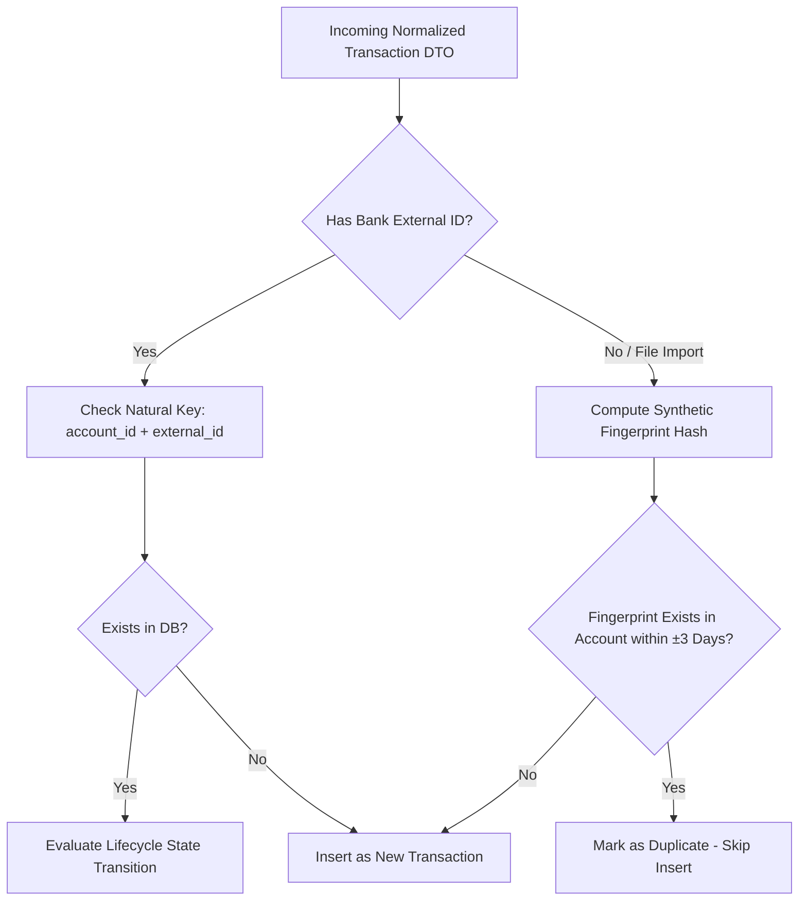

# Deduplication & Transfer Matcher Specification

## 1. Overview & Objectives

In a multi-account family accounting system with two partners, the integrity of financial analytics hinges on two core capabilities:
1. **Deduplication & Lifecycle State Tracking:** Ensuring that bank sync runs, statement imports, authorization holds, and post-clearing settlements never create duplicate transactions.
2. **Transfer Matcher Engine:** Pairing money movements across internal accounts (e.g. transfers between spouses via SBP, moving money from debit to savings, or repaying credit card balances) so that transfers **do not falsely inflate family income or family expenses**.

---

## 2. Ingestion Deduplication Architecture

Every incoming transaction from an automated bank sync or a statement file passes through a multi-layer deduplication pipeline before reaching the ledger.



### 2.1 Natural Key Deduplication (Bank Sync)
- **Constraint:** `UNIQUE (family_id, account_id, external_id) WHERE external_id IS NOT NULL`
- When the bank provides a stable operation identifier (`id` or `operationId` from T-Bank timeline), this constraint guarantees strict idempotency across overlapping sync intervals.

### 2.2 Synthetic Fingerprint Hash (Statement Imports & Fallback)
For CSV/XLSX imports where the bank does not export stable global GUIDs:
$$\text{Fingerprint} = \text{SHA-256}\Big(\text{account\_id} \parallel \text{DATE(transaction\_time)} \parallel \text{amount\_minor} \parallel \text{currency} \parallel \text{Normalize}(\text{raw\_description})\Big)$$
- **Normalization Rules:**
  - Lowercase all characters.
  - Strip all whitespace and punctuation symbols (`.,/#!$%^&*;:{}=\-_~()`).
  - Strip known dynamic prefixes (e.g. `"CH Payment"`, `"RUS MOSCOW"`, authorization codes like `"AUTH 982134"`).
- **Collision Mitigation:** If a user makes two identical purchases at the same merchant on the same day for the exact same amount (e.g., two 200 RUB coffees at the same cafe), the system compares the running count of matching occurrences within that statement batch against the count already recorded in the database.

---

## 3. Transaction Lifecycle State Transitions

Bank operations evolve through distinct chronological phases:
1. **`pending` (Authorization / Hold):** The merchant verified the card and reserved funds. Balance is reduced, but the money has not left the bank.
2. **`posted` (Cleared / Settled):** The financial clearing file arrived (typically 1 to 5 days later). Funds are permanently debited.
3. **`cancelled` (Reversal / Expired Hold):** The authorization was dropped or canceled (e.g., hotel deposit released). Funds are unreserved.
4. **`refunded` (Return):** Merchant processed a refund after clearing.

### 3.1 Authorization-to-Settlement Linking Matrix

| Incoming Bank Event | Existing State in DB | Action Taken | Ledger Impact |
| :--- | :--- | :--- | :--- |
| **New Authorization** | None | Insert with `status = 'pending'`, `transaction_time = event.time`, `posted_time = NULL`. | Reflected in available balance; flagged as pending in UI. |
| **Settlement by `external_id`** | Matches existing `pending` transaction. | Update `status = 'posted'`, `posted_time = event.debiting_time`, `account_amount_minor = event.cleared_amount`. | Converted to settled transaction without creating a duplicate record. |
| **Settlement by `external_auth_id`** | New `operationId`, but matches existing `external_auth_id` on same account. | Update existing record: set `external_id = event.operationId`, `status = 'posted'`, update `amount_minor` if altered (e.g., tip or FX drift). | Deduplicated against hold. |
| **Hold Expiry / Void** | Existed as `pending` for > 7 days without settlement. | Update `status = 'cancelled'`. | Removed from pending balance; excluded from analytics. |
| **Merchant Refund** | Linked to original purchase or standalone refund. | Insert as `status = 'refunded'`, with positive `amount_minor`. Category is set to **original purchase category**. | **Negative expense** in original category, accurately netting out the family's true spend. |

---

## 4. Multi-Tier Transfer Matcher Specification

The Transfer Matcher identifies reciprocal transactions between two accounts owned by the family, transforming two unilateral cash flows into a single internal transfer.

### 4.1 Match Record Schema & Constraints
```
TransferMatch {
    id: UUID
    family_id: UUID
    source_transaction_id: UUID      // Must have amount_minor < 0 (Outflow)
    destination_transaction_id: UUID // Must have amount_minor > 0 (Inflow)
    match_type: "exact" | "probable" | "manual"
    confidence_score: 0.00 to 100.00
    status: "auto_confirmed" | "suggested" | "confirmed" | "rejected"
    fee_minor: int64
    is_credit_card_repayment: boolean
}
```

### 4.2 Multi-Tier Matching Engine Rules

```mermaid
flowchart TD
    Out[Unmatched Outflow Transaction A: amount < 0] --> Search[Search Candidate Inflows B in family_id: amount > 0]
    
    Search --> T1{Tier 1 Check:
    abs(A.amount) == B.amount AND
    time_delta <= 120 min AND
    both accounts in family}
    
    T1 -->|Pass| M1[Tier 1 Exact Match
    Confidence: 99%
    Status: auto_confirmed]
    
    T1 -->|Fail| T2{Tier 2 Check:
    time_delta <= 3 days AND
    (amount_diff <= fee_threshold OR
     SBP / Transfer counterparty match)}
     
    T2 -->|Pass| M2[Tier 2 Probable Match
    Confidence: 75% - 95%
    Status: suggested]
    
    T2 -->|Fail| T3[Tier 3 Manual Pool
    Available for user manual search & link]
```

#### Tier 1: Exact Match (`match_type = 'exact'`, Confidence: 99–100%)
- **Criteria:**
  1. Both `account_id` values belong to the same `family_id` (e.g. Partner A's checking and Partner B's checking).
  2. `abs(source.amount_minor) == destination.amount_minor`.
  3. `source.currency == destination.currency`.
  4. Time difference: $|\text{source.transaction\_time} - \text{destination.transaction\_time}| \le 2\text{ hours}$.
  5. Neither transaction is currently matched to another transfer.
- **System Action:**
  - Created automatically with `status = 'auto_confirmed'`.
  - Sets `is_internal_transfer = TRUE` on both transactions.
  - Category automatically assigned to `"Transfer: Internal"`.
  - Excluded from real expense and income totals in analytics.

#### Tier 2: Probable Match (`match_type = 'probable'`, Confidence: 75–95%)
- **Criteria:**
  - **Scenario A (Inter-Bank Delay):** $|\text{source.time} - \text{destination.time}| \le 72\text{ hours}$ (handles bank clearing over weekends) with exact amount match. (Confidence: 90%).
  - **Scenario B (Transfer Fee):** Outflow is slightly larger than inflow due to transfer fee:
    $$0 < (\text{abs}(\text{source.amount}) - \text{destination.amount}) \le \max(50000 \text{ minor units [500 RUB]}, 0.015 \times \text{destination.amount})$$
    Difference is recorded as `fee_minor`. (Confidence: 85%).
  - **Scenario C (Counterparty Clues):** Raw description contains reciprocal hints:
    - E.g., Source: `"Перевод по СБП: Получатель Анна И."`
    - Destination: `"Пополнение через СБП: Отправитель Иван И."`
    (Confidence: 95%).
- **System Action:**
  - Created with `status = 'suggested'`.
  - Appears in the "Transfers to Review" inbox on the dashboard.
  - Clicking "Confirm" sets `status = 'confirmed'` and activates `is_internal_transfer = TRUE`.

#### Tier 3: Manual Match (`match_type = 'manual'`)
- Used when a transfer involves an account not yet connected to Family Finance or ambiguous situations (e.g., three identical 10,000 RUB transfers on the same day).
- User selects any two transactions in the UI and clicks "Link as Internal Transfer".
- Generates an immutable audit trail entry in `audit_logs`.

---

## 5. Credit Card Repayment Modeling

A critical failure of naive personal accounting systems is **double-counting credit card spending**:
1. When a user buys groceries with a credit card for 5,000 RUB, the expense occurs **at the moment of purchase**.
2. When the user later transfers 5,000 RUB from their debit card to pay off the credit card statement, this is **debt servicing**, NOT a second 5,000 RUB grocery expense.

### 5.1 Formal Debt & Expense Accounting Rules

```
[ Purchase Phase ]
Debit:   Expense (Groceries)                     +5,000 RUB
Credit:  Credit Card Liability (Debt Balance)    +5,000 RUB
Result:  Real Family Expense recorded immediately.
         Operating cash unaffected; Family net worth decreases by 5,000 RUB.

[ Repayment Phase ]
Debit:   Credit Card Liability (Debt Balance)    -5,000 RUB
Credit:  Checking Account Cash Balance           -5,000 RUB
Result:  Matched as TransferMatch(is_credit_card_repayment = true).
         Real Family Expense = ZERO.
         Total debt decreases; Cash decreases; Family net worth UNCHANGED.
```

### 5.2 Automatic Credit Card Payoff Detection
The Transfer Matcher sets `is_credit_card_repayment = TRUE` when:
1. `destination_account.type == 'credit_card'`
2. `source_account.type IN ('checking', 'savings', 'cash')`
3. Description matches common repayment patterns:
   - T-Bank: `"Пополнение кредитной карты"`, `"Гашение долга"`.
   - Sberbank: `"Оплата кредитной карты"`.
   - Alfa-Bank: `"Погашение кредита / карты"`.
4. The destination transaction reduces `accounts.debt_balance_minor` and restores `accounts.available_balance_minor`.
