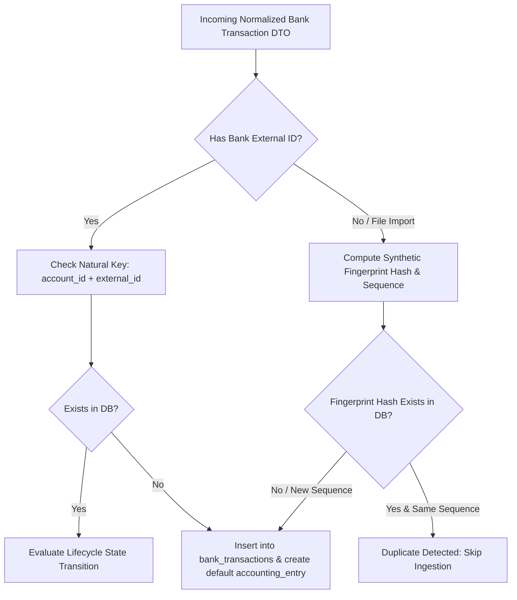

# Deduplication & Conservative Transfer Matcher Specification

## 1. Overview & Objectives

In a multi-account family accounting system with two partners, the integrity of financial analytics hinges on:
1. **Deduplication & Lifecycle State Tracking:** Ensuring that bank sync runs, statement imports, authorization holds, and post-clearing settlements never create duplicate transactions.
2. **Conservative Transfer Matching Engine:** Pairing money movements across internal accounts (e.g. transfers between spouses via SBP, moving money from debit to savings, or repaying credit card balances) so that transfers **do not falsely inflate family income or family expenses**, while strictly preventing false-positive matches from erasing real merchant expenses.

---

## 2. Ingestion Deduplication Architecture

Every incoming transaction passes through a multi-layer deduplication pipeline before reaching the ledger.



### 2.1 Natural Key Deduplication (Bank Sync)
- **Constraint:** `UNIQUE (family_id, account_id, external_id) WHERE external_id IS NOT NULL`
- When the bank provides a stable operation identifier (`id` or `operationId`), this constraint guarantees strict idempotency across overlapping sync intervals.

### 2.2 Synthetic Fingerprint Hash & Collision Disambiguation (Statement Imports)
For CSV/XLSX imports where the bank does not export stable global GUIDs:
$$\text{Fingerprint} = \text{SHA-256}\Big(\text{account\_id} \parallel \text{DATE(transaction\_time)} \parallel \text{amount\_minor} \parallel \text{currency} \parallel \text{Normalize}(\text{raw\_description})\Big)$$
- **Disambiguation via `fingerprint_sequence`:**
  If a partner buys two identical 200 RUB tickets at the same vendor on the same day, both rows produce the exact same SHA-256 fingerprint.
  The importer numbers identical occurrences sequentially within the statement batch:
  - First occurrence: `fingerprint_sequence = 1`
  - Second occurrence: `fingerprint_sequence = 2`
  Constraint `UNIQUE(family_id, account_id, fingerprint_hash, fingerprint_sequence)` ensures exact, non-colliding imports.

---

## 3. Transaction Lifecycle State Transitions

Bank operations evolve through distinct chronological phases:
1. **`pending` (Authorization / Hold):** Merchant reserved funds. Balance is reduced, but funds have not cleared.
2. **`posted` (Cleared / Settled):** Clearing file debited account.
3. **`cancelled` (Reversal / Expired Hold):** Authorization voided or expired.
4. **`refund` (Return):** Separate credit operation issued by merchant after clearing.

### 3.1 Non-Interchangeable Bank Identifiers
T-Bank responses contain three distinct identifier fields:
- `id`: Timeline item identifier.
- `operationId`: Bank ledger operation identifier.
- `authorizationId`: Card network authorization hold code.

**Deterministic Lifecycle Pipeline:**
1. **Direct ID Match:** If incoming operation has `external_id == existing.external_id`:
   - If existing is `pending` and incoming is `posted`, update `booking_status = 'posted'`, `posted_time = incoming.posted_time`, and `account_amount_minor = incoming.account_amount_minor`.
2. **Authorization Code Resolution:** If an incoming operation has a new `external_id`, but has `authorizationId` matching an existing record with `external_auth_id == incoming.authorizationId` on the same `account_id` where `booking_status = 'pending'`:
   - Transition pending record: set `external_id = incoming.external_id`, `booking_status = 'posted'`, update `amount_minor` to settled amount, and set `posted_time`.
   - Prevent 1:N or N:1 collisions: an authorization code can resolve **at most one** pending hold.
3. **Cancellation vs. Expiry Conditions:**
   - An authorization is **never** cancelled merely because it is absent from a single sync response.
   - It transitions to `cancelled` only if the bank explicitly reports it as failed/voided, or after a complete, successfully paginated sync covering 14 days completes without the authorization appearing.

### 3.2 Refund & Reversal Representation
- **Reversals (Pre-clearing):** The pending hold is updated to `booking_status = 'cancelled'`. Linked accounting entries are set to `classification = 'excluded'`.
- **Refunds (Post-clearing):** A refund is **NEVER a mutation of the original transaction**. It is ingested as a distinct `bank_transaction` (`operation_type = 'refund'`) with positive `amount_minor` and `related_bank_transaction_id` referencing the original purchase.
- **Accounting Impact:** The refund's `accounting_entry` is assigned the **original purchase's category** with a positive amount. In analytics, this automatically nets out the category expense without inflating gross income. Multiple or partial refunds are supported naturally (each as its own linked refund transaction).

---

## 4. Conservative Transfer Matcher Specification

### 4.1 Strict Elimination of False Positives

> [!WARNING]
> **Why MCC Alone is Not Proof of an Internal Transfer:**
> MCC codes like `4829` (Wire Transfer), `6012` (Financial Institution), or `6538` (P2P Transfer) indicate that money was transferred, but **do not prove it was an internal family transfer**. A user could be paying a landlord, sending money to a friend, or funding a brokerage account.
> **Mandatory Rule:** MCC codes or transfer categories alone **must never trigger Tier 1 automatic confirmation**. Tier 1 auto-confirmation requires strong reciprocal evidence connecting two known family accounts.

### 4.2 Multi-Tier Matching Heuristics

```mermaid
flowchart TD
    Out[Unmatched Outflow Transaction A: amount < 0] --> Search[Search Candidate Inflows B in family_id: amount > 0]
    
    Search --> T1{Tier 1 Check:
    abs(A.amount) == B.amount AND
    time_delta <= 30 min AND
    Same Currency AND
    Both accounts in family AND
    Reciprocal Evidence Present AND
    Not in transfer_rejections}
    
    T1 -->|Pass| M1[Tier 1 Exact Match
    Status: auto_confirmed
    Link transfer_match_id non-destructively]
    
    T1 -->|Fail| T2{Tier 2 Check:
    time_delta <= 72 hours AND
    (amount_diff <= fee_threshold OR SBP hints) AND
    Both accounts in family AND
    Not in transfer_rejections}
    
    T2 -->|Pass| M2[Tier 2 Probable Match
    Status: suggested
    Awaiting User 1-Click Confirmation]
    
    T2 -->|Fail| T3[Tier 3 Manual Pool
    Available in UI Manual Link Dialog]
```

#### Tier 1: Exact Match (`match_type = 'exact'`, Status: `auto_confirmed`)
*High Heuristic Confidence.* All of the following must hold:
1. **Opposite Directions:** $\text{source.amount\_minor} < 0$ and $\text{destination.amount\_minor} > 0$.
2. **Account Disjointness:** $\text{source.account\_id} \neq \text{destination.account\_id}$ (both belonging to the same `family_id`).
3. **Exact Amount & Currency:** $|\text{source.amount\_minor}| == \text{destination.amount\_minor}$ and `source.currency == destination.currency`.
4. **Tight Time Window:** $|\text{source.transaction\_time} - \text{destination.transaction\_time}| \le 30\text{ minutes}$ (SBP and intra-bank transfers settle in seconds).
5. **MANDATORY Reciprocal Semantic Evidence:**
   - **Case A (SBP Reciprocal Hints):** Source description indicates outgoing SBP and destination indicates incoming SBP (e.g., source: `"Перевод по СБП: Анна И."`, destination: `"Пополнение через СБП: Иван И."`).
   - **Case B (Credit Card Repayment):** Destination account is `type = 'credit_card'`, source account is checking/savings, and description matches debt repayment signatures.
   - **Case C (Intra-Bank Account Transfer):** Both accounts are at the same bank connection, and bank metadata marks operation as internal transfer between user's accounts (`"Перевод между своими счетами"`).
6. **Negative Constraint:** Neither transaction is a merchant purchase (MCC 5411, 5812, etc.) or ATM cash withdrawal.
7. **Rejection Check:** The pair does not exist in `transfer_rejections`.

*If amounts and times match but Reciprocal Evidence (Condition 5) is absent, the match **must not be auto-confirmed**; it is placed in Tier 2 (`suggested`) for user review.*

#### Tier 2: Probable Match (`match_type = 'probable'`, Status: `suggested`)
Surfaces in the "Transfers to Review" inbox for 1-click user confirmation:
- **Scenario 2A (Inter-Bank Delay):** Same amount, same currency, but clearing took longer ($30\text{ min} < |\Delta t| \le 72\text{ hours}$).
- **Scenario 2B (Transfer Fee):** Outflow is slightly larger than inflow due to inter-bank fee:
  $$0 < (|\text{source.amount}| - \text{destination.amount}) \le \max(50000 \text{ minor units [500 RUB]}, 0.015 \times \text{destination.amount})$$
  Difference is captured as `fee_minor`.
- **Scenario 2C (Unverified Evidence):** Matching amounts and close timestamps, but bank descriptions lack reciprocal proof.

#### Tier 3: Manual Match (`match_type = 'manual'`)
- User selects any two transactions in the UI and clicks "Link as Internal Transfer".
- **Cross-Currency Transfers:** Because exchange rates fluctuate, transfers between different currencies (e.g. RUB to USD) are **never auto-confirmed**. They are routed to Tier 3 where the user confirms the pairing and verifies the implied exchange rate.

---

## 5. Non-Destructive Transfer Interpretation, Integrity Triggers & Rejection Protocol

### 5.1 Zero-Data-Loss Architecture
Previous designs mutated `accounting_entries.classification = 'transfer'`, which destroyed user categorization and notes if a match was later rejected or unlinked.

The hardened architecture uses **non-destructive linkage**:
1. When a match is established (`auto_confirmed` or `confirmed`):
   - The foreign key `accounting_entries.transfer_match_id` is set to `transfer_matches.id`.
   - **The underlying `category_id`, `user_comment`, and `classification` on `accounting_entries` are NEVER overwritten.**
2. In analytical views and expense reports:
   - Queries inspect `transfer_match_id`. If linked to a confirmed transfer, the entry is projected as an internal transfer or debt repayment and excluded from consumption expenses.
3. When a match is rejected or unlinked:
   - `transfer_match_id` is set to `NULL`.
   - The accounting entry **instantly and effortlessly behaves as its original category and classification** without losing any historical edits!

### 5.2 Transfer Match Ownership & Endpoint Immutability Triggers
To strictly prevent orphaned or cross-transaction corruption:

1. **Endpoint Immutability Trigger (`trg_immutability_transfer_endpoints`):**
   * Table `transfer_matches` enforces a `BEFORE UPDATE` trigger preventing modification of `source_bank_transaction_id` or `destination_bank_transaction_id`.
   * If a transfer match was proposed erroneously, it must be rejected or deleted; it can never be mutated to point to a different physical transaction.
2. **Accounting Entry Ownership Trigger (`trg_accounting_entry_transfer_match_deferred`):**
   * A deferred constraint trigger validates every linked accounting entry:
     ```sql
     -- Invariant: If accounting_entries.transfer_match_id IS NOT NULL:
     -- entry.bank_transaction_id IN (match.source_bank_transaction_id, match.destination_bank_transaction_id)
     ```
   * When an accounting entry is linked to `transfer_matches(id)`, the database verifies that `entry.bank_transaction_id` matches either the source or destination transaction of that exact match row.
   * Linking an accounting entry from Transaction C to a transfer match between Transactions A and B is immediately rejected with an integrity violation.
   * Combined with endpoint immutability, this guarantees that once an entry is validated, the match can never be shifted to another transaction behind its back.

### 5.3 Symmetric Transfer Rejection Protocol
To guarantee that rejecting a proposed transfer between Transaction A and Transaction B permanently suppresses the pairing regardless of evaluation order:

1. **Symmetric Unique Storage Index:**
   Table `transfer_rejections` defines:
   ```sql
   CREATE UNIQUE INDEX uq_transfer_rejections_symmetric ON transfer_rejections (
       family_id,
       LEAST(source_bank_transaction_id, destination_bank_transaction_id),
       GREATEST(source_bank_transaction_id, destination_bank_transaction_id)
   );
   ```
2. **Symmetric Candidate Filtering in Matcher:**
   When the matching engine searches candidate pairs, it verifies:
   ```sql
   NOT EXISTS (
       SELECT 1 FROM transfer_rejections r
       WHERE r.family_id = candidate.family_id
         AND LEAST(r.source_bank_transaction_id, r.destination_bank_transaction_id) = LEAST(candidate_source_id, candidate_dest_id)
         AND GREATEST(r.source_bank_transaction_id, r.destination_bank_transaction_id) = GREATEST(candidate_source_id, candidate_dest_id)
   )
   ```
   If A $\rightarrow$ B was rejected, evaluating B $\rightarrow$ A evaluates to the identical `(LEAST, GREATEST)` pair and is immediately skipped.

### 5.4 Atomic 5-Step Non-Destructive Rejection Transaction
Rejection executes atomically within a single tenant transaction `WithFamilyTx`:
1. **Lock Match:** `SELECT * FROM transfer_matches WHERE id = $1 AND family_id = get_current_family_id() FOR UPDATE;`
2. **Persist Symmetric Rejection:**
   ```sql
   INSERT INTO transfer_rejections (family_id, source_bank_transaction_id, destination_bank_transaction_id, rejected_by_user_id, reason)
   VALUES ($family_id, $src_id, $dst_id, $user_id, $reason)
   ON CONFLICT (family_id, LEAST(source_bank_transaction_id, destination_bank_transaction_id), GREATEST(source_bank_transaction_id, destination_bank_transaction_id))
   DO NOTHING;
   ```
3. **Unlink Accounting Entries Non-Destructively:**
   ```sql
   UPDATE accounting_entries
   SET transfer_match_id = NULL, updated_at = NOW()
   WHERE transfer_match_id = $1 AND family_id = get_current_family_id();
   ```
   *(All original categories, notes, and splits are 100% retained).*
4. **Update Match Status:**
   ```sql
   UPDATE transfer_matches
   SET status = 'rejected', updated_at = NOW()
   WHERE id = $1 AND family_id = get_current_family_id();
   ```
5. **Record Audit Log:**
   ```sql
   INSERT INTO audit_logs (family_id, user_id, action, entity_type, entity_id, new_values)
   VALUES ($family_id, $user_id, 'reject_transfer', 'transfer_matches', $1, jsonb_build_object('reason', $reason));
   ```

---

## 6. Comprehensive Transfer Matcher Test Matrix

Coding agents must verify the matcher against the following deterministic test scenarios:

| Test ID | Scenario | Source Tx | Destination Tx | Expected Tier | Expected Status | Ledger & Analytics Impact |
| :--- | :--- | :--- | :--- | :--- | :--- | :--- |
| **TC-TR-01** | Standard SBP transfer between partners | -10,000 RUB, checking A, "Перевод СБП: Анна", 12:00 | +10,000 RUB, checking B, "Пополнение СБП: Иван", 12:01 | Tier 1 | `auto_confirmed` | `transfer_match_id` linked non-destructively. Expense = 0. |
| **TC-TR-02** | Simultaneous merchant purchase & income (False Positive Defense) | -3,500 RUB, checking A, MCC 5411 "Пятерочка", 14:00 | +3,500 RUB, checking B, "Клиентский платеж", 14:15 | None / Tier 3 | Unmatched | **NOT MATCHED.** Source remains Grocery Expense; Dest remains Income. |
| **TC-TR-03** | Credit card repayment from checking | -45,000 RUB, checking A, "Оплата карты *1234", 10:00 | +45,000 RUB, credit card A, "Пополнение карты", 10:05 | Tier 1 | `auto_confirmed` | `is_credit_card_repayment = true`. Expense = 0. Debt balance reduced. |
| **TC-TR-04** | Inter-bank transfer with 50 RUB fee | -50,050 RUB, checking A, "Перевод в другой банк", 11:00 | +50,000 RUB, checking B, "Входящий перевод", 11:02 | Tier 2B | `suggested` | Suggested with `fee_minor = 5,000` (50 RUB). Requires 1-click confirmation. |
| **TC-TR-05** | Delayed weekend bank clearing | -20,000 RUB, checking A, Friday 18:00 | +20,000 RUB, checking B, Monday 10:00 | Tier 2A | `suggested` | Suggested due to 64-hour time delta. |
| **TC-TR-06** | Cross-currency transfer | -100,000 RUB, checking A, 15:00 | +1,050 USD, savings B, 15:05 | Tier 3 | Manual pool only | **Never auto-confirmed.** User must manually link and confirm FX rate. |
| **TC-TR-07** | Rejection and rematching | Suggested pair rejected by user | Same source tx paired with true destination tx later | Tier 1 / 2 | Rematched cleanly | Rejected pair recorded in `transfer_rejections`; source freed to match true counterpart; prior entries intact. |
| **TC-TR-08** | Symmetric rejection defense | User rejects pair (Tx A, Tx B) | Engine evaluates candidate (Tx B, Tx A) on subsequent sync | Suppressed | Never proposed | Filter checks `LEAST(A, B) = LEAST(B, A)`; engine suppresses proposal in both directions. |
| **TC-TR-09** | Transfer match entry ownership trigger | Tx C (unrelated) linked to Match(Tx A, Tx B) | Target `transfer_match_id` references match with source A, dest B | Rejected | Integrity Violation | `trg_validate_accounting_entry_transfer_match` aborts transaction with deferred constraint error. |
| **TC-TR-10** | Transfer match endpoint immutability | Attempt `UPDATE transfer_matches SET source_bank_transaction_id = Tx C` | Existing match between Tx A and Tx B | Aborted | Exception | `trg_immutability_transfer_endpoints` aborts update; endpoints are strictly immutable. |
