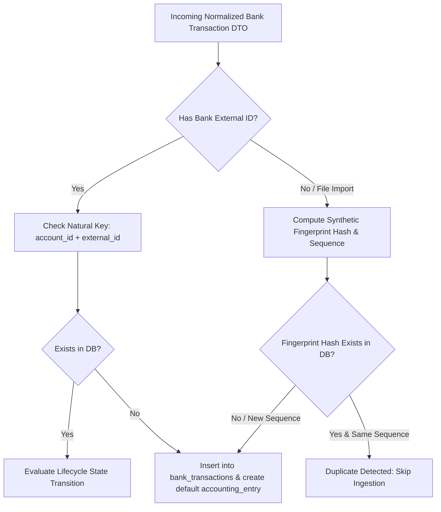

# Deduplication & Transfer Matcher Specification

## 1. Overview & Objectives

In a multi-account family accounting system with two partners, the integrity of financial analytics hinges on:
1. **Deduplication & Lifecycle State Tracking:** Ensuring that bank sync runs, statement imports, authorization holds, and post-clearing settlements never create duplicate transactions.
2. **Transfer Matcher Engine:** Pairing money movements across internal accounts (e.g. transfers between spouses via SBP, moving money from debit to savings, or repaying credit card balances) so that transfers **do not falsely inflate family income or family expenses**.

---

## 2. Ingestion Deduplication Architecture

Every incoming transaction from an automated bank sync or statement file passes through a multi-layer deduplication pipeline before reaching the ledger.



### 2.1 Natural Key Deduplication (Bank Sync)
- **Constraint:** `UNIQUE (family_id, account_id, external_id) WHERE external_id IS NOT NULL`
- When the bank provides a stable operation identifier (`id` or `operationId` from T-Bank timeline), this constraint guarantees strict idempotency across overlapping sync intervals.

### 2.2 Synthetic Fingerprint Hash & Collision Disambiguation (Statement Imports)
For CSV/XLSX imports where the bank does not export stable global GUIDs:
$$\text{Fingerprint} = \text{SHA-256}\Big(\text{account\_id} \parallel \text{DATE(transaction\_time)} \parallel \text{amount\_minor} \parallel \text{currency} \parallel \text{Normalize}(\text{raw\_description})\Big)$$
- **Normalization Rules:**
  - Lowercase all characters.
  - Strip all whitespace and punctuation symbols (`.,/#!$%^&*;:{}=\-_~()`).
  - Strip dynamic prefixes (e.g. `"CH Payment"`, `"RUS MOSCOW"`, authorization codes like `"AUTH 982134"`).
- **Collision Disambiguation via `fingerprint_sequence`:**
  If a partner buys two identical 200 RUB tickets at the same subway station on the same day, both rows produce the exact same SHA-256 fingerprint.
  To prevent discarding valid transactions, the importer numbers identical occurrences sequentially within the statement batch:
  - First occurrence: `fingerprint_sequence = 1`
  - Second occurrence: `fingerprint_sequence = 2`
  Constraint `UNIQUE(family_id, account_id, fingerprint_hash, fingerprint_sequence)` ensures exact, non-colliding imports.

---

## 3. Transaction Lifecycle State Transitions

Bank operations evolve through distinct chronological phases:
1. **`pending` (Authorization / Hold):** Merchant reserved funds. Balance is reduced, but funds have not cleared.
2. **`posted` (Cleared / Settled):** Clearing file debited account.
3. **`cancelled` (Reversal / Expired Hold):** Authorization voided or expired.
4. **`refund` (Return):** Separate credit operation issued by merchant after clearing.

### 3.1 Non-Interchangeable Bank Identifiers
T-Bank responses contain three distinct identifier fields:
- `id`: Timeline item identifier.
- `operationId`: Bank ledger operation identifier.
- `authorizationId`: Card network authorization hold code.

**Matching Rules:**
1. **Direct ID Match:** If an incoming operation has `external_id == existing.external_id`:
   - If existing is `pending` and incoming is `posted`, update `booking_status = 'posted'`, `posted_time = incoming.posted_time`, and `account_amount_minor = incoming.account_amount_minor`.
2. **Authorization Code Resolution:** If an incoming operation has a new `external_id`, but has `authorizationId` matching an existing record with `external_auth_id == incoming.authorizationId` on the same `account_id` where `booking_status = 'pending'`:
   - Transition the pending record: set `external_id = incoming.external_id`, `booking_status = 'posted'`, update `amount_minor` to settled amount, and set `posted_time`.
3. **Hold Expiry:** If a `pending` operation is no longer returned in the active sync window after 14 days, transition to `booking_status = 'cancelled'`.

### 3.2 Refund & Reversal Representation
- **Reversals (Pre-clearing):** The pending hold is updated to `booking_status = 'cancelled'`. Linked accounting entries are set to `classification = 'excluded'`.
- **Refunds (Post-clearing):** A refund is **NEVER a mutation of the original transaction**. It is ingested as a **brand new `bank_transaction`** with `operation_type = 'refund'` and a positive `amount_minor`.
- **Linkage:** If the bank payload references the original operation (or matches original merchant within 60 days), `related_bank_transaction_id` is set to the original purchase's ID.
- **Accounting Impact:** The refund's `accounting_entry` is assigned the **original purchase's category** with a positive amount. In analytics, this automatically nets out the category expense without inflating gross income.

---

## 4. Transfer Matcher Safety & False-Positive Elimination

### 4.1 Fatal Flaw in Naive Amount/Timestamp Matching
If an engine matches transactions based only on equal amounts and close timestamps ($\Delta t \le 120\text{ min}$):
- **Scenario:** Partner A buys groceries for 3,500 RUB at 14:00. Partner B receives a 3,500 RUB client payment at 14:30.
- **Result:** Naive Tier 1 auto-confirms this as an internal transfer! Partner A's grocery expense and Partner B's income are both wiped out from family reports.

**Core Principle:** *Conservative suggestions are always preferred over incorrect automatic confirmations.*

### 4.2 Strict Mandatory Conditions for Tier 1 Auto-Matching

To qualify for **Tier 1 (`auto_confirmed`)**, ALL of the following criteria must be met:
1. **Opposite Directions:** `source.amount_minor < 0` AND `destination.amount_minor > 0`.
2. **Account Disjointness:** `source.account_id != destination.account_id` (both belonging to the same `family_id`).
3. **Exact Amount & Currency:** $\text{abs}(\text{source.amount\_minor}) == \text{destination.amount\_minor}$ and `source.currency == destination.currency`.
4. **Tight Time Window:** $|\text{source.transaction\_time} - \text{destination.transaction\_time}| \le 30\text{ minutes}$ (SBP and intra-bank transfers settle in seconds).
5. **MANDATORY Semantic Transfer Evidence (At least one must hold):**
   - **Condition A (Transfer Category/MCC):** Source or destination has a bank-assigned transfer category (e.g. T-Bank `spendingCategory == "Переводы"`, MCC `4829`, `6012`, `6538`, or `6536`).
   - **Condition B (SBP Transfer Clues):** Description matches reciprocal SBP patterns (e.g., source contains `"Перевод по СБП"` and destination contains `"Пополнение по СБП"` / `"СБП"`).
   - **Condition C (Credit Card Repayment):** Destination is `accounts.type = 'credit_card'` and description matches bank debt payment signatures.
6. **Negative Constraint:** Neither transaction is a merchant purchase (MCC `5411`, `5812`, etc.) or ATM cash withdrawal.
7. **No Prior Rejection:** The pair does not exist in `transfer_rejections`.

If conditions 1–4 are met but Condition 5 lacks semantic evidence, the match **MUST NOT be auto-confirmed**. It is downgraded to **Tier 2 (`suggested`)**.

---

### 4.3 Multi-Tier Classification & Confidence Matrix

```mermaid
flowchart TD
    Out[Unmatched Outflow Transaction A: amount < 0] --> Search[Search Candidate Inflows B in family_id: amount > 0]
    
    Search --> T1{Tier 1 Check:
    abs(A.amount) == B.amount AND
    time_delta <= 30 min AND
    Semantic Transfer Evidence Present AND
    Not in transfer_rejections}
    
    T1 -->|Pass| M1[Tier 1 Exact Match
    Confidence: 99%
    Status: auto_confirmed
    Accounting: classification='transfer']
    
    T1 -->|Fail| T2{Tier 2 Check:
    time_delta <= 72 hours AND
    (amount_diff <= fee_threshold OR SBP hints) AND
    Not in transfer_rejections}
    
    T2 -->|Pass| M2[Tier 2 Probable Match
    Confidence: 70% - 90%
    Status: suggested
    Awaiting User 1-Click Confirmation]
    
    T2 -->|Fail| T3[Tier 3 Manual Pool
    Available in UI Manual Link Dialog]
```

| Tier | Status | Confidence | Mandatory Criteria | System Action |
| :--- | :--- | :--- | :--- | :--- |
| **Tier 1 (Exact)** | `auto_confirmed` | 99% | Exact amounts, $\Delta t \le 30\text{ min}$, internal accounts, **verified transfer MCC or SBP description**. | Auto-links; updates linked `accounting_entries.classification = 'transfer'`. |
| **Tier 2A (Inter-Bank Delay)** | `suggested` | 85% | Exact amounts, $30\text{ min} < \Delta t \le 72\text{ hours}$, internal accounts, transfer keywords present. | Surfaces in "Transfers to Review" inbox. |
| **Tier 2B (Transfer Fee)** | `suggested` | 80% | Outflow exceeds inflow by $\le \max(500\text{ RUB}, 1.5\%)$, internal accounts, transfer keywords. | Surfaces in review inbox with detected `fee_minor`. |
| **Tier 2C (Unverified Evidence)** | `suggested` | 70% | Exact amounts, $\Delta t \le 30\text{ min}$, but **lacks explicit transfer MCC/keywords**. | Surfaces in review inbox to verify it is not an accidental coincidence. |
| **Tier 3 (Manual)** | `confirmed` | User set | User manually links any two transactions via UI dialog. | Recorded with `match_type = 'manual'`, `matched_by_user_id`. |

---

### 4.4 Candidate Lifecycle & Rejection Protocol
- **Partial Uniqueness:**
  `transfer_matches` enforces partial unique indexes:
  ```sql
  CREATE UNIQUE INDEX uq_transfer_source_active ON transfer_matches(source_bank_transaction_id) 
      WHERE status IN ('auto_confirmed', 'confirmed', 'suggested');
  ```
- **Rejection Flow:**
  When a user clicks "Reject" on a suggested or confirmed match:
  1. `transfer_matches.status` is set to `'rejected'`.
  2. Linked `accounting_entries` revert their classification to `'expense'` / `'income'`.
  3. A record is inserted into `transfer_rejections(source_id, destination_id, rejected_by_user_id)`.
  4. The partial index immediately unblocks both transactions, allowing them to match with other potential candidates!
  5. Subsequent sync runs will NEVER suggest this rejected pairing again.

---

## 5. Credit Card Repayment Modeling

A critical failure of naive personal accounting systems is **double-counting credit card spending**:
1. When groceries are purchased on a credit card for 5,000 RUB, the expense occurs **at the moment of purchase**.
2. When the user later transfers 5,000 RUB from checking to pay off the credit card statement, this is **debt servicing**, NOT a second 5,000 RUB expense.

### 5.1 Formal Accounting Rules
```
[ Step 1: Purchase on Credit Card ]
bank_transactions:
  account_id: Credit Card
  amount_minor: -500,000 (-5,000.00 RUB)
accounting_entries:
  classification: 'expense'
  category: 'Groceries'
  amount_minor: -500,000
Effect:
  Family Expense increases by 5,000 RUB.
  Credit Card debt_balance increases by 5,000 RUB.
  Net worth decreases by 5,000 RUB.

[ Step 2: Repayment from Checking Account ]
bank_transactions (Outflow):
  account_id: Checking Account
  amount_minor: -500,000
bank_transactions (Inflow):
  account_id: Credit Card
  amount_minor: +500,000
transfer_matches:
  is_credit_card_repayment: true
accounting_entries (Outflow & Inflow):
  classification: 'debt_repayment'
Effect:
  Family Expense = ZERO.
  Checking current_balance decreases by 5,000 RUB.
  Credit Card debt_balance decreases by 5,000 RUB.
  Net worth is UNCHANGED.
```
